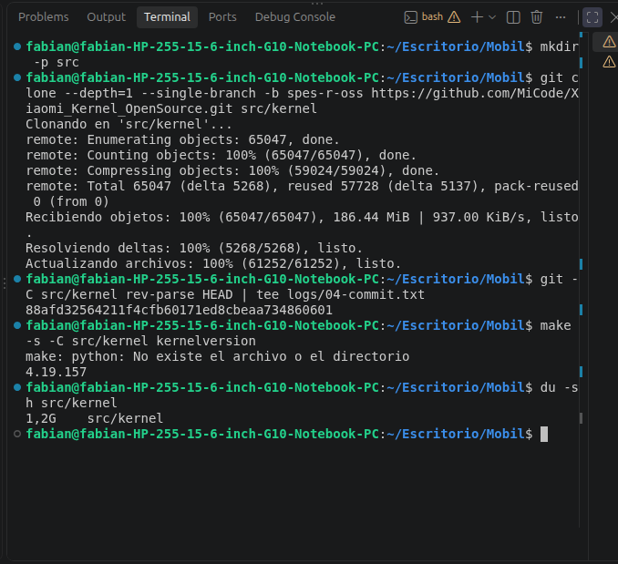
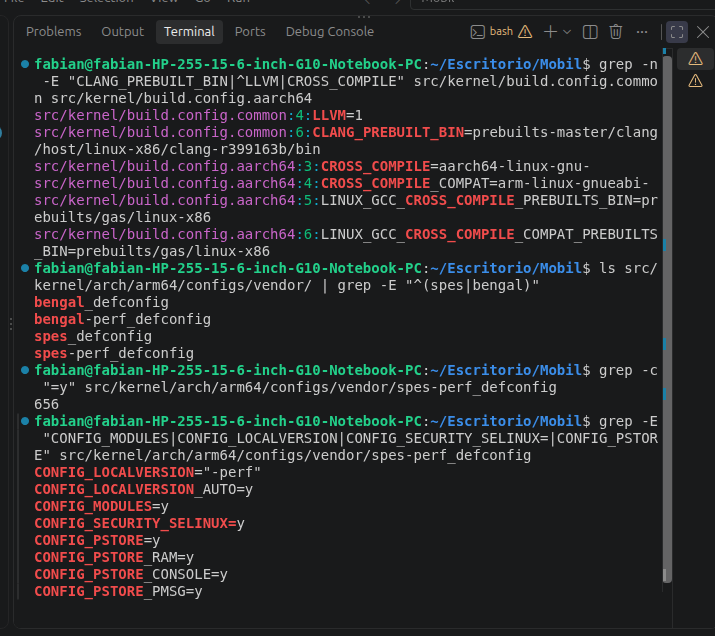
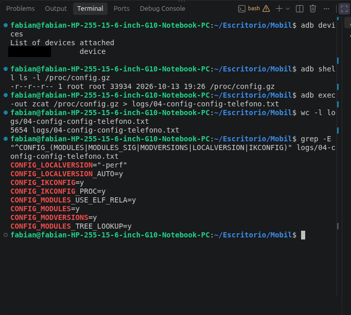

# Módulo 4 — Descargar el kernel `spes-r-oss`

- Estado: Completado
- Fecha: 2026-10-06 (cierre 2026-10-13)
- Fuente: <https://github.com/MiCode/Xiaomi_Kernel_OpenSource>, rama `spes-r-oss`
- Objetivo: tener el código fuente oficial de Xiaomi para `spes`, saber exactamente qué commit y qué versión de kernel es, y localizar su `defconfig` y las instrucciones de compilación. No se compila todavía (Módulo 5) y no hace falta el teléfono.

## Concepto

Un kernel no se compila "a ciegas": hay que saber qué árbol de código es, en qué commit está y qué configuración (`defconfig`) lo describe. Un commit identifica el contenido exacto; registrarlo hace el laboratorio **reproducible**. Se clona solo el último commit (`--depth=1`) de una sola rama para no descargar cientos de miles de commits de historial.

## Datos verificados antes de empezar (solo lectura, sin clonar)

- La rama `spes-r-oss` declara `VERSION = 4`, `PATCHLEVEL = 19`, **`SUBLEVEL = 157`**: la misma versión que corre el teléfono (`4.19.157-perf`).
- El `defconfig` está en `arch/arm64/configs/vendor/`: `spes_defconfig`, `spes-perf_defconfig`, `bengal_defconfig`, `bengal-perf_defconfig`. El kernel del teléfono lleva `-perf` en su versión, así que el candidato es `vendor/spes-perf_defconfig`. **[VERIFICAR]** contra la configuración real del teléfono.
- El commit `cb1ffc010755` (el sufijo `gcb1ffc010755` de `uname -r`) devuelve **404 en GitHub**: Xiaomi compiló el kernel del teléfono desde un commit interno no publicado. El código abierto es lo más cercano, no una copia exacta.
- Último commit de la rama `spes-r-oss` (visto con `git ls-remote`): `88afd32564211f4cfb60171ed8cbeaa734860601`.

## Práctica guiada

```bash
# Paso 1: clonar y registrar el commit
mkdir -p src
git clone --depth=1 --single-branch -b spes-r-oss https://github.com/MiCode/Xiaomi_Kernel_OpenSource.git src/kernel
git -C src/kernel rev-parse HEAD | tee logs/04-commit.txt
make -s -C src/kernel kernelversion      # 4.19.157  (con un aviso inofensivo sobre `python`)
du -sh src/kernel                        # 1,2G

# Paso 2: qué compilador y qué defconfig espera la rama
grep -n -E "CLANG_PREBUILT_BIN|^LLVM|CROSS_COMPILE" src/kernel/build.config.common src/kernel/build.config.aarch64
ls src/kernel/arch/arm64/configs/vendor/ | grep -E "^(spes|bengal)"
grep -c "=y" src/kernel/arch/arm64/configs/vendor/spes-perf_defconfig
grep -E "CONFIG_MODULES|CONFIG_LOCALVERSION|CONFIG_SECURITY_SELINUX=|CONFIG_PSTORE" src/kernel/arch/arm64/configs/vendor/spes-perf_defconfig

# Paso 3: configuración real del kernel del teléfono (solo lectura)
adb devices
adb shell ls -l /proc/config.gz          # 33 934 bytes
adb exec-out zcat /proc/config.gz > logs/04-config-telefono.txt     # 5 654 líneas
grep -E "^CONFIG_(MODULES|MODULE_SIG|MODVERSIONS|LOCALVERSION|IKCONFIG)" logs/04-config-telefono.txt
# comprobaciones sobre el archivo guardado (incluyen las opciones desactivadas, que empiezan por "# CONFIG_...")
grep -n -E "MODULE_SIG|KPROBES|DEBUG_FS|FUNCTION_TRACER|CLANG_VERSION|PSTORE_(RAM|CONSOLE|PMSG)" logs/04-config-telefono.txt
```

## Hallazgos reales

1. **El clonado es ligero:** 65 047 objetos, 186 MiB descargados y 1,2 GB en disco con `--depth=1`. El commit `88afd32564211f4cfb60171ed8cbeaa734860601` coincide con el que `git ls-remote` mostraba antes de clonar, y `kernelversion` da `4.19.157`, igual que el teléfono. El commit es de **2023-05-11** ("Kernel: Xiaomi kernel changes for Redmi Note 11 Android R"), seis meses anterior al kernel del teléfono (28 nov 2023).
2. **`make` avisa `python: No existe el archivo o el directorio`.** La línea 423 del `Makefile` define `CC = $(PYTHON) $(srctree)/scripts/gcc-wrapper.py $(REAL_CC)`: el compilador pasa por un script de Qualcomm que falla ante cualquier aviso nuevo. Ese script usa `#!/usr/bin/env python2` y `print "texto"` (**sintaxis de Python 2**), y Ubuntu 24.04 solo trae `python3`. Instalar `python-is-python3` no ayuda (daría un error de sintaxis). La solución es **no usar el wrapper**: pasar `CC=clang` en la línea de comandos, que prevalece sobre el Makefile. Para `kernelversion` el aviso es inofensivo.
3. **El método oficial se lee en `build.config.*` y `AndroidKernel.mk`** (no hay README): `LLVM=1`, `CROSS_COMPILE=aarch64-linux-gnu-`, `CROSS_COMPILE_COMPAT=arm-linux-gnueabi-` y `CLANG_TRIPLE=aarch64-linux-gnu-`, con `REAL_CC` apuntando a un Clang de AOSP. Coincide con la guía.
4. **El compilador esperado es `clang-r399163b`** (`CLANG_PREBUILT_BIN=prebuilts-master/clang/host/linux-x86/clang-r399163b/bin`), el Clang de AOSP de la era Android 11. El del host es Clang 18.1.3, muy posterior; es probable que el Módulo 5 obligue a descargar ese. **[VERIFICAR]**
5. **El `defconfig` correcto es `vendor/spes-perf_defconfig`** (656 opciones `=y`). Coincide con el kernel del teléfono porque define `CONFIG_LOCALVERSION="-perf"`, y el teléfono muestra `4.19.157-perf`.
6. **El sufijo `-gcb1ffc010755` sale de `CONFIG_LOCALVERSION_AUTO=y`**: el kernel añade `-g<hash del commit de Git>` a su versión. Por eso el teléfono muestra el hash de un commit interno de Xiaomi que no está en GitHub (404). Nuestro kernel mostrará el hash de **nuestro** commit (`-g88afd325…`, o `-dirty` si el árbol tiene cambios), lo que permitirá distinguir con `uname -r` cuál de los dos está corriendo.
7. **La configuración habilita lo que el curso necesita:** `CONFIG_MODULES=y` (módulos cargables, Módulo 9), `CONFIG_SECURITY_SELINUX=y` y `CONFIG_PSTORE=y` con `PSTORE_RAM`, `PSTORE_CONSOLE` y `PSTORE_PMSG` (registro de fallos, Módulo 8). Pendiente confirmar la firma de módulos (`CONFIG_MODULE_SIG*`) y que el Device Tree reserve memoria para `ramoops`. **[VERIFICAR]**
8. **El teléfono sí expone su configuración:** `/proc/config.gz` existe (33 934 bytes, `CONFIG_IKCONFIG_PROC=y`), y descomprimido da 5 654 líneas: `Linux/arm64 4.19.157 Kernel Configuration`. Se guardó como `logs/04-config-telefono.txt`. (Un typo al escribir el comando lo había guardado como `04-config-config-telefono.txt`, y se renombró.) También se tecleó `adb shell -ls` en lugar de `adb shell ls`: `adb` tomó `-ls` como opciones suyas y dio `invalid option -- 'l'`.
9. **El kernel de fábrica EXIGE módulos firmados:** `CONFIG_MODULE_SIG=y` y **`CONFIG_MODULE_SIG_FORCE=y`** (SHA-512), y también `CONFIG_MODVERSIONS=y`. El `grep` inicial no mostraba las líneas de firma porque las opciones desactivadas aparecen como `# CONFIG_X is not set` y empiezan por `#`; hubo que buscar sin anclar a `^CONFIG`. Consecuencia para el Módulo 9: **un módulo propio no se puede cargar en el kernel de fábrica**. En nuestro kernel compilado el `defconfig` mantiene `MODULE_SIG_FORCE=y`, pero `CONFIG_MODULE_SIG_ALL=y` firma automáticamente los módulos construidos en el mismo árbol con la clave que se genera en la compilación (`certs/signing_key.pem`), y nuestro kernel la reconoce; si diera problemas se desactiva `MODULE_SIG_FORCE`.
10. **El kernel de fábrica se compiló con Clang 10.0.7** (`CONFIG_CLANG_VERSION=100007`, `CONFIG_CC_IS_CLANG=y`, sin LTO), no con `clang-r399163b` (el que indica `build.config.common`). Probablemente sea el Snapdragon LLVM de Qualcomm (SDClang), no uno de AOSP. **[VERIFICAR]** Para el Módulo 5 significa que cualquier Clang 10 o 11 es candidato, y que Clang 18 sigue siendo demasiado nuevo.
11. **La configuración real y el `defconfig` público no son idénticos.** Ejemplo: `spes-perf_defconfig` fija `CONFIG_DEBUG_FS=y` y el teléfono tiene `# CONFIG_DEBUG_FS is not set`. La comparación completa necesita expandir el `defconfig` a `.config` y se hace en el Módulo 5.
12. **El kernel de fábrica tiene desactivadas varias herramientas de observación:** `# CONFIG_KPROBES is not set`, `# CONFIG_FUNCTION_TRACER is not set`, `# CONFIG_DEBUG_FS is not set`, `# CONFIG_DEVMEM is not set` y `# CONFIG_PROC_KCORE is not set`. Para el Módulo 13 (`ftrace`/`kprobes`) habrá que activarlas en nuestro propio kernel. En cambio sí están `CONFIG_KALLSYMS=y`, `CONFIG_MAGIC_SYSRQ=y`, `CONFIG_FTRACE=y` y `pstore` con `PSTORE_RAM`, `PSTORE_CONSOLE` y `PSTORE_PMSG` (Módulo 8). Seguridad: `SECURITY_SELINUX=y`, `DM_VERITY=y`, `STRICT_KERNEL_RWX=y`, `RANDOMIZE_BASE=y`.
13. **Privacidad:** la captura de `adb devices` mostraba el número de serie y se tapó antes de entrar al repositorio.

## Evidencias

**01 — Clonado de `spes-r-oss` (hallazgo #1)**
65 047 objetos, commit `88afd325…`, `kernelversion` 4.19.157 y el aviso inofensivo de `python`; 1,2 GB en disco.


**02 — Compilador esperado y `defconfig` (hallazgos #3, #4, #5 y #7)**
`LLVM=1`, `clang-r399163b`, los cuatro `defconfig` de `spes`/`bengal`, 656 opciones activadas y `LOCALVERSION="-perf"`.


**03 — Configuración real del teléfono (hallazgos #8 y #9)**
`/proc/config.gz` de 33 934 bytes, 5 654 líneas, `MODULES=y`, `MODVERSIONS=y`, `IKCONFIG_PROC=y`. Número de serie tapado.


## Pendientes

- [x] Clonar `spes-r-oss` en `src/kernel` y registrar el commit en `logs/04-commit.txt`.
- [x] Confirmar `kernelversion` = `4.19.157`.
- [x] Localizar `spes-perf_defconfig` en el árbol clonado.
- [x] Buscar qué compilador y qué variables pide la rama.
- [x] Guardar la configuración real del teléfono en `logs/04-config-telefono.txt`.
- [ ] Módulo 5: expandir `spes-perf_defconfig` a `.config` y compararlo con `logs/04-config-telefono.txt`.
- [ ] Módulo 5: conseguir un Clang 10 u 11 (`clang-r399163b` o similar); Clang 18 es demasiado nuevo.
- [ ] Módulo 5: compilar con `CC=clang` en la línea de comandos para saltarse `gcc-wrapper.py` (Python 2).
- [ ] Módulo 9: decidir cómo cargar módulos propios dado `MODULE_SIG_FORCE=y`.
