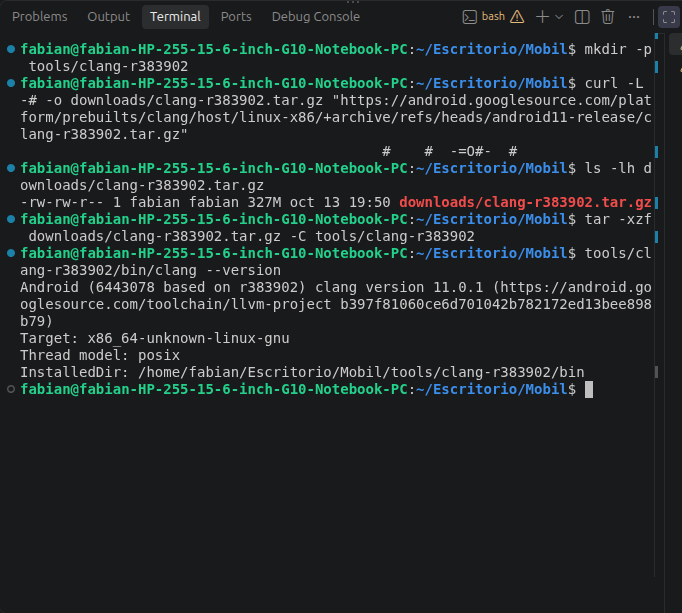
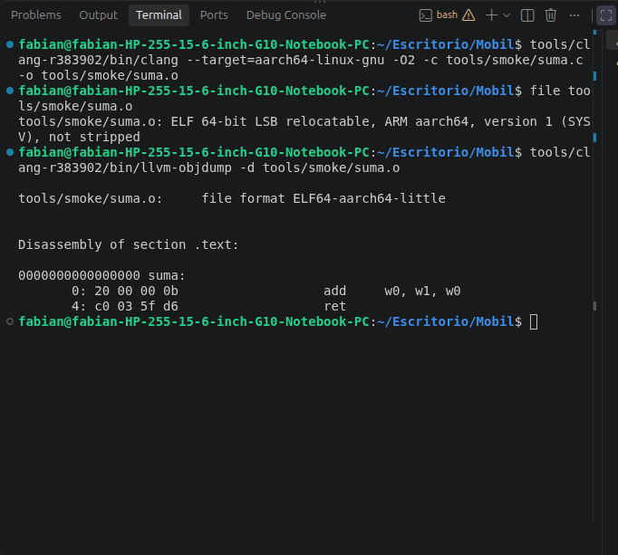
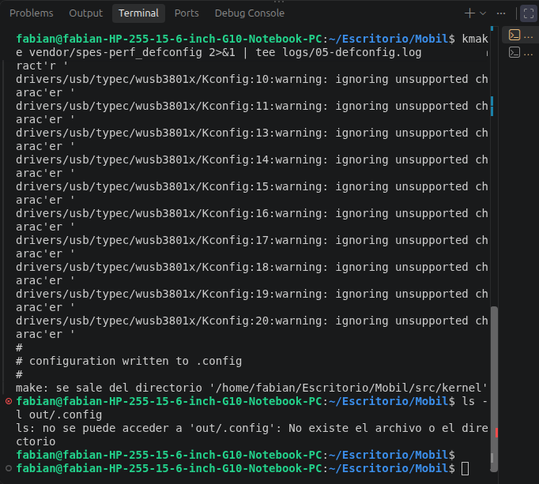
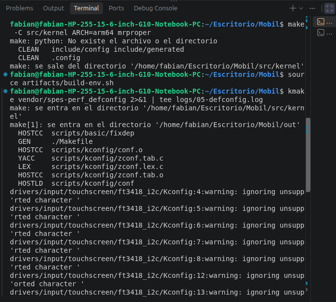
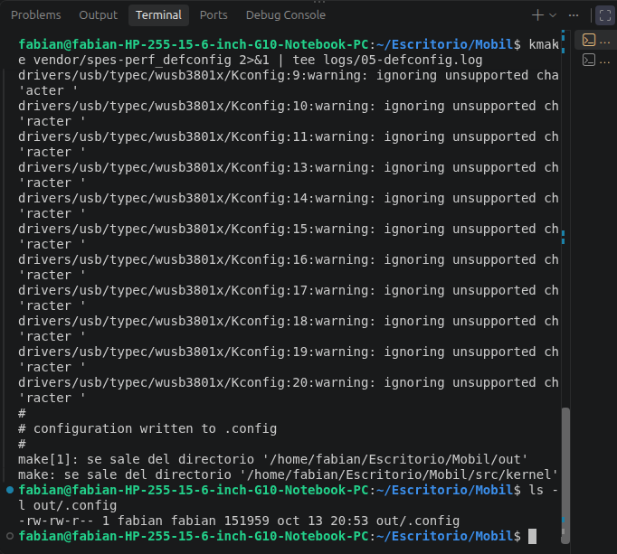
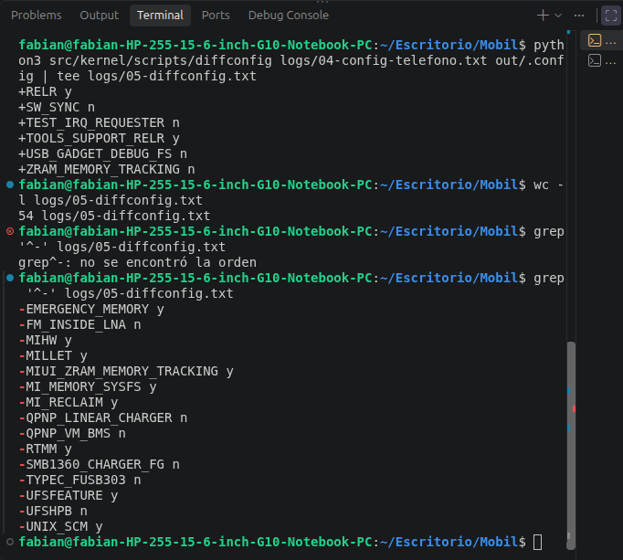
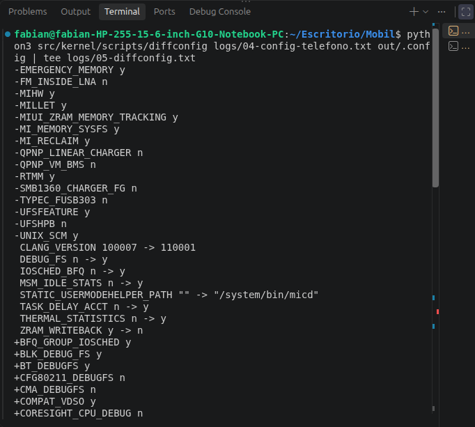

# Módulo 5 — Compilar el kernel sin modificarlo

- Estado: En progreso
- Fecha: 2026-10-13
- Árbol: `src/kernel`, rama `spes-r-oss`, commit `88afd32564211f4cfb60171ed8cbeaa734860601`, kernel 4.19.157
- Objetivo: producir con tus propias manos la imagen `Image` (y su DTB) de un kernel **sin cambios**, entendiendo cada error que aparezca. Es la línea base contra la que se medirá todo lo demás.

## Concepto

Compilar el kernel de un teléfono desde un PC x86_64 es **compilación cruzada**: el compilador corre en x86_64 y genera código ARM64. Hacen falta cuatro cosas bien alineadas: un **compilador** de la época del kernel, el **`defconfig`** correcto, las **variables** que le dicen a `make` qué herramientas usar, y un directorio de salida (`O=out/`) separado del código para no ensuciar Git.

Se divide en dos sesiones:

- **Sesión A (con las manos en el teclado, ~40 min):** conseguir el Clang, comprobar que funciona, expandir el `defconfig` a `.config` y compararlo con el del teléfono.
- **Sesión B (~1 h de espera):** la compilación completa. Laptop enchufada y sin suspenderse.

## Datos de partida (módulos 1 y 4)

- Host: Ubuntu 24.04, Ryzen 5 7530U (12 hilos), 14 GiB de RAM, **59 GB libres** (87 % usado). Se compilará con `-j8`.
- Clang del sistema: 18.1.3, demasiado nuevo para un kernel 4.19. El kernel de fábrica se compiló con **Clang 10.0.7** (`CONFIG_CLANG_VERSION=100007`, sin LTO).
- `build.config.common` pide `clang-r399163b`, que **no existe** en la rama `android11-release` de AOSP (404). Sí existe **`clang-r383902`**, declarado como "11.0.1 based on r383902" en su `AndroidVersion.txt`. El servidor de AOSP descarga a ≈ 4 MB/s.
- El `Makefile` define `CC = $(PYTHON) scripts/gcc-wrapper.py $(REAL_CC)` y ese script es de Python 2. Se evita pasando `CC=clang` en la línea de comandos.
- El `defconfig` impone `CONFIG_MODULE_SIG_FORCE=y`; los módulos propios se firmarán con la clave que genere la compilación.

## Plan

| Paso | Qué | Sesión |
|---|---|---|
| 1 | Descargar `clang-r383902` de AOSP a `tools/` | A |
| 2 | Prueba de humo: compilar un `hello.c` para ARM64 con ese Clang | A |
| 3 | Expandir `vendor/spes-perf_defconfig` a `.config` en `out/` | A |
| 4 | Comparar ese `.config` con el del teléfono (`scripts/diffconfig`) | A |
| 5 | Compilar con `CC=clang`, `-j8`, y guardar el log | B |
| 6 | Localizar `Image`/`Image.gz-dtb` y guardar sus hashes | B |

## Práctica guiada

```bash
# Paso 1: Clang 11.0.1 de AOSP a tools/
mkdir -p tools/clang-r383902
curl -L -# -o downloads/clang-r383902.tar.gz "https://android.googlesource.com/platform/prebuilts/clang/host/linux-x86/+archive/refs/heads/android11-release/clang-r383902.tar.gz"
tar -xzf downloads/clang-r383902.tar.gz -C tools/clang-r383902
tools/clang-r383902/bin/clang --version      # clang version 11.0.1 (based on r383902)

# Paso 2: prueba de humo ARM64
tools/clang-r383902/bin/clang --target=aarch64-linux-gnu -O2 -c tools/smoke/suma.c -o tools/smoke/suma.o
file tools/smoke/suma.o                      # ELF 64-bit LSB relocatable, ARM aarch64
tools/clang-r383902/bin/llvm-objdump -d tools/smoke/suma.o   # add w0, w1, w0 ; ret

# Paso 3: script de entorno (artifacts/build-env.sh, versionado) y defconfig
source artifacts/build-env.sh
make -C src/kernel ARCH=arm64 mrproper       # solo tras el error de 0= (ver hallazgos)
kmake vendor/spes-perf_defconfig 2>&1 | tee logs/05-defconfig.log

# Paso 4: comparar con la configuración del teléfono
python3 src/kernel/scripts/diffconfig logs/04-config-telefono.txt out/.config | tee logs/05-diffconfig.txt
```

## Hallazgos reales

1. **El Clang de AOSP funciona tal cual en Ubuntu 24.04.** `clang-r383902` (327 MB comprimido, 1,1 GB descomprimido) se descargó a ≈ 4 MB/s desde `android.googlesource.com` y arranca sin librerías que falten. Trae `clang`, `ld.lld`, `llvm-ar`, `llvm-nm`, `llvm-objcopy`, `llvm-objdump`, `llvm-strip` y `llvm-readelf`, así que se usa toda la cadena LLVM 11 y no la 18 de Ubuntu. Su `AndroidVersion.txt` dice "11.0.1 based on r383902". El `clang-r399163b` que pide `build.config.common` no existe en AOSP (404).
2. **La prueba de humo confirma que genera ARM64:** `ELF 64-bit LSB relocatable, ARM aarch64`; `suma()` se desensambla en `add w0, w1, w0` y `ret`, dos instrucciones de 4 bytes (`20 00 00 0b`, `c0 03 5f d6`), con los argumentos en `w0` y `w1`.
3. **Corrección a la guía:** el vDSO de 32 bits usa la variable `CROSS_COMPILE_COMPAT` (`arch/arm64/kernel/vdso32/Makefile`), no `CROSS_COMPILE_ARM32`. El script de entorno usa la correcta. `CONFIG_COMPAT_VDSO=y` aparece activado en nuestro `.config`, así que ese vDSO sí se compilará.
4. **Un `0` en lugar de `O`:** el script se tecleó con `0="$LAB/out"` (cero) y no `O="$LAB/out"` (letra O). `make` trató `0=` como una variable inventada, compiló **dentro del árbol** (`configuration written to .config`) y `out/` no existió. Confirmado con `od -c`. El kernel exige un árbol limpio para compilar fuera de él, así que hubo que ejecutar `make mrproper` (que solo elimina archivos generados: `.config`, `.config.old`, `include/config`, `include/generated`, etc.). Con la corrección, `kmake` entra en `.../out` y escribe `out/.config` (151 959 bytes, igual que el accidental).
5. **El aviso `ignoring unsupported character` (25 veces) viene de finales de línea de Windows (CRLF)** en `drivers/input/touchscreen/ft3418_i2c/Kconfig` y `drivers/usb/typec/wusb3801x/Kconfig` (`file` dice "ASCII text, with CRLF line terminators"; se ve `^M` con `cat -A`). Es inofensivo.
6. **El `Makefile` crea archivos de relleno de Xiaomi al ejecutarse** (líneas 305-312): enlaces simbólicos `include/linux/{rtmm,ktrace}.h` hacia `include/dum/` y `Kconfig`/`Makefile` vacíos en `drivers/staging/{rtmm,ktrace}`. Son sustitutos de dos módulos de Xiaomi que no son de código abierto. Aparecen como "sin seguimiento" en `git status` y no hay que tocarlos.
7. **`make mrproper` sin `CC=clang` repite el aviso `python: No existe el archivo`** (decenas de líneas y `gcc-version.sh: python: orden no encontrada`): es el *wrapper* de Python 2 del `Makefile` y es inofensivo; con `kmake` no sale.
8. **El kernel de fábrica y nuestra configuración se parecen en un 99 %:** `diffconfig` da 54 líneas de diferencia sobre 5 654. **Solo el teléfono** tiene (`-`): `EMERGENCY_MEMORY`, `MIHW`, `MILLET`, `MIUI_ZRAM_MEMORY_TRACKING`, `MI_MEMORY_SYSFS`, `MI_RECLAIM`, `RTMM`, `UFSFEATURE` y `UNIX_SCM` (activadas, `y`), y seis símbolos que en el teléfono están apagados (`n`: `FM_INSIDE_LNA`, `QPNP_LINEAR_CHARGER`, `QPNP_VM_BMS`, `SMB1360_CHARGER_FG`, `TYPEC_FUSB303`, `UFSHPB`) pero que ni existen en nuestro árbol. Por el nombre, las nueve activadas parecen **funciones propias de MIUI** (gestión de memoria y reclamación, congelado de apps, seguimiento de zram) que Xiaomi no publica; `RTMM` es justo uno de los módulos que el `Makefile` sustituye por relleno. **[VERIFICAR]** su función exacta. Riesgo: MIUI puede esperar esas funciones; se probará con `fastboot boot` (Módulo 7).
9. **Lo demás son opciones de depuración y del compilador.** Nuestro `.config` activa `DEBUG_FS`, `IOSCHED_BFQ`, `TASK_DELAY_ACCT`, `THERMAL_STATISTICS` y varias `*_DEBUGFS`, que el teléfono tiene apagadas (útil para los módulos 10 y 13). `CLANG_VERSION` pasa de 100007 a 110001, y `LD_IS_LLD`, `RELR` y `TOOLS_SUPPORT_RELR` se derivan del Clang/LLD que usamos. `ZRAM_WRITEBACK` pasa de `y` a `n`, y `STATIC_USERMODEHELPER_PATH` de vacío a `"/system/bin/micd"`.
10. **Este repositorio NO contiene los Device Tree de `spes`/`bengal`:** no existe `arch/arm64/boot/dts/vendor/` y `find` no encuentra ningún `*bengal*.dts*` ni `*spes*.dts*` (solo hay 193 `.dts` de otras plataformas). En los árboles Qualcomm de Android el Device Tree vive en repositorios aparte. Consecuencias: el kernel compilará sin DTB, `CONFIG_BUILD_ARM64_APPENDED_DTB_IMAGE` no está activado, y el DTB que arranque el teléfono tendrá que ser el **original** (viene en `vendor_boot`). Se confirmará al analizar el `boot.img` en el Módulo 6. **[VERIFICAR]**
11. **Un typo de `grep`:** `grep'^-'` (sin espacio entre el comando y el patrón entre comillas) dio `grep^-: no se encontró la orden`; el shell pegó las dos cosas en una sola palabra. Con el espacio, `grep '^-' archivo` funcionó.
12. **El kernel se comprime con GZIP** (`CONFIG_KERNEL_GZIP=y`), así que `make` generará `Image` e `Image.gz`.
13. **Primera compilación completa (`kmake -j8`, `logs/05-build-01.log`, 3 605 líneas): `real 4m58`**, `user 34m23`, `sys 5m16`. Mucho menos que el cálculo previo (30-60 min). Se compilaron **2 589 objetos**, con **15 avisos y ningún error de compilación**. Falló solo en el **enlazado de `vmlinux`** (`make: *** [Makefile:146: sub-make] Error 2`), así que no se llegó a generar `Image` ni los módulos.
14. **Error A: 8 símbolos sin definir, todos del subsistema de pantalla.** `ld.lld: error: undefined symbol:` `dsi_display_mipi_reg_read`, `dsi_display_mipi_reg_write`, `dsi_bridge_disp_get_doze_backlight` y `dsi_bridge_disp_set_doze_backlight` (referenciados desde `drivers/gpu/drm/drm_sysfs.c`), `set_lcd_reset_gpio_keep_high` (desde el táctil `nt36525b_spi/nt36xxx.c`), y `drm_register_client` / `drm_unregister_client` (desde `drivers/thermal/thermal_core.c`). Los *headers* los declaran (`include/drm/drm_panel.h`, `drivers/gpu/drm/drm_internal.h`) pero ningún `.c` del árbol los define. Causa: **`techpack/` solo contiene `Kbuild` y `stub`** y en `out/.config` solo está `CONFIG_DRM=y` (no `DRM_MSM`). El código de pantalla (`techpack/display`), y también audio, cámara y vídeo, **no está en el árbol publicado por Xiaomi**.
15. **Error B: un único símbolo sin versión.** `WARNING: EXPORT symbol "gsi_write_channel_scratch" [vmlinux] version generation failed` seguido de `ld.lld: error: relocation R_AARCH64_ABS32 cannot be used against symbol __crc_gsi_write_channel_scratch; recompile with -fPIC` (aparece 1 sola vez). Es un problema de `CONFIG_MODVERSIONS` con LLD: cuando `genksyms` no genera la versión (CRC) de un símbolo exportado, `__crc_...` deja de ser absoluto y el enlazador lo rechaza. `CONFIG_GSI=y` y el prototipo está en `include/linux/msm_gsi.h`. **No está diagnosticado del todo**; las salidas posibles son arreglar ese símbolo o desactivar `CONFIG_MODVERSIONS`. **[VERIFICAR]**
16. **Es la misma causa que el hallazgo #10 (sin Device Tree):** la publicación de Xiaomi omite `techpack/` y los DT. Por eso el árbol oficial **no basta para producir un kernel completo** para este teléfono.
17. **Existen árboles de la comunidad que sí están completos.** Se comprobó con la API pública de GitHub (rama por defecto de cada uno): `PixelExperience-Devices/kernel_xiaomi_sm6225` (rama `fourteen`, **archivado el 2023-11-15**, kernel **4.19.297**, 95 archivos `spes`/`bengal` de Device Tree, trae `spes-perf_defconfig`, y `techpack` con `audio`, `camera`, `data`, `display` y `video`); `knyplaygrnd/android_kernel_xiaomi_spes` y `Nexs7/android_kernel_xiaomi_spes` (activos en 2026, 4.19.325, con `techpack/display` y 89-95 DT; ramas `asano`, `asano-ksu`, `asano-spes`, `urumi`); y `spi3ex/android_kernel_xiaomi_sm6225` (LineageOS 19.1, 4.19.113). Ninguno es oficial de Xiaomi. **[VERIFICAR]** que compilan y arrancan en este teléfono.
18. **Posible problema para el Módulo 7:** el `defconfig` tiene `CONFIG_MODULE_SIG_FORCE=y`. Un kernel propio solo confía en la clave que genera al compilarse, así que **no cargaría los módulos `.ko` de Xiaomi** que pueda traer el teléfono (firmados con su clave). Habría que desactivar `MODULE_SIG_FORCE` en nuestra configuración. **[VERIFICAR]** al analizar `vendor_boot`.

19. **Decisión: pasar al árbol archivado de PixelExperience** (`PixelExperience-Devices/kernel_xiaomi_sm6225`, rama `fourteen`, commit `dad6f6ab28fc2694e9e1f431daa3eab228cb955b`), conservando el árbol oficial en `src/kernel` como referencia. Razones: está **archivado** (no cambia, reproducible), su fecha (nov 2023, con fusiones `ASB-2023-11-05_4.19-stable`) coincide con la ROM del teléfono, y trae `spes-perf_defconfig`, `techpack/display` y 95 archivos de Device Tree. Comprobado antes de clonar: su `Makefile` usa `CC = clang` (sin el *wrapper* de Python 2), su `defconfig` fija `CONFIG_LOCALVERSION="-uvite"` y no menciona `MODULE_SIG` (no exigiría módulos firmados, lo que atenúa el hallazgo #18), declara `clang-r416183b` (Clang 12) y tiene `MODVERSIONS=y`. No hay README. Los más de 10 000 *contributors* que muestra GitHub vienen del historial del kernel Linux y de Android Common Kernel incluido en el repositorio: **no es un repositorio oficial ni lo mantienen esos autores**. Es código de terceros que correrá con privilegios de kernel en un teléfono de laboratorio.
20. **El script `artifacts/build-env.sh` ahora admite varios árboles:** usa las variables `KSRC` y `KOUT` (por defecto `src/kernel` y `out/`). El árbol de PixelExperience irá a `src/kernel-px` y `out-px/`.
21. **El árbol de PixelExperience está completo** (clonado: 75 848 objetos, 211 MiB, 1,4 GB; commit `dad6f6ab28fc2694e9e1f431daa3eab228cb955b`; `kernelversion` 4.19.297): trae `techpack/display/msm` (`dsi`, `dp`, `msm_drv.c`, `msm_atomic.c`…), `techpack` con audio 225, camera 157, display 146, video 24 y data 23 archivos `.c`, y los Device Tree `spes.dtsi`, `spesn.dtsi`, `spes-sm5602.dtsi` y tres `*-khaje-idp-nopmi-overlay.dts` (el `Makefile` de DT compila los `*.dtbo` sobre la base `khaje.dtb`). `set_lcd_reset_gpio_keep_high` (`dsi_panel.c:511`) y `drm_register_client` (`dsi_drm.c:40`) ya tienen definición. `dsi_display_mipi_reg_read` no se define en ningún sitio, pero este `drm_sysfs.c` ya no la referencia (el oficial tiene 13 referencias a esos símbolos).
22. **Configuración de PX (`out-px/.config`, 150 752 bytes):** `CLANG_VERSION=110001`, `LOCALVERSION="-uvite"` (distinto del `-perf` de fábrica), `MODVERSIONS=y` y **`# CONFIG_MODULE_SIG is not set`** (no exige módulos firmados: resuelve el hallazgo #18). `# DRM_MSM is not set`, pero el `techpack/display` se activa por `Kbuild`; lo confirmará la compilación. `DEBUG_FS`, `KPROBES`, `FUNCTION_TRACER` y `DEVMEM` están desactivados.
23. **Diferencias con el teléfono: 222 líneas** (`logs/05-diffconfig-px.txt`) frente a 54 del árbol oficial: **95** solo en el teléfono, **71** solo en PX y **56** que cambian de valor. Solo en el teléfono: `CORESIGHT_*`, `EXFAT_*`, `DVB_MPQ`, `FB_MSM` y **8 de las 9 funciones de MIUI** (`MILLET`, `MI_RECLAIM`, `RTMM`, `MIHW`, `EMERGENCY_MEMORY`, `UFSFEATURE`, `MI_MEMORY_SYSFS`, `MIUI_ZRAM_MEMORY_TRACKING`); `UNIX_SCM` sí está en PX. Cambian: `CORESIGHT y→n`, `FB y→n`, `EXFAT m→y`, `ARM64_SW_TTBR0_PAN y→n`, `ARM64_LSE_ATOMICS n→y`, `BUILD_ARM64_DT_OVERLAY n→y`, `DEFAULT_TCP_CONG cubic→westwood` y varias de cifrado nuevas (`CHACHA20`, `CURVE25519`, `POLY1305`). PX está pensado para otra ROM, no para MIUI: **compilar no garantiza que MIUI arranque**; riesgo para el Módulo 7.
24. **`tee` pisó un log.** Se tecleó `tee logs/05-diffconfig.txt` en lugar de `logs/05-diffconfig-px.txt`: las 222 líneas de PX sobrescribieron las 54 del árbol oficial (que ya estaban en Git). Se recuperó guardando el archivo pisado como `05-diffconfig-px.txt` y restaurando el original con `git checkout`. Lección: `tee` sobrescribe sin avisar; para nombres de log importantes, copiar y pegar.
25. **Mi `grep` repitió la trampa del `^`:** `grep -E "^CONFIG_(...)"` no encuentra las opciones apagadas (`# CONFIG_X is not set`); mostró solo 3 de las 8 opciones. Es la misma lección que el hallazgo #9 del Módulo 4; esta vez el fallo estuvo en el comando del mentor. Regla: para comprobar si algo está activado **o desactivado**, buscar sin anclar a `^`.
26. **Primera compilación del árbol de PixelExperience (`logs/05-build-px-01.log`, 4 439 líneas): `real 7m21`, `user 51m12`, `sys 7m48`.** Se compilaron **3 442 objetos** con solo **3 avisos** y ningún error de compilación: `techpack/display` 102, `techpack/audio` 130, `techpack/camera` 92, `techpack/video` 24, el controlador WiFi `drivers/staging/qcacld-3.0` 516, y los Device Tree (`bengal.dtb`, `bengal-1gb.dtb`, `bengal-2gb.dtb`…). **Con Clang 11 funcionó**, aunque el árbol declara Clang 12 (`clang-r416183b`). **No apareció ningún error de enlazado** (el del árbol oficial, hallazgo #14, no se repite). Con este árbol ya no faltan `techpack` ni DT.
27. **Fallo: `DTBOIMG arch/arm64/boot/dtbo.img` → `/bin/sh: 1: python: not found` → `Error 127`** (`arch/arm64/boot/Makefile:74`). `scripts/Makefile.lib` (línea 324) define `cmd_mkdtimg = $(PYTHON) $(srctree)/scripts/mkdtboimg.py create …` y el `Makefile` raíz fija `PYTHON = python`, que Ubuntu 24.04 no tiene (solo `python3`). `mkdtboimg.py` pide `#! /usr/bin/env python` pero es compatible con Python 3 (`python3 -m py_compile` no da error y no usa sintaxis de Python 2). Solución: añadir **`PYTHON=python3`** a `kmake` (la línea de comandos prevalece sobre el `Makefile`); `artifacts/build-env.sh` ya lo incluye. No hace falta instalar `python-is-python3`. Este fallo apareció aquí y no en el árbol oficial porque aquí `BUILD_ARM64_DT_OVERLAY=y` (hallazgo #23), que activa la creación de `dtbo.img`.
28. **`grep "error:"` no encontró nada, y el log sí tenía un fallo.** `make` marca sus errores como `make: *** [...] Error 2` (y `Error 127` si un comando no existe), sin la palabra `error:` en minúscula con dos puntos, que es lo que usan el compilador y el enlazador. Para localizar el primer fallo en un log de `make`: `grep -n -m3 "\*\*\*"` y mirar las líneas anteriores. Es la misma familia de lección que el `^` de `grep`: **el patrón de búsqueda tiene que corresponder al formato real del mensaje**.
29. **La compilación completa tarda ~7 minutos con `-j8`** (la primera, la del árbol oficial, 5 min porque se detuvo antes). `kmake` repite solo lo que falta, así que reanudar tras arreglar `PYTHON` debería ser rápido.
30. **La segunda compilación de PX terminó sin errores (`logs/05-build-px-02.log`): `real 0m21`, `user 0m52`, `sys 0m29`.** `make` es incremental y solo repitió lo pendiente: `DTBOIMG dtbo.img` (ya sin el fallo de `python`), `DTC` de todos los `.dtb`/`.dtbo`, `CAT dtb.img`, `LD vmlinux`, `SORTEX`, `SYSMAP`, `OBJCOPY Image`, `GZIP Image.gz` y `MODPOST 4 modules` con sus `.ko`. Es el primer kernel **completo** compilado por el usuario.
31. **Artefactos (`out-px/`):** `arch/arm64/boot/Image` 36 719 104 B (`Linux kernel ARM64 boot executable Image, little-endian, 4K pages`), `Image.gz` 17 619 346 B, `dtb.img` 6 928 200 B, `dtbo.img` 7 758 878 B, `vmlinux` 441 160 984 B y `System.map` 6 031 606 B. Módulos: `net/ipv4/tcp_bic.ko`, `techpack/data/drivers/rmnet/perf/rmnet_perf.ko`, `techpack/data/drivers/rmnet/shs/rmnet_shs.ko` y `drivers/video/backlight/lcd.ko`.
32. **Versión que mostrará el kernel: `4.19.297-uvite`** (`out-px/include/config/kernel.release`). **Corrección al hallazgo #6 del Módulo 4:** con este árbol **no** se añade el sufijo `-g<hash>` (el árbol oficial sí lo haría con `LOCALVERSION_AUTO=y`); el de fábrica es `4.19.157-perf-gcb1ffc010755`. Sigue siendo fácil distinguirlos con `uname -r`. `UTS_VERSION` = `#1 SMP PREEMPT Tue Oct 13 22:00:29 -05 2026`, compilado "por fabian" con `clang version 11.0.1 (based on r383902)`.
33. **Solo 4 módulos `.ko`:** casi todo está integrado (`built-in`); `CONFIG_MODULES=y` y sin `MODULE_SIG`, así que el Módulo 9 es viable con este árbol.
34. **El espacio en disco baja con cada compilación:** 59 GB libres antes de `out/`, 57 al clonar `kernel-px` y 52 tras compilar `out-px/` (89 % usado). Los artefactos grandes quedan fuera de Git (`out/`, `out-px/`, `src/`, `artifacts/px/`).

## Evidencias

**01 — `clang-r383902` descargado y funcionando (hallazgo #1)**
327 MB, `clang version 11.0.1 (based on r383902)`.


**02 — Prueba de humo ARM64 (hallazgo #2)**
`ELF 64-bit LSB relocatable, ARM aarch64` y `add w0, w1, w0` / `ret`.


**03 — El error del `0` en lugar de `O` (hallazgo #4)**
`configuration written to .config` (sin `out/`) y `ls: no se puede acceder a 'out/.config'`.


**04 — Corrección y limpieza con `mrproper` (hallazgos #4 y #7)**
`grep -n 'O='` muestra la letra O roja; `CLEAN include/config include/generated` y `CLEAN .config`.


**05 — `out/.config` generado (hallazgo #4)**
`make[1]: se sale del directorio '.../out'` y `out/.config` de 151 959 bytes.


**06 — Diferencias frente al teléfono (hallazgos #8 y #11)**
`wc -l` da 54 y `grep '^-'` lista las 15 líneas que solo tiene el teléfono. Se ve el typo de `grep`.


**07 — Inicio de la comparación (hallazgos #8 y #9)**
Las primeras líneas: opciones `-` (solo teléfono) y cambios de valor (`n -> y`).



## Pendientes

- [x] Paso 1: `clang-r383902` descargado y funcionando.
- [x] Paso 2: prueba de humo ARM64.
- [x] Paso 3: `out/.config` generado desde `spes-perf_defconfig` (con `artifacts/build-env.sh`).
- [x] Paso 4: diferencias frente al `config.gz` del teléfono anotadas (`logs/05-diffconfig.txt`).
- [x] Paso 5: compilación con `kmake -j8` hecha (`logs/05-build-01.log`), pero **falla en el enlazado** (hallazgos #13-#16).
- [x] Decidir la fuente del kernel: árbol archivado de PixelExperience (hallazgo #19).
- [x] Clonarlo en `src/kernel-px`, registrar su commit y comprobar `techpack/display`, los DT y el `defconfig`.
- [x] Expandir `spes-perf_defconfig` en `out-px/.config` y compararlo con el teléfono (`logs/05-diffconfig-px.txt`).
- [x] Primera compilación de PX (`logs/05-build-px-01.log`): todo compila; falla `dtbo.img` por `PYTHON` (hallazgo #27).
- [x] Reanudar con `PYTHON=python3` y guardar `logs/05-build-px-02.log`: **compila completo** (hallazgos #30-#34).
- [ ] Guardar los hashes SHA-256 de `Image`, `Image.gz`, `dtb.img` y `dtbo.img` en `logs/05-hash-px.txt` y copiar los artefactos a `artifacts/px/`.
- [ ] Repetir la compilación con el árbol elegido hasta obtener `Image`/`Image.gz`.
- [ ] Paso 6: localizar `Image` e `Image.gz` en `out/arch/arm64/boot/` y guardar sus hashes.
- [ ] Resolver el error de `__crc_gsi_write_channel_scratch` (o desactivar `CONFIG_MODVERSIONS`).
- [ ] Módulo 6: confirmar que el DTB original viene en `vendor_boot` (el árbol no trae los Device Tree de `spes`).
- [ ] Verificar la función exacta de `MILLET`, `MI_RECLAIM`, `RTMM`, `MIHW`, `EMERGENCY_MEMORY`, `UFSFEATURE` y `UNIX_SCM`.
