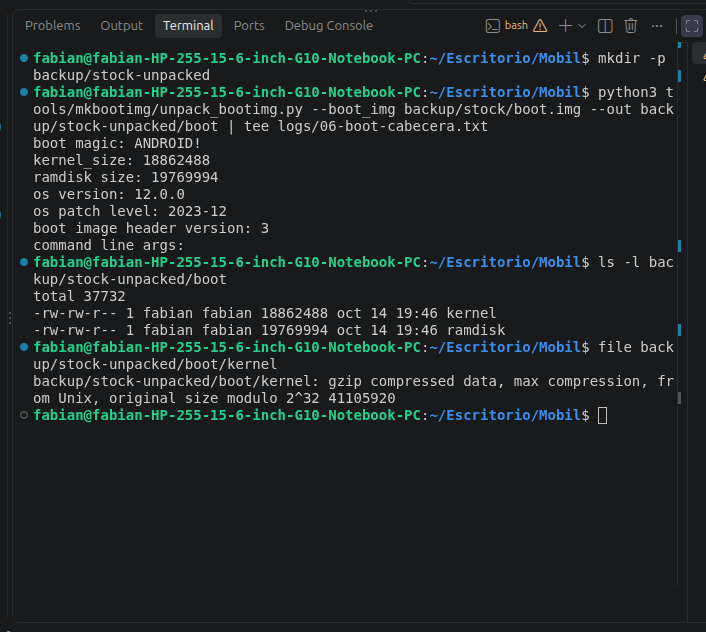
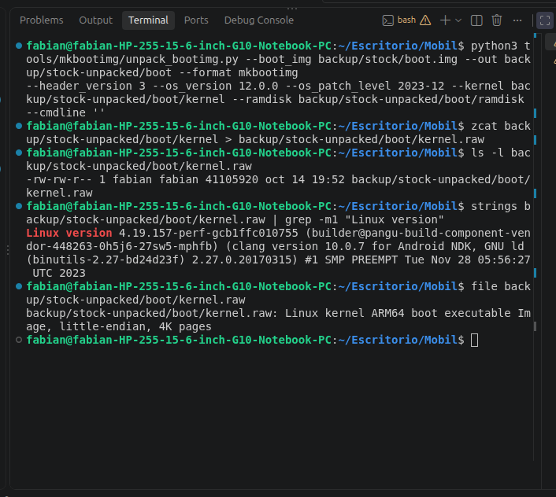
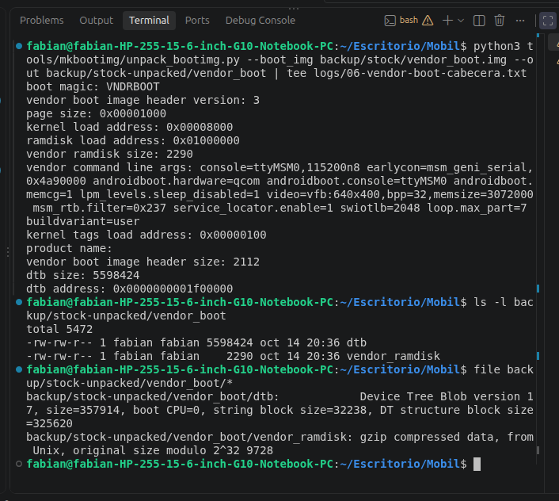
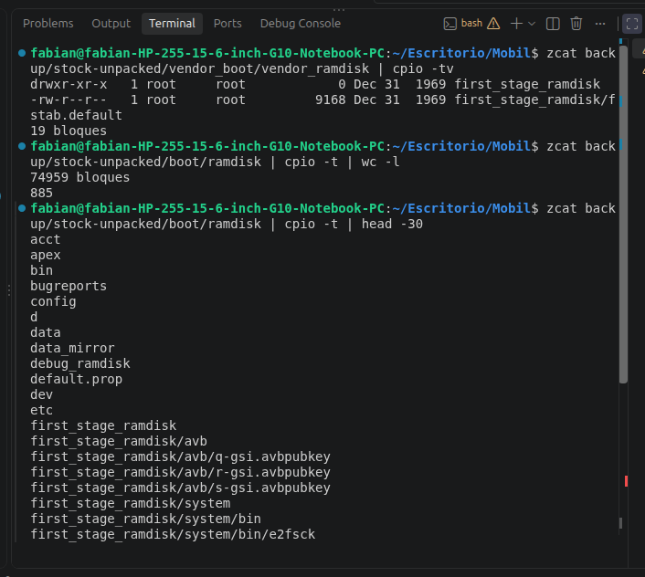
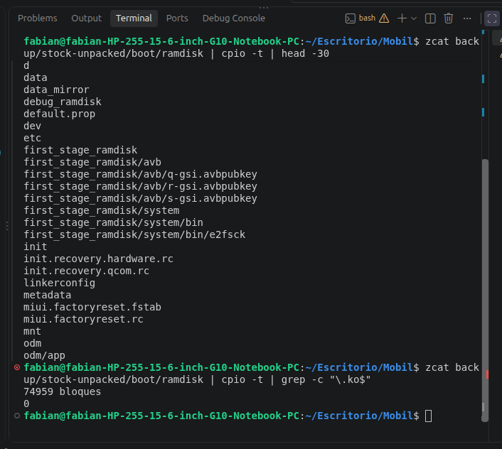
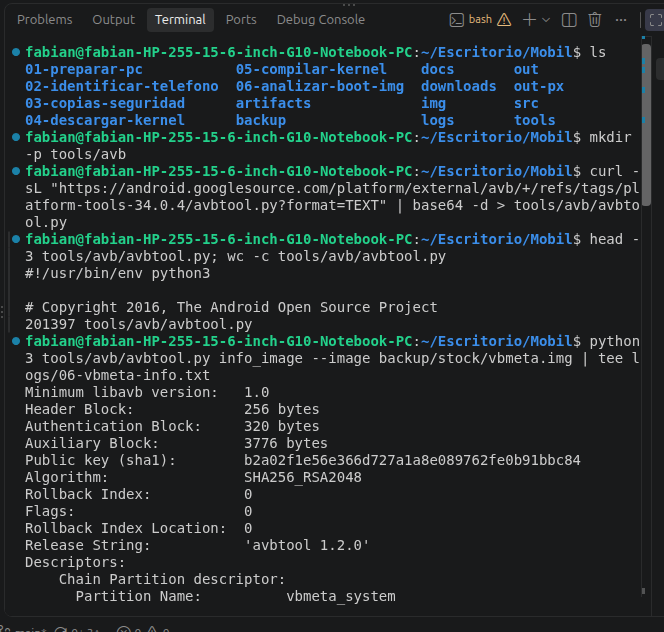
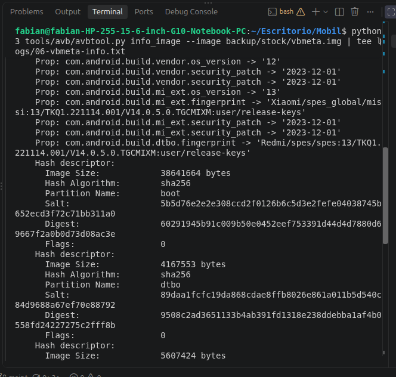
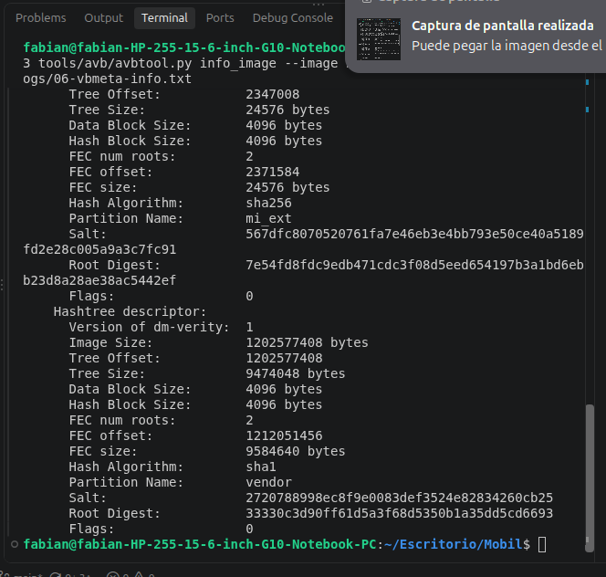
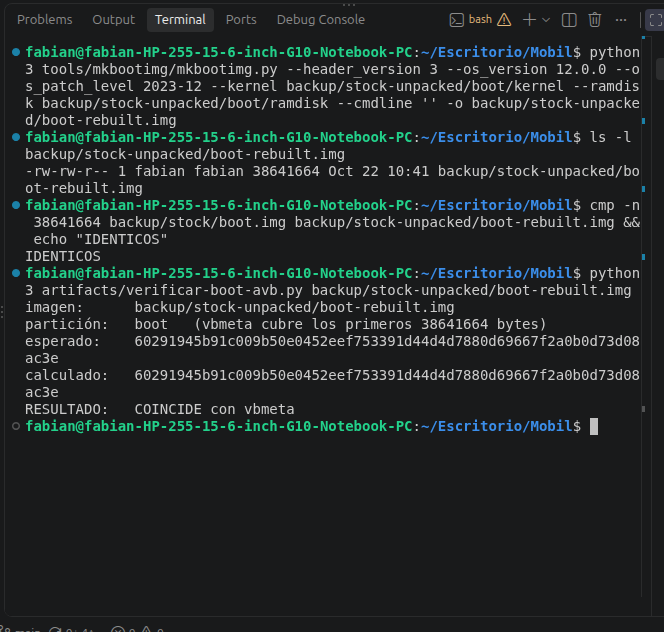

# Módulo 6 — Analizar el `boot.img` original

- Estado: Completado
- Fecha: 2026-10-14 (cierre 2026-10-22)
- Imágenes: `backup/stock/` (copiadas de la ROM `V14.0.5.0.TGCMIXM`, verificadas con `sha256sum -c logs/03-hash-stock.txt`: las cinco coinciden)
- Herramienta: `tools/mkbootimg/unpack_bootimg.py` (AOSP `platform-tools-34.0.4`, módulo 1)
- Objetivo: entender qué hay dentro de la imagen de arranque de fábrica (kernel, ramdisk, Device Tree, línea de comandos), para decidir **qué piezas reutilizamos** y qué piezas sustituye nuestro kernel en el Módulo 7. Todo se hace sobre archivos en el disco: no hace falta el teléfono.

## Concepto

El arranque de Android (`boot.img`) es un contenedor con un **cabecera** y varias piezas: el **kernel**, un **ramdisk** (sistema de archivos mínimo que arranca `init`), y en versiones modernas de la cabecera (3 y 4) parte de esas piezas se mueven a **`vendor_boot`**: el ramdisk del fabricante, el **Device Tree (DTB)** y parte de la línea de comandos. Por eso es clave saber la **versión de cabecera**: decide dónde vive cada pieza y qué tenemos que reempaquetar.

En un teléfono A/B hay dos copias de cada partición (`boot_a`/`boot_b`, `vendor_boot_a`/`vendor_boot_b`). Las imágenes de la ROM son un volcado de **una** partición, rellenado con ceros hasta su tamaño: `boot.img` y `vendor_boot.img` miden 100 663 296 bytes (96 MiB) cada una, `dtbo.img` 8 388 608 (8 MiB), `vbmeta.img` 8 192 y `vbmeta_system.img` 4 096.

## Datos de partida

- Kernel de fábrica: `4.19.157-perf-gcb1ffc010755` (compilado el 28 nov 2023). Nuestro kernel: `4.19.297-uvite` (`artifacts/px/`, hashes en `logs/05-hash-px.txt`).
- El árbol de PixelExperience trae sus propios Device Tree (`dtb.img`, `dtbo.img`), pero **no sabemos si son compatibles** con el hardware real de este teléfono ni con el DTB que arranca MIUI. Por eso conviene reutilizar el DTB de fábrica de `vendor_boot`.
- Falta en el kernel compilado: 8 funciones propias de MIUI (módulo 5, hallazgo #23).

## Plan

| Paso | Qué | Resultado buscado |
|---|---|---|
| 1 | Desempaquetar `boot.img` | Versión de cabecera, tamaños, `cmdline` |
| 2 | Identificar el kernel de fábrica dentro del `boot.img` | Formato (¿gzip, sin comprimir?) y versión |
| 3 | Desempaquetar `vendor_boot.img` | ¿Dónde está el DTB? `cmdline` del fabricante |
| 4 | Mirar el ramdisk (`cpio`) | Módulos del fabricante (`.ko`) y `init` |
| 5 | Comparar con lo que compilamos | Qué sustituye nuestro kernel y qué se reutiliza |
| 6 | `dtbo.img` y `vbmeta` | Estado de la verificación de arranque (AVB) |

## Práctica guiada

```bash
# Paso 1: cabecera del boot.img (--out siempre explícito: por defecto sería ./out, que ya existe)
mkdir -p backup/stock-unpacked
python3 tools/mkbootimg/unpack_bootimg.py --boot_img backup/stock/boot.img --out backup/stock-unpacked/boot | tee logs/06-boot-cabecera.txt
ls -l backup/stock-unpacked/boot
file backup/stock-unpacked/boot/kernel

# Paso 2: receta para reconstruirlo y versión del kernel de fábrica
python3 tools/mkbootimg/unpack_bootimg.py --boot_img backup/stock/boot.img --out backup/stock-unpacked/boot --format mkbootimg
zcat backup/stock-unpacked/boot/kernel > backup/stock-unpacked/boot/kernel.raw
strings backup/stock-unpacked/boot/kernel.raw | grep -m1 "Linux version"
file backup/stock-unpacked/boot/kernel.raw

# Paso 3: vendor_boot
python3 tools/mkbootimg/unpack_bootimg.py --boot_img backup/stock/vendor_boot.img --out backup/stock-unpacked/vendor_boot | tee logs/06-vendor-boot-cabecera.txt
ls -l backup/stock-unpacked/vendor_boot
file backup/stock-unpacked/vendor_boot/*

# Paso 4: contenido de los ramdisks (solo se LISTA con cpio -t, no se extrae nada)
zcat backup/stock-unpacked/vendor_boot/vendor_ramdisk | cpio -tv
zcat backup/stock-unpacked/boot/ramdisk | cpio -t | wc -l          # 885 entradas
zcat backup/stock-unpacked/boot/ramdisk | cpio -t | head -30
zcat backup/stock-unpacked/boot/ramdisk | cpio -t | grep -c "\.ko$"   # 0

# Paso 6: reconstruir el boot.img con la receta y comprobar (solo lectura; salida en backup/, ignorada por Git)
python3 tools/mkbootimg/mkbootimg.py --header_version 3 --os_version 12.0.0 --os_patch_level 2023-12 --kernel backup/stock-unpacked/boot/kernel --ramdisk backup/stock-unpacked/boot/ramdisk --cmdline '' -o backup/stock-unpacked/boot-rebuilt.img
ls -l backup/stock-unpacked/boot-rebuilt.img                          # 38641664
cmp -n 38641664 backup/stock/boot.img backup/stock-unpacked/boot-rebuilt.img && echo "IDENTICOS"
python3 artifacts/verificar-boot-avb.py backup/stock-unpacked/boot-rebuilt.img

# Paso 5: verificación de arranque (AVB). avbtool.py de AOSP, misma etiqueta que mkbootimg
mkdir -p tools/avb
curl -sL "https://android.googlesource.com/platform/external/avb/+/refs/tags/platform-tools-34.0.4/avbtool.py?format=TEXT" | base64 -d > tools/avb/avbtool.py
python3 tools/avb/avbtool.py info_image --image backup/stock/vbmeta.img | tee logs/06-vbmeta-info.txt
```

## Hallazgos reales

1. **`boot.img` es versión de cabecera 3.** `unpack_bootimg` da `boot magic: ANDROID!`, `boot image header version: 3`, `kernel_size: 18862488`, `ramdisk size: 19769994`, `os version: 12.0.0`, `os patch level: 2023-12` y **`command line args:` vacío**. (`os version 12.0.0` es la etiqueta de la imagen de arranque; el sistema es Android 13.) Con la cabecera 3, el `boot.img` solo lleva el kernel y un ramdisk genérico; lo específico del fabricante va en `vendor_boot`.
2. **El kernel de fábrica es un `Image.gz`:** `file` dice `gzip compressed data … original size modulo 2^32 41105920`, y descomprimido (`zcat`) es `Linux kernel ARM64 boot executable Image, little-endian, 4K pages` de **41 105 920 bytes**, con la marca `ARMd` en el byte 56 igual que el nuestro. El nuestro mide 36 719 104 B sin comprimir (17 619 346 B en gzip contra 18 862 488 B). El formato es compatible, así que nuestro `Image.gz` puede ocupar su lugar.
3. **La receta exacta del `boot.img` de fábrica** (`--format mkbootimg`): `--header_version 3 --os_version 12.0.0 --os_patch_level 2023-12 --kernel … --ramdisk … --cmdline ''`. Es la que se usará en el Módulo 7: solo cambia el kernel.
4. **El kernel de fábrica confirma lo medido en el Módulo 2:** `Linux version 4.19.157-perf-gcb1ffc010755 (builder@pangu-build-component-vendor-448263-0h5j6-27sw5-mphfb) (clang version 10.0.7 for Android NDK, GNU ld (binutils-2.27-bd24d23f) 2.27.0.20170315) #1 SMP PREEMPT Tue Nov 28 05:56:27 UTC 2023`, idéntico al `uname -a` del teléfono. **Corrección al hallazgo #10 del Módulo 5:** se compiló con el **Clang 10.0.7 del NDK de Android** (no con el Snapdragon LLVM de Qualcomm) y se enlazó con **GNU ld**, **no LLD**. Nosotros usamos LLD 11.0.1; el `builder@pangu-…` es el servidor de compilación de Xiaomi (por eso el commit `cb1ffc010755` no está en GitHub).
5. **`vendor_boot.img` también es cabecera 3** (`boot magic: VNDRBOOT`, `vendor boot image header version: 3`, `page size: 0x1000`, `kernel load address: 0x00008000`, `ramdisk load address: 0x01000000`, `kernel tags load address: 0x100`, `vendor boot image header size: 2112`).
6. **El Device Tree de fábrica está en `vendor_boot`:** `dtb size: 5598424` (`dtb address: 0x1f00000`). Es un archivo con **varios DTB concatenados**: `file` solo describe el primero (`Device Tree Blob version 17, size=357914`). Responde la pregunta abierta desde el Módulo 4: sí podemos conservar el DTB original, porque el Módulo 7 solo sustituye el kernel de `boot`.
7. **La línea de comandos está en `vendor_boot`** (la de `boot` está vacía): `console=ttyMSM0,115200n8 earlycon=msm_geni_serial,0x4a90000 androidboot.hardware=qcom androidboot.console=ttyMSM0 androidboot.memcg=1 lpm_levels.sleep_disabled=1 video=vfb:640x400,bpp=32,memsize=3072000 msm_rtb.filter=0x237 service_locator.enable=1 swiotlb=2048 loop.max_part=7 buildvariant=user`. **No contiene número de serie** (lo añade el bootloader en tiempo de arranque). Destacan `earlycon=msm_geni_serial,0x4a90000` (consola temprana por la UART del SoC) y `buildvariant=user`.
8. **El ramdisk de `vendor_boot` es diminuto:** `vendor ramdisk size: 2290` bytes (gzip; descomprimido, 9 728). Casi vacío: **no trae los módulos del kernel `.ko` del fabricante** en esta etapa. Esto atenúa la preocupación del Módulo 5 (#18) sobre que nuestro kernel no pudiera cargar módulos firmados por Xiaomi durante el arranque temprano. **[VERIFICAR]** en qué partición están los módulos (`vendor`/`vendor_dlkm` dentro de `super`, o integrados).
9. **Dos trampas evitadas:** `unpack_bootimg` extrae por defecto a una carpeta `./out`, que en este proyecto ya existe (compilación del árbol oficial); por eso se indicó siempre `--out backup/stock-unpacked/…`. Y todo lo desempaquetado queda en `backup/` (ignorada por Git), porque contiene el kernel binario de Xiaomi.
10. **El ramdisk de `vendor_boot` solo trae el `fstab`:** `cpio -tv` lista únicamente `first_stage_ramdisk/` y `first_stage_ramdisk/fstab.default` (9 168 bytes). El `fstab` monta en el arranque temprano `system`, `system_ext`, `vendor`, `product` y `mi_ext` (todos `ext4`, `ro`), y varias superposiciones `overlay` de `/product/*` apoyadas en `/mnt/vendor/mi_ext/…` (la personalización de MIUI). Son particiones lógicas dentro de `super`.
11. **El ramdisk de `boot` tiene 885 entradas (≈ 38,4 MB) y es de tipo «recovery en boot»:** además de `init`, `system/bin` (218 entradas), `system/lib64` (74) y `system/etc` (42), trae `init.recovery.hardware.rc`, `init.recovery.qcom.rc`, `miui.factoryreset.rc`/`.fstab`, `first_stage_ramdisk/avb/{q,r,s}-gsi.avbpubkey` (claves de las imágenes genéricas de Google), `verity_key`, `vendor_file_contexts` y `default.prop`. El teléfono no tiene partición `recovery`; parece que el recovery vive en este ramdisk. **[VERIFICAR]** cómo decide el bootloader entre arrancar Android o el recovery (parámetros añadidos en tiempo de arranque).
12. **Ninguno de los dos ramdisks trae módulos del kernel:** `cpio -t | grep -c "\.ko$"` da **0**. Coherente con la configuración del teléfono, que solo define **5** módulos (`=m`): `MSM_RDBG`, `DVB_MPQ`, `DVB_MPQ_DEMUX`, `LCD_CLASS_DEVICE`, `EXFAT_FS`; la de PixelExperience define 4 (`TCP_CONG_BIC`, `LCD_CLASS_DEVICE`, `RMNET_PERF`, `RMNET_SHS`). Ambos kernels son prácticamente **monolíticos**: casi todo está integrado en la imagen. La preocupación del Módulo 5 (#18) sobre módulos del fabricante firmados queda muy atenuada.
13. **El kernel nuevo tiene lo que necesita el arranque:** las opciones que exige ese `fstab` y Android (`BLK_DEV_DM`, `DM_VERITY`, `DM_CRYPT`, `EXT4_FS`, `F2FS_FS`, `OVERLAY_FS`, `FS_ENCRYPTION`, `ANDROID_BINDER_IPC`, `SECURITY_SELINUX`) están en `y` en `out-px/.config` y **ninguna aparece entre las 222 diferencias** con el teléfono: son iguales. Las diferencias que tocan almacenamiento son `UFSFEATURE` (solo el teléfono; función propia de Xiaomi para UFS), `EXFAT_FS` (`m` en el teléfono, integrado en PX) y `CORESIGHT` (apagado en PX). Ninguna es crítica para arrancar. **[VERIFICAR]** en el Módulo 7.
14. **`vbmeta.img` — verificación ACTIVA y firma RSA-2048:** `Algorithm: SHA256_RSA2048`, **`Flags: 0`** (verificación y árboles hash habilitados), `Rollback Index: 0`, `Release String: 'avbtool 1.2.0'`, clave pública sha1 `b2a02f1e56e366d727a1a8e089762fe0b91bbc84`. Se lee con el `avbtool.py` oficial de AOSP, que ocupa **201 397 bytes** descodificado (los 268 532 que dije antes eran el tamaño del texto en base64, no el del script).
15. **Qué cubre `vbmeta`:** tres **hash descriptors** (la imagen entera, con su sal y su SHA-256): `boot` (38 641 664 B), `dtbo` (4 167 553 B) y `vendor_boot` (5 607 424 B); dos **hashtree descriptors** (dm-verity por bloques, con FEC): `vendor` (hash sha1, raíz `33330c3d…`) y `mi_ext` (sha256, raíz `7e54fd8f…`); y una **Chain Partition** hacia `vbmeta_system` (`Rollback Index Location: 2`, misma clave `b2a02f1e…`), que a su vez firma `system`, `system_ext` y `product`.
16. **Propiedades firmadas dentro de `vbmeta`:** `boot.os_version '12'`, `vendor.os_version '12'` y `mi_ext.os_version '13'`; todas con `security_patch '2023-12-01'` y la fingerprint `Redmi/spes/spes:13/TKQ1.221114.001/V14.0.5.0.TGCMIXM:user/release-keys` (la de `mi_ext` es `Xiaomi/spes_global/missi:13/…`). **El sistema es Android 13 sobre un `vendor` de Android 12**: explica por qué el código publicado es el de Android 11 (`spes-r-oss`) y por qué un kernel 4.19 de esa época es compatible con los controladores (HAL) del `vendor`.
17. **El tamaño que declara `vbmeta` para `boot` (38 641 664 B) es exactamente** `4096` (cabecera) `+` `18 862 488` (kernel) redondeado a páginas de 4 096 B `+` `19 769 994` (ramdisk) redondeado: es el `boot.img` sin el relleno hasta los 96 MiB de la partición.
18. **La receta reproduce el `boot.img` de fábrica byte por byte** (comprobado por el mentor en una carpeta temporal): `mkbootimg --header_version 3 --os_version 12.0.0 --os_patch_level 2023-12 --kernel …/kernel --ramdisk …/ramdisk --cmdline ''` da un archivo de **38 641 664 bytes** que `cmp -n 38641664` declara **idéntico** al original. Además `SHA256(salt || imagen)` da `60291945b91c009b50e0452e…`, el `Digest` del descriptor de `boot` en `vbmeta`, tanto para el original como para el reconstruido. Prueba que entendemos el formato y que la receta del Módulo 7 es la correcta. El script `artifacts/verificar-boot-avb.py` repite esa comprobación con cualquier imagen.
19. **Consecuencia para el Módulo 7:** nuestro `boot.img` (kernel nuevo) tendrá un hash distinto y **no coincidirá con `vbmeta`**. Con el bootloader **desbloqueado** (`orange`), AVB avisa pero deja arrancar; con él bloqueado, no arrancaría. Solo cambia `boot`: `vendor_boot`, `dtbo` y `vbmeta` seguirán siendo los de fábrica, y sus hashes coincidirán. Con nuestro `Image.gz`, el `boot.img` pesaría 37 396 480 B (35,7 MiB de 96) frente a los 38 641 664 B del original. **[VERIFICAR]** que el bootloader acepta `fastboot boot` de una imagen cuyo hash no coincide.
20. **Comprobado por el usuario: la receta reproduce el `boot.img` de fábrica.** `mkbootimg.py` produjo `boot-rebuilt.img` de **38 641 664 bytes**, `cmp -n 38641664` contra `backup/stock/boot.img` imprimió `IDENTICOS`, y `artifacts/verificar-boot-avb.py` calculó `60291945b91c009b50e0452eef753391d44d4d7880d69667f2a0b0d73d08ac3e`, idéntico al `Digest` del descriptor de `boot` en `vbmeta` (`COINCIDE con vbmeta`). Confirma el hallazgo #18.
21. **Resumen del módulo — lo que se aprendió:** (1) `boot` y `vendor_boot` son cabecera v3: `boot` lleva solo kernel y ramdisk genérico; el DTB (5,6 MB, varios DTB juntos) y la línea de comandos van en `vendor_boot`, así que **solo hay que sustituir el kernel**; (2) el kernel de fábrica (4.19.157-perf, Clang 10.0.7 del NDK + GNU ld, gzip, 41,1 MB sin comprimir) y el nuestro (4.19.297-uvite, Clang 11 + LLD, 36,7 MB) comparten formato; (3) ninguno de los ramdisks trae módulos `.ko` y ambos kernels son casi monolíticos (5 y 4 `=m`); (4) `vbmeta` tiene la verificación activa (`Flags: 0`) y cubre por hash `boot`, `dtbo` y `vendor_boot`; con el bootloader desbloqueado AVB avisa pero deja arrancar; (5) el sistema es Android 13 sobre un `vendor` de Android 12; (6) la receta de `mkbootimg` reproduce el original al byte, de modo que la única diferencia en el Módulo 7 será el kernel; (7) las trampas: `unpack_bootimg` extrae a `./out` por defecto (ya existe), y `cpio -t` lista sin extraer.

## Evidencias

**01 — Cabecera del `boot.img` (hallazgos #1 y #2)**
`header version: 3`, `os version: 12.0.0`, `os patch level: 2023-12`, `command line args:` vacío y el kernel en gzip.


**02 — Receta de reconstrucción y versión del kernel de fábrica (hallazgos #3 y #4)**
`--header_version 3 … --cmdline ''` y `Linux version 4.19.157-perf-gcb1ffc010755 … clang version 10.0.7 for Android NDK, GNU ld …`.


**03 — `vendor_boot`: DTB y línea de comandos (hallazgos #5, #6, #7 y #8)**
`VNDRBOOT`, `vendor ramdisk size: 2290`, `dtb size: 5598424`, la línea de comandos completa y los archivos `dtb` y `vendor_ramdisk`.


**04 — Ramdisks: el de `vendor_boot` y el principio del de `boot` (hallazgos #10 y #11)**
`first_stage_ramdisk/fstab.default` y las primeras entradas de `boot` (`acct`, `apex`, `bin`, `first_stage_ramdisk/avb/*-gsi.avbpubkey`…); 885 entradas.


**05 — Resto del ramdisk de `boot` y cero módulos (hallazgos #11 y #12)**
`init`, `init.recovery.*.rc`, `miui.factoryreset.*` y `grep -c "\.ko$"` = 0.


**06 — `vbmeta`: cabecera y flags (hallazgos #14 y #15)**
`avbtool.py` de 201 397 bytes, `Algorithm: SHA256_RSA2048`, `Flags: 0`, `Rollback Index: 0` y la Chain Partition hacia `vbmeta_system`.


**07 — `vbmeta`: propiedades y descriptores de `boot` y `dtbo` (hallazgos #15, #16 y #17)**
`vendor.os_version '12'`, `mi_ext.os_version '13'`, y los *hash descriptors* de `boot` (38 641 664 bytes, `Digest 60291945…`) y `dtbo`.


**08 — `vbmeta`: árboles hash de `mi_ext` y `vendor` (hallazgo #15)**
`Hashtree descriptor` con dm-verity versión 1, FEC y `Root Digest` de cada partición.


**09 — Reconstrucción idéntica y hash AVB coincidente (hallazgos #18 y #20)**
`boot-rebuilt.img` de 38 641 664 B, `cmp` imprime `IDENTICOS` y `verificar-boot-avb.py` da `COINCIDE con vbmeta`.


## Pendientes

- [x] Paso 1: `boot.img` desempaquetado, cabecera versión 3.
- [x] Paso 2: kernel de fábrica gzip (4.19.157-perf) y receta de reconstrucción.
- [x] Paso 3: `vendor_boot.img` desempaquetado: el DTB (5,6 MB) y la línea de comandos viajan ahí.
- [x] Paso 4: ramdisks listados: `vendor_boot` solo trae el `fstab`; ninguno tiene módulos `.ko`.
- [x] Paso 5: `vbmeta`: verificación activa (`Flags: 0`); `boot`, `dtbo` y `vendor_boot` cubiertos por hash.
- [x] Paso 6: `boot.img` reconstruido idéntico al original y hash AVB coincidente.
- [ ] Módulo 7: ¿acepta el bootloader `fastboot boot` de una imagen v3 cuyo hash no coincide con `vbmeta`? (`fastboot getvar all` no lo dice; hay que probarlo).
- [ ] Módulo 7: cómo decide el bootloader entre Android y el recovery del ramdisk de `boot` (parámetros que añade en tiempo de arranque).
- [ ] Verificar dónde están los módulos `.ko` del `vendor` en el sistema en marcha (`/vendor/lib/modules`, si existen).
