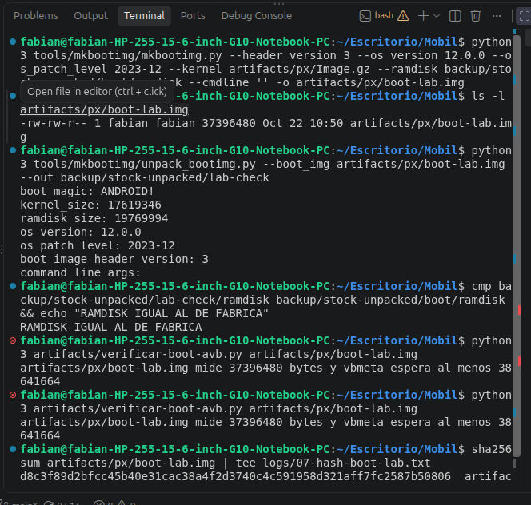
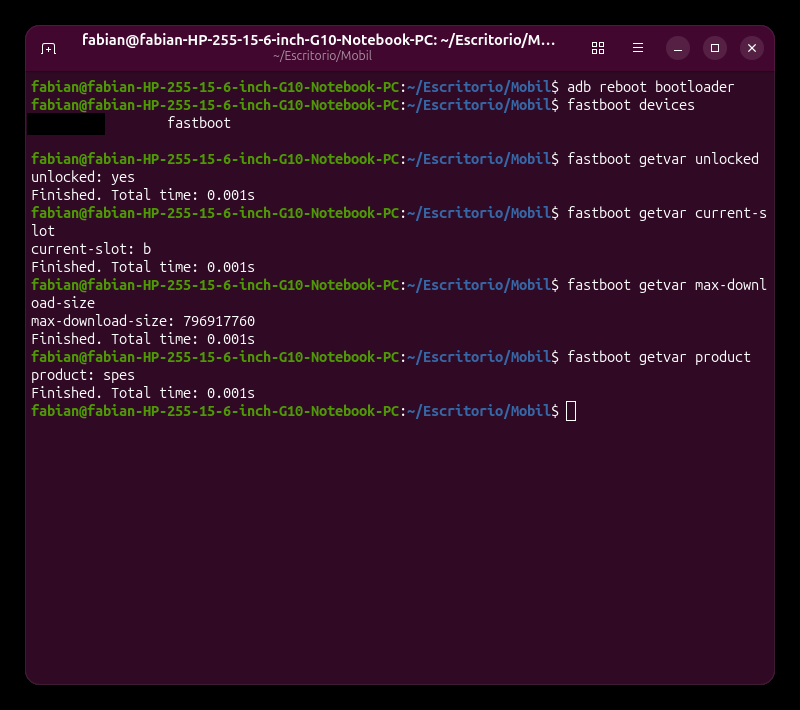
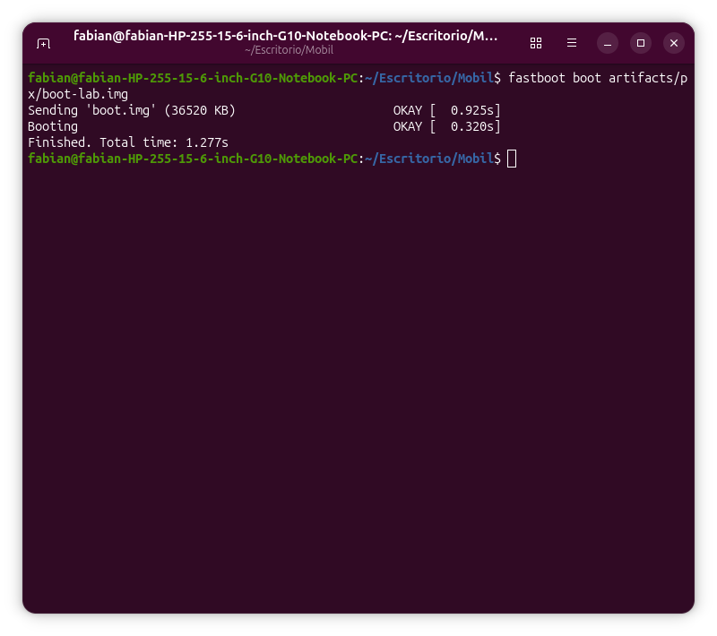
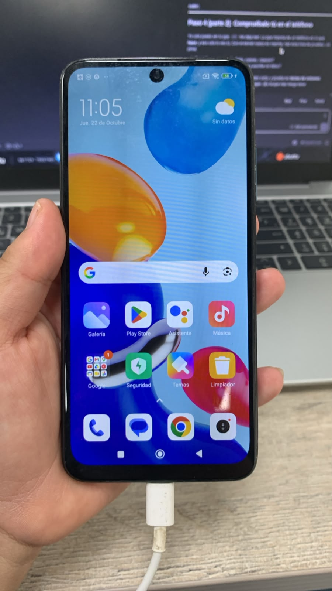
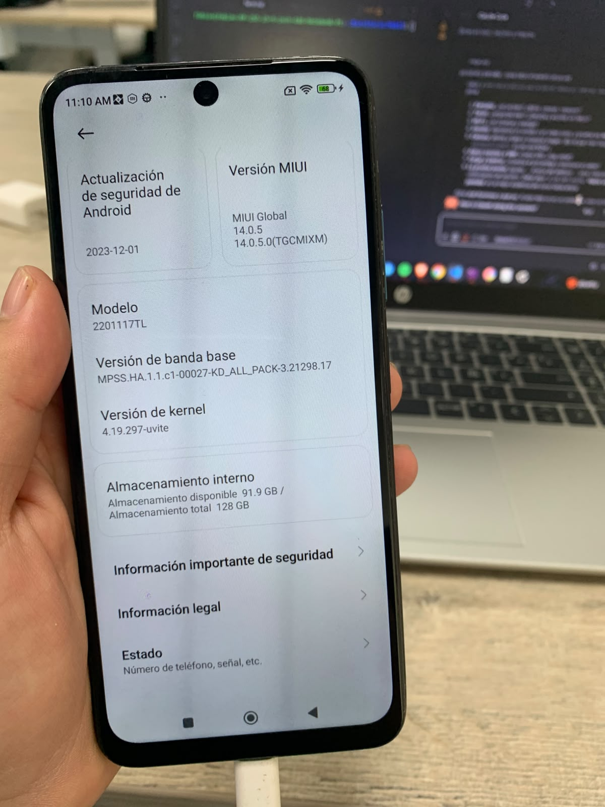
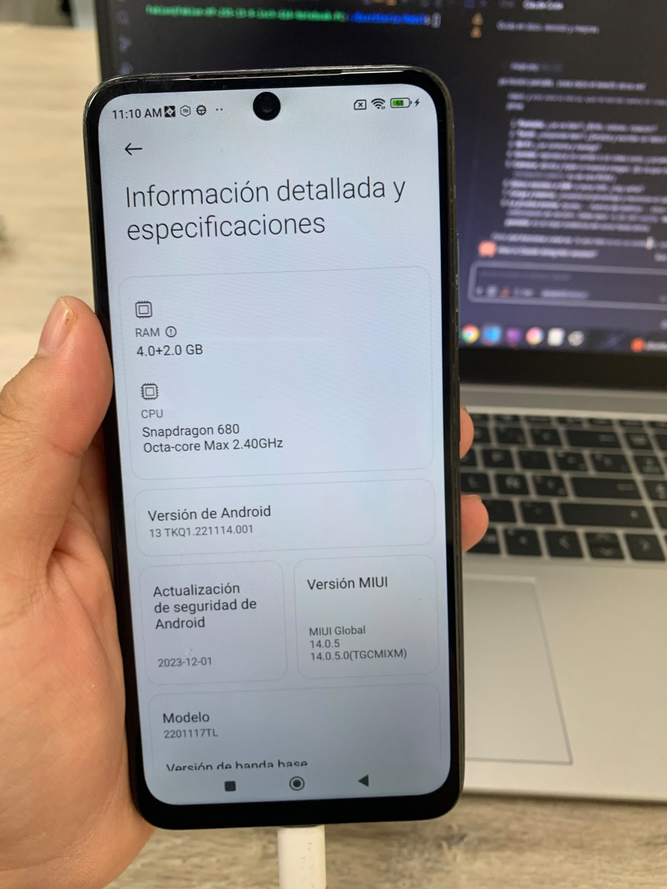
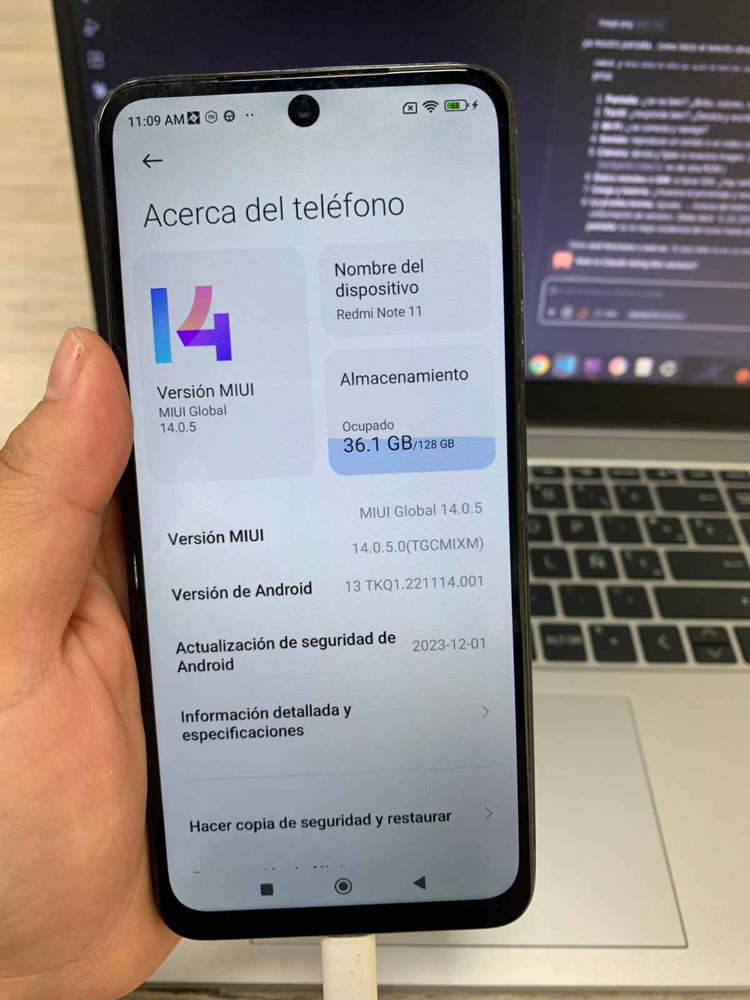
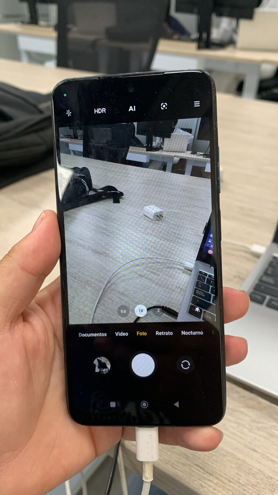
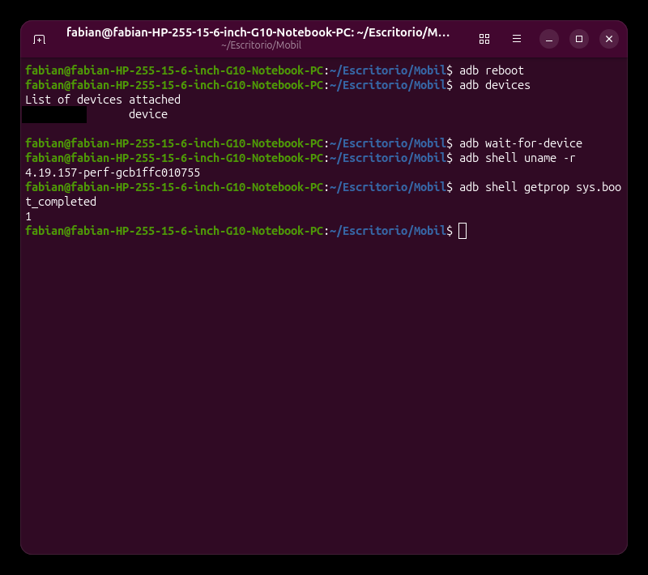

# Módulo 7 — El primer arranque con tu kernel

- Estado: Completado
- Fecha: 2026-10-22 (cierre 2026-10-22)
- Teléfono: Redmi Note 11 `spes`, Android 13 (MIUI `V14.0.5.0.TGCMIXM`), A/B slot `_b` activo, bootloader **desbloqueado** (`ro.boot.flash.locked=0`, `verifiedbootstate=orange`), batería 65 %
- Kernel de fábrica en marcha: `4.19.157-perf-gcb1ffc010755`
- Kernel a probar: `4.19.297-uvite` (`artifacts/px/Image.gz`, hash `61ee45c3…` en `logs/05-hash-px.txt`)
- Objetivo: arrancar **una vez** el teléfono con el kernel que compilaste, sin escribir nada en sus particiones, y comprobar con `uname -r` que es el tuyo.

> ⚠️ Este es el módulo de mayor riesgo del curso. **Regla: solo `fastboot boot` (arranque temporal desde la memoria). Nunca `fastboot flash`/`erase`/`set_active`.** Si algo falla, reiniciar el teléfono devuelve el kernel de fábrica, porque ninguna partición se modifica.

## Concepto

`fastboot boot imagen` no flashea: el bootloader recibe la imagen por USB, la carga en la RAM y arranca desde ahí. Al reiniciar, vuelve a leer `boot_b` (el kernel de fábrica, intacto). Es la prueba más segura que existe.

La imagen que probamos (`boot-lab.img`) es el `boot.img` de fábrica con **una sola pieza cambiada: el kernel**. Todo lo demás se queda como está: el ramdisk de `boot`, y `vendor_boot` (DTB y línea de comandos) y `dtbo` y `vbmeta` en las particiones.

## Datos de partida (módulo 6)

- Receta (validada: reproduce el original al byte): `mkbootimg --header_version 3 --os_version 12.0.0 --os_patch_level 2023-12 --kernel <kernel> --ramdisk backup/stock-unpacked/boot/ramdisk --cmdline ''`.
- Con nuestro `Image.gz` el `boot.img` pesará 37 396 480 B (35,7 MiB), frente a 38 641 664 B el de fábrica.
- `vbmeta` cubre `boot` por hash: el de nuestra imagen **no coincidirá**. Con el bootloader desbloqueado AVB debería avisar pero dejar arrancar. **[VERIFICAR]**
- `max-download-size` del bootloader: 796 917 760 B, mucho más que 37 MB.
- Riesgos conocidos: al kernel le faltan 8 funciones propias de MIUI (módulo 5, hallazgo #23); el DTB y el `dtbo` son los de fábrica (el kernel de PixelExperience los compila distinto); el ramdisk de `boot` es de tipo «recovery en boot».

## Plan

| Paso | Qué | Toca el teléfono |
|---|---|---|
| 1 | Construir `boot-lab.img` y comprobarla en el disco | No |
| 2 | Entrar en modo fastboot y comprobar el estado (`unlocked`, slot, tamaño máximo) | Sí, solo lectura |
| 3 | `fastboot boot boot-lab.img` ⚠️ | Sí, arranque temporal |
| 4 | Si arranca: confirmar `uname -r`, `dmesg`, pantalla, táctil, Wi-Fi | Sí, solo lectura |
| 5 | Reiniciar y comprobar que vuelve el kernel de fábrica | Sí |

## Práctica guiada

```bash
# Paso 1: construir boot-lab.img (receta validada, pero con NUESTRO kernel) y comprobarla en el disco
python3 tools/mkbootimg/mkbootimg.py --header_version 3 --os_version 12.0.0 --os_patch_level 2023-12 --kernel artifacts/px/Image.gz --ramdisk backup/stock-unpacked/boot/ramdisk --cmdline '' -o artifacts/px/boot-lab.img
ls -l artifacts/px/boot-lab.img                                       # 37396480
python3 tools/mkbootimg/unpack_bootimg.py --boot_img artifacts/px/boot-lab.img --out backup/stock-unpacked/lab-check
cmp backup/stock-unpacked/lab-check/ramdisk backup/stock-unpacked/boot/ramdisk && echo "RAMDISK IGUAL AL DE FABRICA"
python3 artifacts/verificar-boot-avb.py artifacts/px/boot-lab.img     # NO coincide (esperado)
sha256sum artifacts/px/boot-lab.img | tee logs/07-hash-boot-lab.txt

# Paso 2: modo fastboot, solo consultas (sin sudo)
adb reboot bootloader
fastboot devices
fastboot getvar unlocked
fastboot getvar current-slot
fastboot getvar max-download-size
fastboot getvar product

# Paso 3: arranque TEMPORAL (no escribe nada en el teléfono)
fastboot boot artifacts/px/boot-lab.img

# Paso 4: comprobaciones de solo lectura con el kernel nuevo en marcha
adb shell uname -r                       # 4.19.297-uvite
adb shell cat /proc/version
adb shell getprop sys.boot_completed     # 1
adb shell getenforce                     # Enforcing

# Paso 4 (parte 2): estado del módem y del hardware que ve el sistema (solo lectura)
adb shell getprop gsm.version.baseband
adb shell getprop gsm.sim.state                     # ABSENT,ABSENT: no hay SIM puesta
adb shell "ip -brief addr | grep -E 'rmnet|wlan0'"
adb shell "dumpsys media.camera | grep -m1 'Number of camera devices'"   # 8

# Paso 5: volver al estado de fábrica (reinicio normal; nada que deshacer porque no se flasheó)
adb reboot
adb wait-for-device
adb shell uname -r                       # 4.19.157-perf-gcb1ffc010755
adb shell getprop sys.boot_completed     # 1
```

## Hallazgos reales

1. **La conexión se validó antes de empezar:** `adb devices` → `device`; `ro.boot.flash.locked=0`, `ro.boot.verifiedbootstate=orange`, slot `_b`, Android 13, kernel `4.19.157-perf-gcb1ffc010755`, batería 65 %, depuración USB activa. Se usó `sudo adb devices` por costumbre: no hace falta, porque el usuario ya está en `plugdev` y existe `51-android.rules`; solo había un servidor `adb`, el del usuario.
2. **`boot-lab.img` construida y comprobada (Paso 1):** mide **37 396 480 bytes** (35,7 MiB de los 96 MiB de la partición: cabe de sobra), `unpack_bootimg` la lee como `ANDROID!`, `header version: 3`, `os version 12.0.0`, `os patch level 2023-12`, **`kernel_size: 17619346`** (el de nuestro `Image.gz`) y `ramdisk size: 19769994`; `cmp` confirma que el **ramdisk es idéntico** al de fábrica (`RAMDISK IGUAL AL DE FABRICA`). Solo cambió el kernel. SHA-256: `d8c3f89d2bfcc45b40e31cac38a4f2d3740c4c591958d321aff7fc2587b50806` (`logs/07-hash-boot-lab.txt`).
3. **Fallo del script `verificar-boot-avb.py` (era del mentor):** el script salía con el error `la imagen mide 37396480 bytes y vbmeta espera al menos 38641664`, porque se escribió suponiendo que la imagen nunca sería más corta que lo que declara `vbmeta`. La nuestra lo es (un kernel más pequeño). Se corrigió rellenando con ceros hasta el tamaño declarado (lo que leería AVB de una partición con relleno) y avisando de ello. Resultado tras la corrección: la imagen de fábrica **coincide** y `boot-lab.img` da `be81f7ababbc093a09b779373553b713f6a001179b9dbd09887e247755052fc0` frente a `60291945b91c009b50e0452e…`: **NO coincide**, como se esperaba. Un hash distinto es el esperado y la primera razón es obvia: la imagen mide 1 245 184 bytes menos que la original.
4. **El modo fastboot funciona y confirma el estado (Paso 2):** `fastboot devices` ve el teléfono **sin `sudo`** (la regla `udev` y el grupo `plugdev` del Módulo 1 bastan); `unlocked: yes` (el registro del otro PC decía `no` porque era anterior al desbloqueo del 13 de octubre), `current-slot: b`, `max-download-size: 796917760` (≈ 760 MiB: la imagen de 37 MB cabe de sobra) y `product: spes`. Todas son consultas (`getvar`); no se escribió nada en el teléfono. La captura mostraba el número de serie y se tapó.
5. **`fastboot boot` aceptó la imagen (Paso 3):** `Sending 'boot.img' (36520 KB) OKAY [0.925s]`, `Booting OKAY [0.320s]`, `Finished. Total time: 1.277s`. Responde dos incógnitas: el bootloader **acepta una imagen de cabecera 3 con `fastboot boot`** y **no la rechaza aunque su hash no coincida con `vbmeta`** (bootloader desbloqueado, estado `orange`). No hubo `FAILED` ni reinicio.
6. **EL TELÉFONO ARRANCÓ ANDROID CON EL KERNEL COMPILADO POR EL USUARIO.** Comprobado por `adb` después de arrancar: `uname -r` = **`4.19.297-uvite`**; `/proc/version` = `Linux version 4.19.297-uvite (fabian@fabian-HP-255-15-6-inch-G10-Notebook-PC) (Android (6443078 based on r383902) clang version 11.0.1 …)`; `uname -a` = `… #1 SMP PREEMPT Tue Oct 13 22:00:29 -05 2026 aarch64`. El de fábrica era `4.19.157-perf-gcb1ffc010755`. El kernel de PixelExperience (más nuevo, de otra ROM y sin 8 funciones de MIUI) **sí** arranca MIUI con el `vendor_boot`, el DTB y el `dtbo` de fábrica: la incógnita principal del módulo queda resuelta a favor.
7. **Android quedó completamente funcional:** `sys.boot_completed=1`, `init.svc.zygote=running`, `init.svc.surfaceflinger=running`, SELinux **`Enforcing`**, `ro.boot.verifiedbootstate=orange`, `ro.boot.flash.locked=0`, slot `_b`. `uptime` 1 min con `load average: 17.81` (pico normal de arranque). El kernel expone `wlan0`, `p2p0`, `wifi-aware0`, las interfaces del módem (`rmnet_data0…8`, `rmnet_ipa0`), la pantalla (`/sys/class/drm/card0-DSI-1`, `sde-crtc-0`) y la zona térmica `pm6125-tz` a 37 °C. El `techpack/display` y el controlador WiFi compilados en el Módulo 5 **funcionan**.
8. **Lo que el usuario `shell` no puede leer en este Android de usuario:** `dmesg` (`klogctl: Operation not permitted`), `/proc/cmdline` y `/proc/bus/input/devices` (`Permission denied`). Es la política normal de una ROM `user`; para ver el registro del kernel hará falta otra vía (Módulo 8: `pstore`/`ramoops`, `logcat`, `bugreport` o root). La línea de comandos se conoce por `vendor_boot` (módulo 6, #7).
9. **Fue un arranque temporal:** `fastboot boot` no escribió nada; `boot_b` sigue siendo el de fábrica. Al reiniciar el teléfono vuelve el kernel `4.19.157-perf-gcb1ffc010755`.
10. **El propio teléfono lo confirma:** *Ajustes → Acerca del teléfono → Versión de kernel* muestra **`4.19.297-uvite`**. En la misma pantalla: *Versión de banda base* `MPSS.HA.1.1.c1-00027-KD_ALL_PACK-3.21298.17`, modelo `2201117TL`, almacenamiento 91,9 GB libres de 128 GB. *Información detallada y especificaciones*: RAM 4,0+2,0 GB, CPU **Snapdragon 680 Octa-core Max 2.40 GHz**, Android 13 `TKQ1.221114.001`, MIUI Global 14.0.5 (`TGCMIXM`), parche de seguridad `2023-12-01`. Es la ROM de fábrica entera funcionando sobre un kernel distinto.
11. **Pruebas físicas hechas por el usuario, con el kernel nuevo: «todo funcionó»** (pantalla, táctil, Wi-Fi, sonido, cámara). La cámara muestra imagen real en el visor con sus modos (Documentos, Video, Foto, Retrato, Nocturno) y los objetivos 0.6 / 1x / 2; el sistema ve **8 dispositivos de cámara** y **46 sensores**. La pantalla de inicio de MIUI se ve normal, con Wi-Fi conectado y batería al 68 %. Con esto, el `techpack/display`, `techpack/camera` y el controlador de Wi-Fi de PixelExperience **funcionan en este teléfono con la ROM de fábrica**, a pesar de que a ese kernel le faltan las 8 funciones propias de MIUI.
12. **El módem carga, pero no se pudo probar datos/SIM:** `gsm.version.baseband` muestra el firmware `MPSS.HA.1.1.c1-00027-KD_ALL_PACK-3.21298.17`, `persist.radio.multisim.config` es `dsds` y existen las interfaces `rmnet_ipa0` y `rmnet_data0…8` (con `rmnet_data0` activa), pero **`gsm.sim.state` es `ABSENT,ABSENT`: ahora mismo el teléfono no tiene SIM puesta**, así que no hay red móvil que probar (el widget del tiempo dice «Sin datos»). La parte del módem (`rmnet`, `techpack/data`) queda como **pendiente de probar con una SIM**.
13. **Lo que el usuario `shell` no puede leer:** además de `dmesg`, `/proc/cmdline` y `/proc/bus/input/devices` (hallazgo #8), tampoco `/proc/asound/cards` (`Permission denied`). Misma causa: política de una ROM `user`.
14. **El reinicio devuelve el kernel de fábrica (Paso 5):** tras `adb reboot`, `uname -r` = **`4.19.157-perf-gcb1ffc010755`** y `sys.boot_completed = 1`; comprobado de nuevo con `uptime` (`up 3 min`: arranque nuevo), `ro.boot.verifiedbootstate = orange` y slot `_b`. Prueba que `fastboot boot` es **totalmente reversible**: no se escribió ninguna partición, y el teléfono quedó como estaba. (En la captura, `adb devices` aún listaba el teléfono justo después de `adb reboot`, porque el sistema tarda unos segundos en apagarse; `wait-for-device` esperó el nuevo arranque.)
15. **Un recuadro de tapado volvió a caer en la línea equivocada** al preparar la captura del reinicio: el número de serie estaba en la línea de `adb devices`, no en la del prompt. Se detectó al **revisar el resultado a ojo** antes de guardarla y se rehízo. Es el mismo despiste que en los módulos 2 y 5: la posición del serial cambia de una captura a otra, así que **hay que mirar cada imagen tapada, no suponer**.
16. **Resumen del módulo — lo que se aprendió:** (1) `fastboot boot` es la forma segura de probar un kernel: carga la imagen en la RAM y no escribe nada; (2) el bootloader desbloqueado **acepta una imagen de cabecera 3 aunque su hash no coincida con `vbmeta`** (estado `orange`); (3) el kernel de PixelExperience 4.19.297 **arranca MIUI 14 completa** con el `vendor_boot`, el DTB y el `dtbo` de fábrica, a pesar de que le faltan 8 funciones propias de MIUI; (4) pantalla, táctil, Wi-Fi, sonido y cámara funcionan, y el módem carga (SIM y datos sin probar: no hay SIM); (5) Ajustes muestra «Versión de kernel 4.19.297-uvite»; (6) una ROM `user` no deja leer `dmesg`, `/proc/cmdline` ni `/proc/bus/input/devices` al usuario `shell`: el Módulo 8 tendrá que resolver cómo ver el registro del kernel; (7) el procedimiento entero (construir la imagen con la receta validada, comprobarla en el disco, `fastboot boot`, verificar, reiniciar) es repetible y reversible.

## Evidencias

**01 — `boot-lab.img` construida y comprobada (hallazgos #2 y #3)**
`ls -l` con 37 396 480 B, cabecera 3 con `kernel_size: 17619346`, `RAMDISK IGUAL AL DE FABRICA`, el error del script antes de corregirlo y el `sha256sum`.


**02 — Fastboot: desbloqueado y listo (hallazgo #4)**
`fastboot devices`, `unlocked: yes`, `current-slot: b`, `max-download-size: 796917760`, `product: spes`. Número de serie tapado.


**03 — `fastboot boot` acepta la imagen (hallazgo #5)**
`Sending 'boot.img' (36520 KB) OKAY`, `Booting OKAY`, `Finished. Total time: 1.277s`. Sin errores.


**04 — La pantalla de inicio de MIUI funciona con el kernel nuevo (hallazgo #11)**
Reloj, buscador de Google, iconos, Wi-Fi conectado y batería al 68 %.


**05 — Ajustes: «Versión de kernel 4.19.297-uvite» (hallazgo #10)**
La prueba más clara de que el teléfono corre el kernel compilado por el usuario; incluye la banda base y el modelo.


**06 — Especificaciones: Snapdragon 680 (hallazgo #10)**
RAM 4,0+2,0 GB, CPU Snapdragon 680 Octa-core Max 2.40 GHz, Android 13 `TKQ1.221114.001`, MIUI Global 14.0.5.


**07 — Acerca del teléfono: MIUI 14 (hallazgo #10)**
`Redmi Note 11`, MIUI Global 14.0.5 (`TGCMIXM`), Android 13, parche `2023-12-01`, 36,1 GB ocupados de 128 GB.


**08 — La cámara muestra imagen (hallazgo #11)**
Visor con imagen real, modos Documentos / Video / Foto / Retrato / Nocturno y objetivos 0.6 / 1x / 2.


**09 — Tras el reinicio vuelve el kernel de fábrica (hallazgos #14 y #15)**
`adb reboot`, `adb wait-for-device`, `uname -r` = `4.19.157-perf-gcb1ffc010755` y `sys.boot_completed` = 1. Número de serie tapado.


## Pendientes

- [x] Paso 1: `artifacts/px/boot-lab.img` construida y comprobada (solo cambia el kernel).
- [x] Paso 2: fastboot con `unlocked: yes`, slot `b`, `max-download-size` 796917760, producto `spes`.
- [x] Paso 3: `fastboot boot` aceptado (`OKAY`) y Android arrancó.
- [x] Paso 4: `uname -r` = `4.19.297-uvite`; pantalla, táctil, Wi-Fi, sonido, cámara y Ajustes comprobados.
- [x] Paso 5: reinicio y regreso al kernel de fábrica `4.19.157-perf-gcb1ffc010755`.
- [ ] Probar datos móviles y SIM con el kernel nuevo (falta una SIM puesta: `gsm.sim.state: ABSENT`).
- [ ] Módulo 8: cómo leer el registro del kernel (`dmesg`, `pstore`/`ramoops`, `logcat`, `bugreport`) en una ROM `user`.
- [ ] Verificar la función exacta de las 8 funciones de MIUI que no están en PX y si algo de MIUI se degrada sin ellas (batería, memoria, congelado de apps).
- [ ] (Opcional) Comparar tiempos de arranque, consumo y temperatura con el kernel de fábrica.
