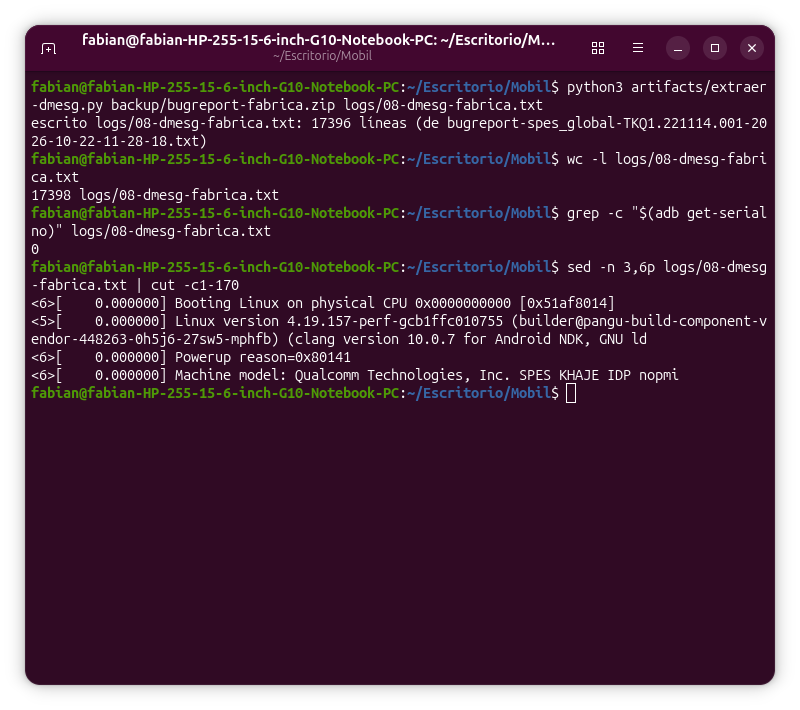
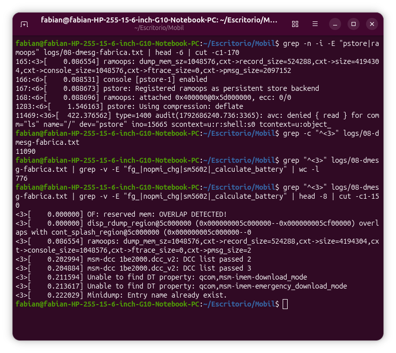
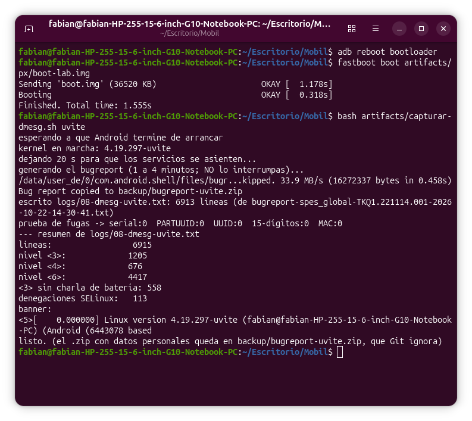
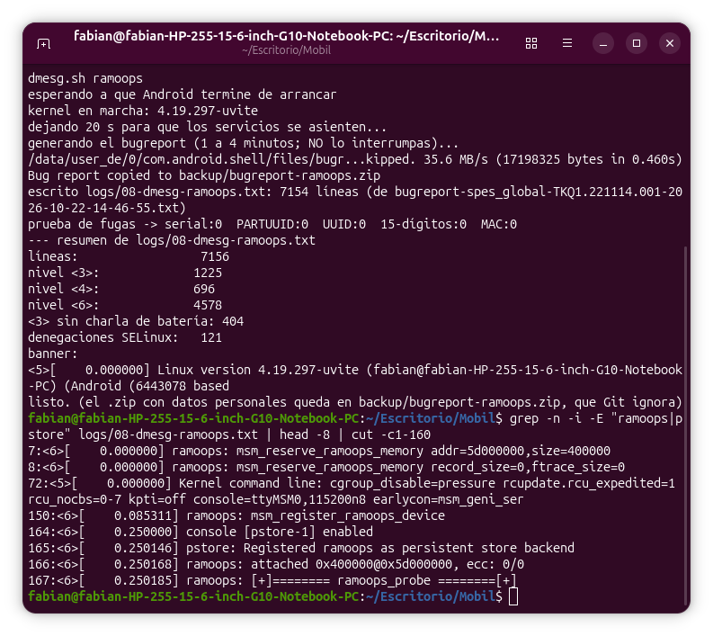
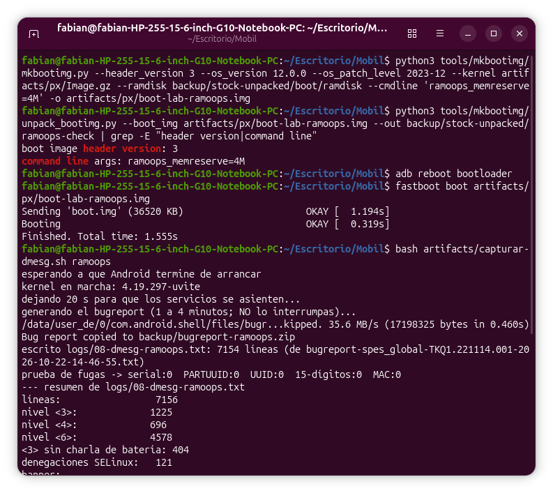

# Módulo 8 — Depuración: ver lo que dice el kernel

- Estado: En progreso
- Fecha: 2026-10-22
- Teléfono: Redmi Note 11 `spes`, ROM `user` (Android 13, MIUI `V14.0.5.0.TGCMIXM`), bootloader desbloqueado, kernel de fábrica en marcha (`4.19.157-perf-gcb1ffc010755`)
- Objetivo: poder **leer el registro del kernel** (`dmesg`) y el del arranque anterior (`pstore`) en una ROM de usuario sin root, para saber qué dice el kernel cuando algo falla. Es la base del Módulo 9 (`printk` de tu propio módulo).

## Concepto

El kernel escribe sus mensajes (`printk`) en un **búfer circular** en memoria. `dmesg` lo lee. En una ROM `user` el usuario `shell` de `adb` no puede (`klogctl: Permission denied`). Hay tres vías:

1. **`adb bugreport`**: el sistema vuelca, con privilegios propios, el `dmesg` dentro de un `.zip`. No necesita root. Contiene también datos personales, así que **el `.zip` nunca va a Git**.
2. **`pstore`/`ramoops`**: parte de la RAM se reserva y el kernel guarda ahí su consola y los *panics*; **sobrevive a un reinicio**. Es la única forma de ver *por qué* se reinició un kernel que falló. En el siguiente arranque se lee en `/sys/fs/pstore` o `/proc/last_kmsg` (en esta ROM, solo `system`/`log`).
3. **Consola serie** (UART): ver los mensajes en directo desde el arranque; necesita hardware y soporte de kernel.

## Datos de partida (comprobados antes de empezar)

- `logcat -b kernel` no da nada (0 líneas); `/sys/fs/pstore` es `dr-xr-x--- system log` (`Permission denied` para `shell`); `/proc/last_kmsg` existe pero con permisos `-r--r-----`; `bugreportz` existe.
- Kernel de fábrica: `CONFIG_PSTORE=y`, `PSTORE_CONSOLE=y`, `PSTORE_PMSG=y`, `PSTORE_RAM=y`, `PRINTK_TIME=y`, `LOG_BUF_SHIFT=21` (búfer de 2 MiB), `MAGIC_SYSRQ=y`, `# SERIAL_MSM_GENI_EARLY_CONSOLE is not set`, `# DYNAMIC_DEBUG is not set`.
- El DT de PixelExperience reserva `ramoops@5D000000` (4 MiB: `record-size` 0x80000, `console-size` 0x100000, `pmsg-size` 0x200000). **[VERIFICAR]** que el DTB de fábrica de `vendor_boot` (el que usa el teléfono) también lo reserva.
- La línea de comandos de fábrica trae `earlycon=msm_geni_serial,0x4a90000`, pero sin `SERIAL_MSM_GENI_EARLY_CONSOLE` esa consola temprana no tiene efecto. **[VERIFICAR]**

## Plan

| Paso | Qué | Toca el teléfono |
|---|---|---|
| 1 | `adb bugreport` con el kernel de fábrica (el `.zip` queda en `backup/`) | Solo lectura |
| 2 | Extraer **solo** `dmesg` y `LAST KMSG`, ya con serial/MAC tapados (`artifacts/extraer-dmesg.py`) | No |
| 3 | Leer ese `dmesg`: banner, línea de comandos real, inicio de `pstore`, errores | No |
| 4 | Repetirlo con tu kernel (`fastboot boot` temporal) y **comparar** | Arranque temporal |
| 5 | ¿Hay `ramoops` en el DTB de fábrica? (separar y descompilar el DTB de `vendor_boot`) | No |

## Práctica guiada

```bash
# Paso 1: informe de depuración (el .zip contiene datos personales: queda en backup/, que Git ignora)
adb devices
adb bugreport backup/bugreport-fabrica.zip
ls -lh backup/bugreport-fabrica.zip                       # 16M
unzip -l backup/bugreport-fabrica.zip | head -15          # solo lista, no extrae

# Paso 2: extraer SOLO el registro del kernel, con identificadores tapados
python3 artifacts/extraer-dmesg.py backup/bugreport-fabrica.zip logs/08-dmesg-fabrica.txt
wc -l logs/08-dmesg-fabrica.txt                           # 17398
grep -c "$(adb get-serialno)" logs/08-dmesg-fabrica.txt   # 0  (prueba de fugas)
sed -n 3,6p logs/08-dmesg-fabrica.txt | cut -c1-170

# Paso 3: leer el dmesg con grep (todo sobre el archivo, solo lectura)
grep -n -i -E "pstore|ramoops" logs/08-dmesg-fabrica.txt | head -6 | cut -c1-170
grep -c "^<3>" logs/08-dmesg-fabrica.txt                                  # 11090
grep "^<3>" logs/08-dmesg-fabrica.txt | grep -v -E "fg_|nopmi_chg|sm5602|_calculate_battery" | wc -l     # 776
grep "^<3>" logs/08-dmesg-fabrica.txt | grep -v -E "fg_|nopmi_chg|sm5602|_calculate_battery" | head -8 | cut -c1-150
```

## Hallazgos reales

1. **Qué puede leer el usuario `shell` en una ROM `user` (comprobado):** `logcat -b kernel` → 0 líneas; `ls /sys/fs/pstore` → `Permission denied` (el directorio es `dr-xr-x--- system log`); `/proc/last_kmsg` → `-r--r----- system log`; ya sabíamos que `dmesg`, `/proc/cmdline`, `/proc/bus/input/devices` y `/proc/asound/cards` dan `Permission denied`. Sí existe `/system/bin/bugreportz`.
2. **`SERIAL_MSM_GENI_EARLY_CONSOLE` está apagado en el kernel de fábrica** (`# CONFIG_SERIAL_MSM_GENI_EARLY_CONSOLE is not set`), aunque la línea de comandos pide `earlycon=msm_geni_serial,0x4a90000`: esa consola temprana no tiene efecto. **[VERIFICAR]** cuando se lea el `dmesg`.
3. **El árbol de PixelExperience reserva memoria para `ramoops`** (`techpack`/`khaje.dtsi` línea 450): `ramoops@5D000000`, 4 MiB, `record-size 0x80000`, `console-size 0x100000`, `pmsg-size 0x200000`. El kernel de PX trae `PSTORE`; falta saber si el DTB de fábrica también lo reserva.
4. **`adb bugreport` funciona sin root:** copia **16 MB** en 0,45 s a `backup/bugreport-fabrica.zip`. El zip trae `version.txt`, `proto/*_CRITICAL.proto`, el `bugreport-spes_global-TKQ1.221114.001-….txt` y las carpetas de **MQSAS**, el sistema de estabilidad de MIUI (`FS/mnt/rescue/mqsas/stabilityrecord/LocalKernelExceptionRecord.txt`, `LocalHangRecord.txt`, `BootFailure/BootFailure_spes_V14.0.2.0…zip`, `UnhealthyBootLog/…`, `android-kmsg.txt` de 1,9 MB). Es material muy personal y de MIUI: **el zip nunca se abre ni se publica**; solo lo procesa el script.
5. **`artifacts/extraer-dmesg.py` extrae `KERNEL LOG (dmesg)` (17 396 líneas) y `LAST KMSG` (vacía: no hubo ningún *panic* previo) con los identificadores tapados.** Se probó contra el zip real y con una **prueba de fugas** (`grep -c "$(adb get-serialno)"` = 0). Al leer el resultado se vio que la línea de comandos incluía `androidboot.vbmeta.device=PARTUUID=5f899e57-…`, el **identificador único de una partición**, que el script no tapaba. Se añadieron `PARTUUID=` y los UUID genéricos y se regeneró; las pruebas dan 0 para serial, `PARTUUID`, UUID, números de 15 dígitos y MAC. Lección: **una prueba de fugas no basta con el serial; hay que leer el contenido y preguntarse qué más identifica al aparato.**
6. **Hay 11 090 líneas de nivel `ERR` (`<3>`) sobre 17 398, pero no son errores reales:** son los controladores de batería y carga de Xiaomi, que imprimen su estado con `pr_err`: `fg_read_temperature` y `_calculate_battery_temp_ex` (932 veces cada uno), `fg_read_current` (669), `fg_get_property` (469) y `nopmi_cv_step_monitor_work` (352 y 306). **El nivel lo elige el autor del controlador, no mide la gravedad real.** Por eso un `dmesg | grep err` en este teléfono es inútil si no se filtra primero esa charla. Distribución: `ALERT` 2, `ERR` 11 090, `WARN` 741, `NOTICE` 213, `INFO` 4 677, `DEBUG` 22.
7. **`pstore`/`ramoops` ya funciona en el kernel de fábrica y el DTB de fábrica sí reserva la memoria** (responde el **[VERIFICAR]** del plan): `ramoops: dump_mem_sz=1048576, record_size=524288, size=4194304, console_size=1048576, ftrace_size=0, pmsg_size=2097152`; `console [pstore-1] enabled`; `pstore: Registered ramoops as persistent store backend`; `ramoops: attached 0x400000@0x5d000000, ecc: 0/0`; `pstore: Using compression: deflate`. Es **la misma reserva** (`0x5d000000`, 4 MiB) que el DT de PixelExperience. Un *panic* de nuestro kernel dejará su rastro en `/sys/fs/pstore`, que `shell` no puede leer (hay que usar `LAST KMSG` del `bugreport` o root).
8. **La consola temprana de la línea de comandos no hace nada**, tal como se sospechaba: aunque `earlycon=msm_geni_serial,0x4a90000` está en la línea de comandos, el `dmesg` **no contiene ninguna línea `bootconsole` ni de `earlycon`** (coherente con `# CONFIG_SERIAL_MSM_GENI_EARLY_CONSOLE is not set`). Para ver el arranque por UART habría que activarla en nuestro kernel.
9. **La línea de comandos real del kernel** (ya sin identificadores) es la de `vendor_boot` más lo que añade el bootloader y el DT: `cgroup_disable=pressure rcupdate.rcu_expedited=1 rcu_nocbs=0-7 kpti=off console=ttyMSM0,115200n8 earlycon=msm_geni_serial,0x4a90000 androidboot.hardware=qcom … buildvariant=user androidboot.verifiedbootstate=orange androidboot.keymaster=1 androidboot.vbmeta.device=PARTUUID=[TAPADO] androidboot.vbmeta.avb_version=1.0 androidboot.vbmeta.device_state=unlocked androidboot.vbmeta.hash_alg=sha256 androidboot.vbmeta.size=7360 androidboot.vbmeta.digest=7ddb33b4… androidboot.vbmeta.invalidate_on_error=yes androidboot.veritymode=enforcing androidboot.bootdevice=4804000.ufshc androidboot.fstab_suffix=default androidboot.boot_devices=soc/4804000.ufshc androidboot.serialno=[TAPADO] androidboot.cpui`. **Termina cortada** en `androidboot.cpui` (940 caracteres). **Corrección:** antes se atribuyó al kernel, pero el `COMMAND_LINE_SIZE` de arm64 es **4 096**, así que no es su límite; el recorte lo introduce el bootloader, `printk` o el volcado de `dumpstate`. **[VERIFICAR]**
10. **SELinux registra 212 denegaciones (`avc: denied`) en 713 s de funcionamiento**, entre ellas la nuestra: a los 422 s, `comm="ls" name="/" dev="pstore" … scontext=u:r:shell:s0`, es decir, nuestro `ls /sys/fs/pstore` desde `adb shell` (hallazgo #1). Se ven también 754 mensajes de `binder`. El último registro del `dmesg` es el instante 713,5 s.
11. **Filtrando la charla de la batería, de los 11 090 mensajes `<3>` quedan 776** (comprobado por el usuario con `grep -v`). Y esos 776 siguen siendo en su mayoría charla: el monitor del cargador (`bq…_monitor_workfunc`, 139; `bq…_usb_changed_workfunc`, 80) y `USBPD-PM` (152). Por tiempo: **288** en los primeros 5 s (arranque del kernel), 130 entre los 5 y 30 s y **358** después de los 30 s. Los errores genuinos de arranque son unas pocas familias: `OF: reserved mem: OVERLAP DETECTED!` y `disp_rdump_region@5c000000 … overlaps with cont_splash_region@5c000000` (dos regiones de memoria reservada del DT de Xiaomi se solapan: un error de su Device Tree, inofensivo), `Unable to find DT property: qcom,msm-imem-download_mode` y `…emergency_download_mode` (el DT no define las propiedades del modo de volcado de memoria), `Minidump: Entry name already exist`, `msm_mem_dump soc:mem_dump: Mini dump entry failed`, `OF: graph: no port node found in /soc/cti@…` (12), `ufshcd_slave_configure` y mensajes de `ipa`. **Estos son la línea base con el kernel de fábrica** para comparar con el de PixelExperience (Paso 4).
12. **Una prueba de captura automática** (`artifacts/capturar-dmesg.sh <etiqueta>`): espera a que Android termine de arrancar, genera el `bugreport` en `backup/`, extrae el `dmesg` limpio a `logs/08-dmesg-<etiqueta>.txt`, hace la **prueba de fugas** (serial, `PARTUUID`, UUID, 15 dígitos, MAC) y **borra la salida si encuentra alguna**.
13. **Generar un `bugreport` tarda de 1 a 4 minutos en este teléfono** (el del usuario, 11:28→11:29; uno de prueba, 14:03→14:07). Dos pruebas del script se cortaron desde la laptop a los 40 y 200 segundos con `timeout`; **el teléfono siguió generando el informe** (aparecieron dos `.zip` de ≈ 16 MB en `/bugreports/`) y una tercera orden recibió `adb: device failed to take a zipped bugreport: Failed to connect to dumpstatez service: No such file or directory`. Regla: **no interrumpir `adb bugreport`**; si se interrumpe, esperar unos minutos antes de repetirlo. Los informes quedan además almacenados en el teléfono (`/bugreports/`, `/data/user_de/0/com.android.shell/files/bugreports/`).
14. **Otro fallo de la prueba, este del entorno:** la salida del script no se veía porque `| tail -16` solo imprime cuando termina el proceso, y el proceso fue cortado por `timeout`. Con `bash -x` y la salida a un archivo se vio exactamente dónde se quedaba (en `adb bugreport`). Lección de depuración: cuando un comando «no imprime nada», **redirigir a un archivo y leerlo** da más información que encadenar un `tail`.
15. **`capturar-dmesg.sh` admite reutilizar un zip** (`bash artifacts/capturar-dmesg.sh <etiqueta> <zip>`) para repetir el análisis sin esperar. Probado con el zip de fábrica: el resultado es **idéntico** (`cmp`) al `logs/08-dmesg-fabrica.txt` ya generado, y la prueba de fugas da 0. Con un filtro más amplio de la charla del hardware (batería `fg_`/`nopmi_chg`/`sm5602`/`bq…`, `USBPD`, `xm_pd`), los `<3>` que quedan son **370**.
16. **Captura con el kernel nuevo (Paso 4):** `fastboot boot artifacts/px/boot-lab.img` (`Sending 'boot.img' (36520 KB) OKAY [1.178s]`, `Booting OKAY [0.318s]`) y `bash artifacts/capturar-dmesg.sh uvite`: `kernel en marcha: 4.19.297-uvite`, `bugreport` de 16 272 337 bytes, `logs/08-dmesg-uvite.txt` con 6 913 líneas, **prueba de fugas todo a 0**. Resumen: `<3>` 1 205, `<4>` 676, `<6>` 4 417, 558 `<3>` sin la charla de hardware, 113 denegaciones de SELinux.
17. **Los números brutos no son comparables, la ventana de tiempo sí:** el `dmesg` de fábrica cubre **713 s** y el nuestro **108 s**. En los **primeros 108 s**: fábrica 6 617 líneas y **365** `<3>` filtrados; uvite 6 907 líneas y **558**. La **línea de comandos es idéntica** en los dos arranques (`diff`, 940 caracteres). Con nuestro kernel casi no aparece la charla de batería (1 205 `<3>` contra 11 090): los controladores de carga de PixelExperience son más silenciosos que los de Xiaomi.
18. **`pstore`/`ramoops` NO funciona con nuestro kernel** (en el de fábrica sí, hallazgo #7): `ramoops: msm_register_ramoops_device`, `ramoops: The memory size and the record/console size must be non-zero` y `ramoops: probe of ramoops.0 failed with error -22`. Causa: el `fs/pstore/ram.c` del árbol de PixelExperience tiene un parche (líneas 982-1023) que registra un dispositivo `ramoops` **fijo** (`ramoops_dev`, `core_initcall`) cuyos datos (`ramoops_data`) están a **cero** salvo que el kernel reciba el parámetro de arranque **`ramoops_memreserve=<tamaño>`** (`early_param`; fija la dirección `0x5D000000`, `console_size = tamaño/2`, `pmsg_size = tamaño/2` y `dump_oops = 1`). Ninguna línea de comandos lo trae (0 apariciones en ambos logs), así que `mem_size == 0` y el probe devuelve `-EINVAL` (-22) (`fs/pstore/ram.c:763`). El nodo `ramoops@5D000000` del Device Tree que usa el kernel de fábrica no se aprovecha. **Consecuencia: si nuestro kernel entra en *panic*, no quedará ningún rastro.**
19. **Errores que solo tiene nuestro kernel (misma ventana de 108 s):** `elliptic_system_configuration_param_get` (66) y `[ELUS] … get ELLIPTIC_SYSTEM_CONFIGURATION_CUSTOM_SETTING` (32), del sensor de proximidad ultrasónico de Elliptic Labs; `msm_dwc3_perf_vote_work` (52), charla del USB; el amplificador de audio Awinic, `aw…_show_current_profile_index: not found struct` (20); y el **audio**: `msm-pcm-routing … mux AUDIO_REF_EC_UL10 MUX has no paths` (13), `bengal-asoc-snd … no source widget found for DMIC1_OUTPUT` (12), `Failed to add route DMIC1_OUTPUT -> …` (12) y `no source widget found for MINS_TX` (5): el controlador de audio de PixelExperience define rutas de micrófono digital (DMIC) que el hardware o el DT de fábrica no tienen. Además USB `unexpected PWR_EVNT` (6) y `power supply error when setting property` (4), y `palm_sensor_store has not implement` (4). El usuario comprobó que el **sonido** funciona; **el micrófono no se ha probado**. **[VERIFICAR]**
20. **Errores que solo tiene el kernel de fábrica (misma ventana):** `wlan: read_all_reg` (16), `OF: graph: no port node found in /soc/cti@…` (12), `[FTS_TS/E]fb_notifier_callback` (10, el táctil de Focaltech), `msm-usb-hsphy … clocks_enabled` (7), `ipa_rm … IPA RM was not initialized` (4) y `ASoC: CODEC DAI btfm_bt_sco_a2dp_slim_rx not registered` (4).
21. **`LAST KMSG` está vacío en los dos informes** (3 líneas). En el de fábrica, porque no hubo *panic*; en el de uvite, además, porque `ramoops` no arrancó (hallazgo #18).
22. **`pstore` funciona con nuestro kernel añadiendo `ramoops_memreserve=4M` a la línea de comandos de `boot-lab.img` (Paso 5), sin recompilar.** Imagen: `mkbootimg … --cmdline 'ramoops_memreserve=4M' -o artifacts/px/boot-lab-ramoops.img`; `unpack_bootimg` confirma `command line args: ramoops_memreserve=4M`. En el `dmesg` del nuevo arranque (`logs/08-dmesg-ramoops.txt`, 7 154 líneas): `ramoops: msm_reserve_ramoops_memory addr=5d000000,size=400000` y `record_size=0,ftrace_size=0` (t=0), `console [pstore-1] enabled`, `pstore: Registered ramoops as persistent store backend`, `ramoops: attached 0x400000@0x5d000000, ecc: 0/0` y `{cxt}: physical address: 0x5d000000, memory size: 400000, record size: 0, console size: 200000`. **Ya no aparece el `failed with error -22`.** Es el primer cambio hecho por el usuario a la configuración de arranque, y confirma la causa del hallazgo #18 (el parche de PixelExperience en `fs/pstore/ram.c`).
23. **El `cmdline` de `boot.img` se une en el MEDIO de la línea final** (con la cabecera v3): en la línea real, `ramoops_memreserve=4M` es el parámetro nº 17, después de lo de `vendor_boot` y antes de los `androidboot.*` que añade el bootloader. La línea sigue terminando cortada: pasa de 940 a **944 caracteres** y el único cambio es `+ ramoops_memreserve=4M` y `− androidboot.cpui` (el último token se pierde al meter 21 caracteres más). Es decir, hay un **límite fijo de ≈ 944 caracteres en lo que se registra** (el `COMMAND_LINE_SIZE` del kernel es 4 096, así que no es el kernel). Para añadir parámetros al arranque: **ponerlos en `boot.img`, que caen antes del corte**. **[VERIFICAR]** quién impone el límite.
24. **`record_size=0`:** con `ramoops_memreserve` el parche reparte la memoria a mitades (consola 2 MiB + `pmsg` 2 MiB) y deja `record_size` en 0. Se guardará la **consola** (donde queda el mensaje de un *panic*) y `pmsg`, pero **no los volcados de *oops*** que sí guardaba el kernel de fábrica (`record_size=524288`). Es suficiente para depurar.
25. **`ramoops` se registra más tarde con nuestro kernel:** `pstore: Registered ramoops` a los **0,250 s**, frente a los 0,0886 s del kernel de fábrica. Los mensajes anteriores a 0,25 s de un arranque no estarían en `pstore`.
26. **Un segundo arranque idéntico es casi igual al primero:** `<3>` 1 225 (antes 1 205), `<4>` 696 (676), `<6>` 4 578 (4 417), 404 `<3>` sin la charla de hardware (antes 558) y 121 denegaciones de SELinux (113), en 153 s de registro (antes 108 s). Las diferencias son de ventana de tiempo, no del cambio.

## Evidencias

**01 — Extracción del `dmesg` y prueba de fugas (hallazgos #5 y #6)**
`extraer-dmesg.py` produce `logs/08-dmesg-fabrica.txt` de 17 396 líneas (17 398 con `wc`), la prueba de fugas da `0` y se ven las primeras líneas (`Booting Linux`, `Linux version 4.19.157-perf-gcb1ffc010755`, `Machine model: … SPES KHAJE IDP nopmi`).


**02 — Leer el `dmesg` con `grep` (hallazgos #7 y #11)**
Las líneas de `pstore`/`ramoops` (165-168), 11 090 mensajes de nivel `<3>`, **776** tras quitar la batería y los primeros 8: `OF: reserved mem: OVERLAP DETECTED!`, `disp_rdump_region … overlaps with cont_splash_region`, `Unable to find DT property: qcom,msm-imem-download_mode`, `Minidump: Entry name already exist`.


**03 — Captura del `dmesg` con el kernel nuevo (hallazgos #16 y #17)**
`fastboot boot` con `OKAY`, `kernel en marcha: 4.19.297-uvite`, el `bugreport` de 16 272 337 bytes, la prueba de fugas a 0 y el resumen del registro.


**04 — `pstore` funciona con `ramoops_memreserve=4M` (hallazgos #22 y #24)**
`grep` sobre `logs/08-dmesg-ramoops.txt`: `msm_reserve_ramoops_memory addr=5d000000,size=400000`, `console [pstore-1] enabled`, `Registered ramoops as persistent store backend` y `attached 0x400000@0x5d000000`.


**05 — Construir la imagen con el parámetro, arrancarla y capturar (hallazgos #22 y #23)**
`mkbootimg --cmdline 'ramoops_memreserve=4M'`, `command line args: ramoops_memreserve=4M`, `fastboot boot` con `OKAY` y el resumen del script con la prueba de fugas a 0.


## Pendientes

- [x] Paso 1: `adb bugreport` con el kernel de fábrica (16 MB, en `backup/`).
- [x] Paso 2: `dmesg` y `LAST KMSG` extraídos y sin datos personales (`logs/08-dmesg-fabrica.txt`, prueba de fugas = 0).
- [x] Paso 3 (análisis del mentor): cmdline real, `pstore`/`ramoops` activo, `earlycon` inerte, charla de la batería a nivel ERR.
- [x] Paso 3 (el usuario): búsquedas con `grep` en `logs/08-dmesg-fabrica.txt`: 11 090 `<3>` → 776 sin batería.
- [x] Paso 4: `dmesg` con tu kernel capturado y comparado (misma ventana de 108 s): `pstore` NO funciona con nuestro kernel; hay errores de audio (DMIC) y de Elliptic solo en el nuestro.
- [x] Paso 5: `pstore` funciona con nuestro kernel añadiendo `ramoops_memreserve=4M` a la línea de comandos de `boot-lab.img` (sin recompilar).
- [ ] Paso 6: comprobar que `pstore` GUARDA: reiniciar en caliente con la misma imagen y leer `LAST KMSG` (debe traer la consola del arranque anterior).
- [ ] Probar el micrófono (grabar un audio) con nuestro kernel.
- [x] Paso 5: ¿`ramoops` en el DTB de fábrica? **Sí**: `attached 0x400000@0x5d000000` (hallazgo #7). No hizo falta descompilar el DTB.
- [ ] (Módulo 13) Provocar un *panic* controlado y leerlo desde `pstore`: requiere root (`echo c > /proc/sysrq-trigger`).
