# Módulo 9 — Tu primer módulo del kernel, en C

- Estado: En progreso
- Fecha: 2026-10-22
- Kernel: `4.19.297-uvite` (`src/kernel-px`, salida en `out-px/`), compilado con Clang 11.0.1 de AOSP
- Imagen de prueba: `artifacts/px/boot-lab-ramoops.img` (con `ramoops_memreserve=4M`, módulo 8)
- Objetivo: escribir **a mano** un módulo en C, compilarlo contra tu kernel, entender qué lleva dentro (`vermagic`, símbolos) y hacerlo correr **dentro del teléfono**, leyendo su `printk` con las herramientas del módulo 8.

## Concepto

Un **módulo del kernel** es código que se añade al kernel en marcha, sin recompilarlo entero. Tiene dos puntos de entrada: `module_init(f)` (se ejecuta al cargarlo) y `module_exit(f)` (al descargarlo). Sus mensajes se escriben con `printk` (o `pr_info`, `pr_err`…) en el mismo búfer circular que lee `dmesg`.

Dos formas de llevar código al kernel:

| | Módulo (`.ko`) | Integrado (*built-in*) |
|---|---|---|
| Cuándo corre | Cuando alguien ejecuta `insmod` | Siempre, en el arranque del kernel |
| Cómo se compila | Aparte, con `obj-m` | Dentro de `vmlinux`, con `obj-y` |
| ¿Necesita root en el teléfono? | **Sí** (`insmod`) | **No**: lo arranca `fastboot boot` |

Esta ROM es de usuario: no se puede ser root, así que **no se puede ejecutar `insmod`** sin KernelSU (módulo 13). Por eso el plan es: (1) escribirlo y compilarlo como módulo para aprender lo que lleva (`modinfo`, `vermagic`), y (2) **integrarlo en el kernel** y arrancarlo, que no necesita root y deja ver su `printk` en el `dmesg`.

## Datos de partida (comprobados)

- `CONFIG_MODULES=y`, `MODULE_UNLOAD=y`, `MODVERSIONS=y`, `# CONFIG_MODULE_SIG is not set`, `CONFIG_PROC_FS=y`, `PRINTK=y`, `PRINTK_TIME=y`, `CONSOLE_LOGLEVEL_DEFAULT=7`, `MESSAGE_LOGLEVEL_DEFAULT=4`.
- **`proc_ops` no existe en este kernel** (llegó en la 5.6): un nodo en `/proc` se crea con `proc_create(nombre, modo, padre, const struct file_operations *)`.
- `vermagic` que llevará el `.ko`: `4.19.297-uvite SMP preempt mod_unload modversions aarch64` (`SMP`, `PREEMPT`, `MODULE_UNLOAD` y `MODVERSIONS` activos).
- El código fuente de los módulos vive en `modulos/` (versionado); sus salidas (`*.ko`, `*.o`…) están ignoradas por Git (`modulos/.gitignore`).
- `kmake M="$LAB/modulos/hello_lab" modules` compila un módulo externo con el mismo Clang, el mismo `.config` y las mismas opciones que el kernel.

## Plan

| Paso | Qué | Toca el teléfono |
|---|---|---|
| 1 | Escribir `hello_lab.c` (solo `printk`) a mano y compilarlo como `.ko` | No |
| 2 | Inspeccionar el `.ko`: `file`, `modinfo`, `vermagic`, símbolos, comparar con el kernel | No |
| 3 | Añadir un nodo `/proc/hello_lab` con `seq_file` y volver a compilar | No |
| 4 | Integrarlo en el árbol del kernel (`drivers/misc`, `Kconfig`, `Makefile`) y recompilar el kernel | No |
| 5 | Arrancar con `fastboot boot` y leer su `printk` en el `dmesg` | Arranque temporal |
| 6 | Leer `/proc/hello_lab` desde `adb shell` | Solo lectura |

## Práctica guiada

```bash
# Paso 1: entorno + código escrito a mano (modulos/hello_lab/hello_lab.c y Makefile) + compilar
export KSRC="$HOME/Escritorio/Mobil/src/kernel-px"
export KOUT="$HOME/Escritorio/Mobil/out-px"
source artifacts/build-env.sh                  # define $LAB y la función kmake (solo vive en esa terminal)
kmake M="$LAB/modulos/hello_lab" modules 2>&1 | tail -15
ls -l modulos/hello_lab/

# Paso 2: inspeccionar el .ko (solo lectura)
file modulos/hello_lab/hello_lab.ko
modinfo modulos/hello_lab/hello_lab.ko
tools/clang-r383902/bin/llvm-nm modulos/hello_lab/hello_lab.ko | grep -E " (T|U|D) "
tools/clang-r383902/bin/llvm-objdump -d --section=.init.text modulos/hello_lab/hello_lab.ko

# Paso 3: hello_lab.c con nodo /proc/hello_lab (seq_file). Atajo para el entorno en una terminal nueva:
source ~/Escritorio/Mobil/artifacts/entorno-px.sh        # = export KSRC, KOUT + source build-env.sh
kmake M="$LAB/modulos/hello_lab" modules 2>&1 | tail -8
grep -n -i "out of memory" src/kernel-px/include/uapi/asm-generic/errno-base.h    # 16:#define ENOMEM 12 /* Out of memory */
tools/clang-r383902/bin/llvm-nm modulos/hello_lab/hello_lab.ko | grep " U "      # 9 símbolos
ls -l modulos/hello_lab/hello_lab.ko                                              # 137176
strings modulos/hello_lab/hello_lab.ko | grep -E "hello_lab:|description="
# Paso 4: integrar en el kernel (3 piezas: archivo .c por enlace simbólico, Kconfig y Makefile) y activar la opción
ln -s ../../../../modulos/hello_lab/hello_lab.c src/kernel-px/drivers/misc/hello_lab.c
# (entrada config HELLO_LAB añadida al final de src/kernel-px/drivers/misc/Kconfig: bool, depends on PROC_FS, default n)
printf 'obj-$(CONFIG_HELLO_LAB)\t+= hello_lab.o\n' >> src/kernel-px/drivers/misc/Makefile
src/kernel-px/scripts/config --file out-px/.config --enable HELLO_LAB
kmake olddefconfig 2>&1 | grep -v "unsupported character" | tail -4
grep -n "HELLO_LAB" out-px/.config                                   # CONFIG_HELLO_LAB=y

# Paso 5: recompilar el kernel y buscar nuestro código dentro
time kmake -j8 2>&1 | tee logs/09-build-hello.log | tail -16
ls -l out-px/drivers/misc/hello_lab.o out-px/arch/arm64/boot/Image.gz
tools/clang-r383902/bin/llvm-nm out-px/vmlinux | grep -i hello
grep -c "hello_lab" out-px/System.map                                # 3

# Paso 6: imagen con el kernel nuevo, arranque temporal y lectura
cp out-px/arch/arm64/boot/Image.gz artifacts/px/Image-hello.gz
python3 tools/mkbootimg/mkbootimg.py --header_version 3 --os_version 12.0.0 --os_patch_level 2023-12 --kernel artifacts/px/Image-hello.gz --ramdisk backup/stock-unpacked/boot/ramdisk --cmdline 'ramoops_memreserve=4M' -o artifacts/px/boot-lab-hello.img
sha256sum artifacts/px/boot-lab-hello.img | tee logs/09-hash-boot-lab-hello.txt
adb reboot bootloader
fastboot boot artifacts/px/boot-lab-hello.img
adb shell cat /proc/hello_lab                       # cat: /proc/hello_lab: Permission denied
adb shell ls -lZ /proc/hello_lab                    # ls: /proc/hello_lab: Permission denied
bash artifacts/capturar-dmesg.sh hello              # logs/08-dmesg-hello.txt (1 a 4 min; no interrumpir)
grep -n "hello_lab" logs/08-dmesg-hello.txt | cut -c1-170
```

## Hallazgos reales

1. **Antes de empezar se comprobó que el kernel lo admite todo** (ver «Datos de partida»), y que `proc_ops` no existe en 4.19: el nodo de `/proc` usa `struct file_operations`. Los módulos del fabricante no son un problema para el arranque: ya se vio en el módulo 6 que ningún ramdisk trae `.ko`.
2. **El código escrito a mano por el usuario salió idéntico al propuesto** (verificado con `cat -A`: tabuladores correctos, sin typos) y compiló a la primera. `modulos/hello_lab/hello_lab.c` mide 467 bytes y su `Makefile` (`obj-m += hello_lab.o`) 20 (sin salto de línea final: a Kbuild le da igual).
3. **`kmake` «no se encuentra» en una terminal nueva:** `kmake` no es un programa sino una **función de bash** definida por `source artifacts/build-env.sh`, y solo existe en esa terminal. Con una terminal nueva hay que volver a ejecutar los `export` y el `source`. Se diagnosticó antes de repetir probando el mismo comando en una carpeta temporal (mismo resultado: compila).
4. **Resultado de la compilación (Paso 1):** `CC [M] …/hello_lab.o`, `Building modules, stage 2.`, `MODPOST 1 modules`, `CC …/hello_lab.mod.o`, `LD [M] …/hello_lab.ko`. Se generaron `hello_lab.ko` (**30 168 bytes**), `hello_lab.o` (5 040), `hello_lab.mod.o` (26 720), `hello_lab.mod.c` (759), `modules.order` (68) y `Module.symvers` (**0 bytes**: el módulo no exporta ningún símbolo). Las salidas están ignoradas por `modulos/.gitignore`; solo el `.c` y el `Makefile` se versionan.
5. **Lo que lleva por dentro el `.ko` (comprobado por el mentor sobre una copia, 30 424 B por la ruta más larga):** `file` → `ELF 64-bit LSB relocatable, ARM aarch64 … with debug_info, not stripped`; `modinfo` → `license: GPL`, `author: fabian`, `description: Laboratorio: primer modulo`, **`vermagic: 4.19.297-uvite SMP preempt mod_unload modversions aarch64`** (exactamente el predicho), `name: hello_lab`, `depends:` vacío. Secciones: `.init.text` (0x20 = 32 B), `.exit.text` (0x1c = 28 B), `.modinfo` (0x9c), `.rodata.str1.1` (0x49, los textos), `.gnu.linkonce.this_module` (0x340 = 832 B, la `struct module`) y `__versions` (0x80, los CRC de los símbolos que importa). Símbolos: `T init_module` y `T cleanup_module` (los nombres reales que `module_init`/`module_exit` dan a tus dos funciones), `D __this_module` y **`U printk`**: la única función que no es suya y que el kernel resolverá al cargarlo.
6. **`init_module` en ARM64, 8 instrucciones (32 B):** `stp x29, x30, [sp, #-16]!` (guarda el registro de marco y el de retorno), `mov x29, sp`, `adrp x0, #0` y `add x0, x0, #0` (cargan la dirección del texto en `x0`, el primer argumento; los ceros se rellenan al cargar el módulo mediante las reubicaciones de `.rela.init.text`), `bl #0` (la llamada a `printk`, con su destino también por reubicar), `mov w0, wzr` (`return 0`), `ldp x29, x30, [sp], #16` y `ret`. Es la teoría del módulo 3 (argumentos en `x0`…, resultado en `w0`, `bl` y el registro de enlace `x30`) delante de código tuyo.
7. **El usuario abrió su `.ko` (Paso 2) y todo coincide con lo previsto:** `file` → `ELF 64-bit LSB relocatable, ARM aarch64 … BuildID[xxHash]=6b6d32c8f41a117f, with debug_info, not stripped`; `modinfo` → `license GPL`, `author fabian`, `description Laboratorio: primer modulo`, **`vermagic 4.19.297-uvite SMP preempt mod_unload modversions aarch64`**, `name hello_lab`, `depends` vacío; `llvm-nm` → `D __this_module`, `T cleanup_module`, `T init_module`, **`U printk`**; el desensamblado de `.init.text` tiene **8 instrucciones** (`stp x29,x30,[sp,#-16]!`, `mov x29,sp`, `adrp x0,#0`, `add x0,x0,#0`, **`bl #0 <init_module+0x10>`**, `mov w0,wzr`, `ldp x29,x30,[sp],#16`, `ret`). Las preguntas del mentor: `init_module` tiene 8 instrucciones y la que llama a `printk` es el `bl` de `0x10`, con destino por reubicar (por eso `printk` es `U`).
8. **Lo que ocurriría al cargarlo:** el kernel compara el `vermagic` con el suyo (si no coincide, rechaza el módulo), resuelve el `U printk` buscando ese símbolo y comprobando su CRC contra `__versions` (por `MODVERSIONS`), rellena las reubicaciones (`adrp`/`add`/`bl` a cero), y llama a `init_module`. Como no hay `insmod` sin root, se hará mediante la integración *built-in* (Paso 4).
9. **El módulo con `/proc` (versión del Paso 3) compila sin avisos** (comprobado por el mentor en una copia): importa `printk`, `proc_create`, `proc_remove`, `seq_lseek`, `seq_printf`, `seq_puts`, `seq_read`, `single_open` y `single_release`, y su `.ko` pasa a ≈ 137 KB (con la información de depuración de las nuevas estructuras).
10. **Dos terminales nuevas seguidas sin `kmake`** (el `.ko` que se veía era el viejo, de las 16:35): `kmake` es una función de bash que solo vive en la terminal donde se carga. Se creó **`artifacts/entorno-px.sh`**, que hace los dos `export` y el `source` con una sola orden desde cualquier carpeta: `source ~/Escritorio/Mobil/artifacts/entorno-px.sh`.
11. **Primer error de compilador del usuario:** `hello_lab.c:36:12: error: use of undeclared identifier 'ENOMEN'` con la flecha `^` sobre la palabra, seguido de `1 error generated.` y de tres líneas `make[2]/make[1]/make: *** … Error 1/2/2` que son **el mismo fallo subiendo de nivel**, no tres errores. Un typo de **una letra** (`ENOMEN` por `ENOMEM`, «error: no memory»). Al corregir solo la sangría, el error volvió con **`36:16`**: la columna cambió, la palabra no. Lección: **si un error no cambia, lo que se arregló no era la causa**; la columna que cambia demuestra que el compilador sí lee el archivo nuevo.
12. **Cómo encontrar el nombre correcto en el propio kernel:** `grep -n -i "out of memory" src/kernel-px/include/uapi/asm-generic/errno-base.h` → `16:#define ENOMEM 12 /* Out of memory */`. Se busca por la descripción que sí se recuerda. Hubo que mostrar las dos palabras una encima de la otra (`ENOME`**`M`** contra `ENOME`**`N`**): en la fuente de la terminal la `N` y la `M` se parecen.
13. **Compilación correcta con `/proc` (Paso 3):** `CC [M]`, `MODPOST 1 modules`, `LD [M]`; símbolos `U` (nueve): `printk`, `proc_create`, `proc_remove`, `seq_lseek`, `seq_printf`, `seq_puts`, `seq_read`, `single_open`, `single_release`; `hello_lab.ko` de **137 176 bytes** (de 30 168: crece por la información de depuración de `file_operations` y `seq_file`). Sin avisos del compilador.
14. **El compilador no ve las erratas dentro de comillas:** además de `ENOMEN` había `"…elimiando\n"` (línea 44) y `MODULE_DESCRIPTION("…nod /proc…")` (línea 52). Para el compilador lo que va entre comillas son **datos**, no nombres: se graban tal cual en el `.ko` (`strings` los mostraba: `6hello_lab: descargado, nodo /proc/hello_lab elimiando` y `description=Laboratorio: nod /proc…`) y saldrían en el `dmesg` y en `modinfo`. Solo las encuentra una persona **leyendo** la salida. Tras corregirlas, `strings` muestra `description=Laboratorio: nodo /proc de solo lectura`, `6hello_lab: cargado, nodo /proc/hello_lab creado` y `6hello_lab: descargado, nodo /proc/hello_lab eliminado` (la `6` es el nivel `INFO`, `KERN_INFO`).
15. **El `.c` final del usuario es idéntico en contenido a la referencia** (`diff -b -w`); solo difiere en espacios y tabuladores (alineación de los `=` en `file_operations`). Se versiona `modulos/hello_lab/hello_lab.c` (1 248 bytes): es código escrito a mano.

16. **Integración en el kernel (Paso 4), tres piezas:** (1) el archivo, por **enlace simbólico** `src/kernel-px/drivers/misc/hello_lab.c -> ../../../../modulos/hello_lab/hello_lab.c` (un solo archivo, el del usuario, versionado en este repositorio); (2) la opción en `drivers/misc/Kconfig` (`config HELLO_LAB`, `bool`, `depends on PROC_FS`, `default n`), añadida al final con `cat >>`; (3) `obj-$(CONFIG_HELLO_LAB) += hello_lab.o` en `drivers/misc/Makefile`. Se activó con `scripts/config --file out-px/.config --enable HELLO_LAB` y `kmake olddefconfig` terminó sin errores: `out-px/.config` línea 1590, **`CONFIG_HELLO_LAB=y`**. Al ser `bool`, el código va dentro de `vmlinux` y no existe modo módulo. El árbol de PixelExperience queda con cambios locales (`Kconfig`, `Makefile` y el enlace) y un `scripts/__pycache__/` sin seguimiento, creado por ejecutar `diffconfig` con `python3`.
17. **Recompilación incremental (Paso 5): `real 0m35,8s`** (`user 1m29`, `sys 0m54`), con 8 hilos. Solo se compiló `drivers/misc/hello_lab.o` (**115 600 bytes**) y se volvió a enlazar `vmlinux`: `LD vmlinux`, `SORTEX`, `SYSMAP`, `OBJCOPY Image`, `GZIP Image.gz`, `MODPOST 4 modules`. El resultado es `out-px/arch/arm64/boot/Image.gz` de **17 634 827 bytes** (antes 17 619 346: +15 481).
18. **Tu código dentro de `vmlinux` (`llvm-nm`):** `d __initcall_hello_lab_init6` (la entrada en la **tabla de initcalls**; el `6` es el nivel de `device_initcall`, el que corresponde a `module_init` en código integrado), `t hello_lab_init`, `t hello_open`, `t hello_show`, `d hello_fops`, `b hello_ent` (la variable global, en `.bss`) y `t hello_lab_exit`. `System.map` tiene **3** líneas con `hello_lab`. Ya no hay `init_module`, `cleanup_module` ni `__this_module` (eso era del `.ko`), y los símbolos que eran `U` en el módulo (`printk`, `proc_create`...) son ahora funciones normales del propio kernel. El `grep -i hello` también devolvió ruido ajeno (`br_set_hello_time`, `dev_attr_hello_timer`, `qrtr_hello_work`: temporizadores y trabajos *hello* de la red): el patrón era demasiado amplio.
19. **Corrección del mentor: `hello_lab_exit` SÍ está en el kernel.** Se predijo que el compilador la descartaría por ser código integrado. En `arch/arm64/kernel/vmlinux.lds.S` hay un comentario que lo explica: `/* .exit.text needed in case of alternative patching */`, con `#define ARM_EXIT_KEEP(x) x` y `#define ARM_EXIT_DISCARD(x)` (vacío): en arm64 **la sección `.exit.text` se conserva**. Lo que sí se descarta (`EXIT_CALL`, líneas 103-106) es la tabla `.exitcall.exit` de **punteros** a funciones de salida (`module_exit(x)` integrado = `__exitcall(x)`, `include/linux/init.h:257`). La función está en memoria, pero nada la llama nunca.
20. **El crecimiento de 15 KB de `Image.gz` no viene de otra opción:** `diffconfig` entre un `spes-perf_defconfig` limpio y `out-px/.config` da **una sola diferencia, `HELLO_LAB n -> y`**. La `Image` sin comprimir mide **lo mismo** que antes (36 719 104 bytes, por el redondeo de alineación). Los 15 KB son bytes que cambian al desplazarse las direcciones (tablas de reubicación y de símbolos) y comprimen peor.
21. **Incidente del mentor: un `heredoc` mal cerrado ejecutó texto del documento como comandos.** El script de actualización de este documento contenía, dentro de una cadena, una línea `EOF` (la del ejemplo de `Kconfig`); el *shell* la tomó como el final de su propio `heredoc`, Python no se ejecutó (`SyntaxError`) y **las líneas siguientes se ejecutaron como órdenes**. Efecto real: se añadió una **línea basura al final de `src/kernel-px/drivers/misc/Makefile`** (`obj-$(CONFIG_HELLO_LAB)\t+= hello_lab.o\n`, con las barras escritas literalmente y sin salto de línea). Se detectó revisando el estado antes de volver a compilar (`tail | cat -A` y `git diff`), se comprobó que el resto estaba intacto (una sola entrada en `Kconfig`, una sola línea de `HELLO_LAB` en `.config`, el repositorio principal sin tocar) y se eliminó **solo esa línea**; el `git diff` del `Makefile` quedó con exactamente `+obj-$(CONFIG_HELLO_LAB)<TAB>+= hello_lab.o`. El kernel compilado era válido porque se construyó antes. Lección: un delimitador de `heredoc` no puede aparecer dentro del texto que encierra; para scripts con texto libre, **escribir el script a un archivo** con la herramienta de edición y ejecutarlo después.

22. **Paso 6: imagen con `hello_lab` dentro y arranque temporal.** `boot-lab-hello.img` (kernel `Image-hello.gz` + ramdisk de fábrica + `cmdline 'ramoops_memreserve=4M'`), SHA-256 `99da4356e7087a1c6955ba5e390724de2e4a6aa4f4c9651d67dea78f4067402c` (`logs/09-hash-boot-lab-hello.txt`). `fastboot boot`: `Sending 'boot.img' (36536 KB) OKAY [1.195s]`, `Booting OKAY [0.317s]`, `Finished. Total time: 1.544s`. El teléfono arrancó Android con `4.19.297-uvite`.
23. **`cat /proc/hello_lab` da `Permission denied`, no `No such file or directory`** (el usuario lo ejecutó dos veces; `ls -lZ /proc/hello_lab` también: `Permission denied`). La diferencia prueba que el nodo **existe**: `cat /proc/no_existe_este` da `No such file or directory`. Es decir, `hello_lab_init` se ejecutó al arrancar y `proc_create` funcionó. Otros nodos de `/proc` sí se pueden leer (`/proc/uptime` → `167.30 789.02`, `/proc/version`).
24. **La prueba definitiva, en el `dmesg` del propio teléfono** (`logs/08-dmesg-hello.txt`, 33 607 líneas, prueba de fugas a 0; el archivo tiene el `dmesg` de esta sesión hasta la línea 8 406 y a continuación `LAST KMSG`): **`<6>[    1.195224] hello_lab: cargado, nodo /proc/hello_lab creado`**. Tu `printk`, a **1,195 s** del arranque. Aparece **después** de `pstore: Registered ramoops as persistent store backend` (0,2749 s): el `device_initcall` de nivel 6 de `hello_lab_init` corre tras el registro de `pstore`.
25. **Quién lo bloquea: SELinux, con la política de la ROM.** Cuatro denegaciones (`permissive=0`, es decir, haciéndose cumplir): dos `{ read }` de `comm="cat"` sobre `name="hello_lab"` (a los 96,8 s y 135,4 s, las dos lecturas del usuario) y dos `{ getattr }` de `comm="ls"` sobre `path="/proc/hello_lab"` (167,1 s y 167,3 s), siempre con `scontext=u:r:shell:s0`, **`tcontext=u:object_r:proc:s0`**, `tclass=file`, `dev="proc"`, `ino=4026532365`. Los nodos de `/proc` que nadie etiqueta reciben la etiqueta genérica `proc`, a la que el dominio `shell` no tiene acceso; los que se leen llevan una propia (`u:object_r:proc_uptime:s0`, `u:object_r:proc_version:s0`).
26. **Trasladar el nodo a sysfs no lo arregla** (sondeado desde `adb shell`): las entradas con etiqueta específica se leen (`/sys/class/thermal/thermal_zone0/type` → `u:object_r:sysfs_thermal:s0`, `pm6125-tz`), pero los nodos con la etiqueta genérica `sysfs` o sin etiqueta conocida dan `Permission denied` (`/sys/kernel/uevent_seqnum`, `/sys/power/state`) o aparecen como `-?????????` (`fscaps`, `notes`, `kheaders.tar.xz`, `always_kmsg_dump`, `console_suspend`). Salidas posibles: **root** (KernelSU, módulo 13), cambiar la política de SELinux de la ROM (fuera de lo que se toca) o limitarse a `printk`. `adb root` no existe en una ROM `user`.
27. **Resumen del módulo — lo que se aprendió:** (1) un módulo del kernel son dos funciones (`init`/`exit`) más metadatos; compila contra **tu** kernel (`vermagic 4.19.297-uvite SMP preempt mod_unload modversions aarch64`) y su único símbolo externo era `printk`; (2) su `init_module` son 8 instrucciones ARM64 con reubicaciones que el kernel rellena al cargarlo; (3) el compilador solo ve **nombres**, no el texto entre comillas: el typo `ENOMEN` lo paró y `elimiando`/`nod` pasaron; (4) un error de compilador se lee de izquierda a derecha (`archivo:línea:columna: error:`), las tres líneas `*** Error` de `make` son un mismo fallo, y si un error no cambia es que no se arregló la causa; (5) `/proc` en 4.19 usa `file_operations` + `seq_file` (en 5.6+ es `proc_ops`), y **la limpieza (`proc_remove`) es obligatoria**; (6) integrar código en el kernel son tres piezas (archivo, `Kconfig`, `Makefile`) y se comparte como un **parche** (`patches/0001-…`); (7) en arm64 el código de `__exit` se conserva en `vmlinux` aunque nada lo llame; (8) un nodo `/proc` creado por tu código **existe pero no lo puede leer `shell`** por SELinux: leerlo exige root; (9) `printk` + `dmesg` sigue siendo el canal que sí funciona sin permisos especiales.

28. **Fuga que el mentor dejó pasar: el nombre de la red Wi-Fi.** Al revisar `logs/08-dmesg-hello.txt` se vio, en cada uno de los cinco `dmesg` versionados, una línea `wlan: … vdev-0: Connecting to <NOMBRE> [MAC-TAPADA] rssi: …`: el controlador Wi-Fi escribe el nombre de la red **sin la palabra `ssid`** y la prueba de fugas (serial, PARTUUID, UUID, 15 dígitos, MAC) no lo buscaba. Nunca se había subido (21 commits locales, sin `push`). Arreglo: `extraer-dmesg.py` tapa ahora lo que sigue a `Connecting to` (`[SSID-TAPADO]`), `capturar-dmesg.sh` exige que toda línea `Connect(ing|ed) to` lleve esa marca, los cinco registros se regeneraron desde sus `.zip` (0 coincidencias del nombre) y el historial local se reescribió con `git filter-branch` para que ningún commit alcanzable conserve el dato (`git log --all -S` del nombre: vacío). Lección: **una prueba de fugas solo detecta lo que alguien pensó en buscar**; hay que *leer* el contenido, no solo pasar el filtro.

## Evidencias

**01 — Compilación de `hello_lab.ko` (hallazgo #4)**
Entorno cargado (`kernel:` `kernel-px`, `salida:` `out-px`), `kmake M="$LAB/modulos/hello_lab" modules` con `CC [M]`, `MODPOST` y `LD [M]`, y el `ls` con `hello_lab.ko` de 30 168 bytes.
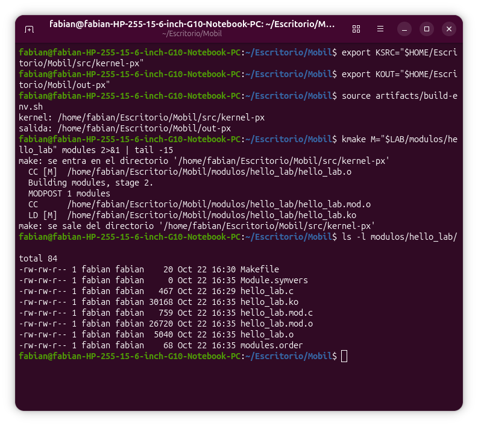

**02 — `file`, `modinfo` y `llvm-nm` sobre `hello_lab.ko` (hallazgo #7)**
`ARM aarch64`, el `vermagic` `4.19.297-uvite SMP preempt mod_unload modversions aarch64`, y los símbolos `T init_module`, `T cleanup_module`, `D __this_module`, `U printk`.
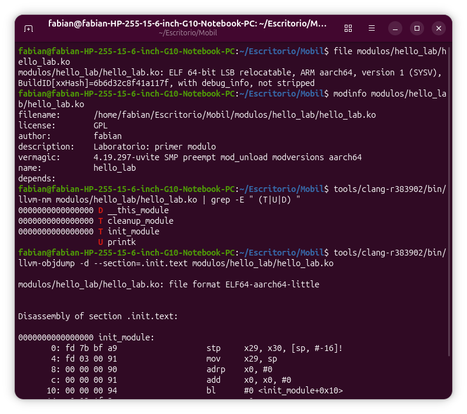

**03 — `init_module` desensamblado en ARM64 (hallazgo #7)**
Ocho instrucciones: `stp`, `mov`, `adrp`, `add`, `bl` (la llamada a `printk`), `mov w0, wzr`, `ldp` y `ret`.
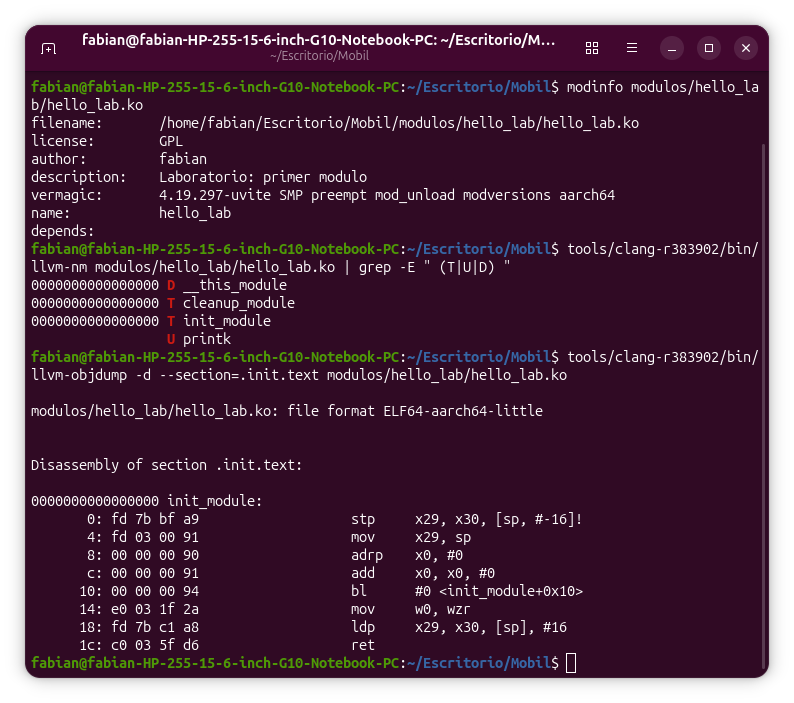

**04 — El error del compilador (hallazgo #11)**
`hello_lab.c:36:12: error: use of undeclared identifier 'ENOMEN'`, `1 error generated.` y las tres líneas `make: *** … Error`.
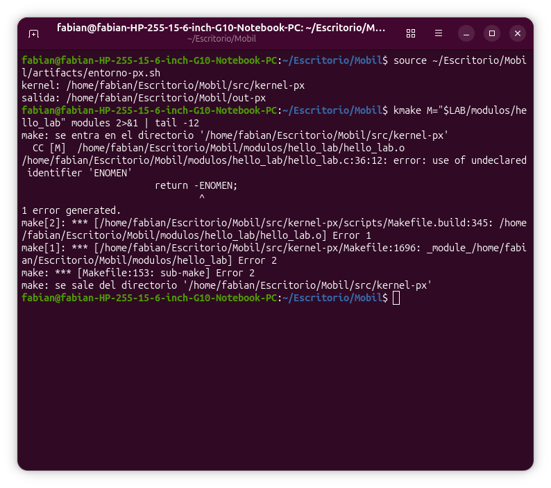

**05 — El error no cambia: columna 12 → 16 (hallazgo #11)**
Mismo mensaje con `36:16`; el `.ko` sigue siendo el viejo (`30168`, 16:35).
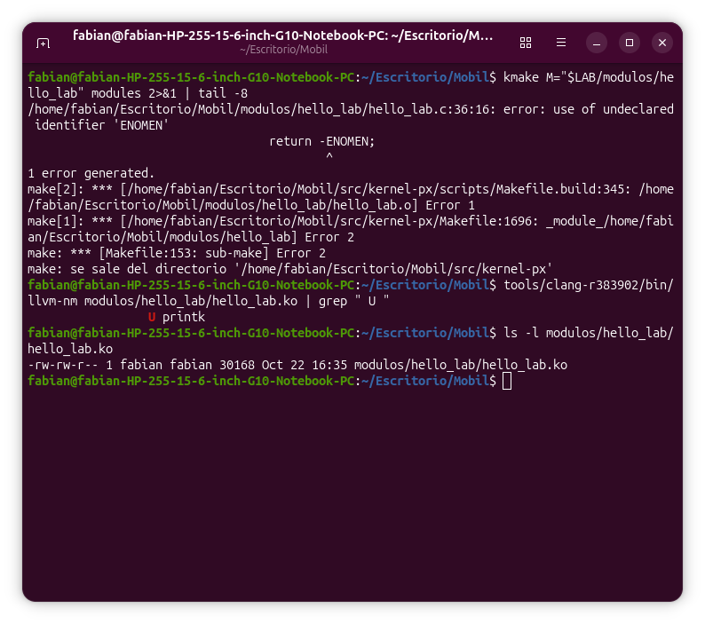

**06 — Buscar `ENOMEM` en el propio kernel (hallazgo #12)**
`grep -n -i "out of memory" …/errno-base.h` → `16:#define ENOMEM 12 /* Out of memory */`.
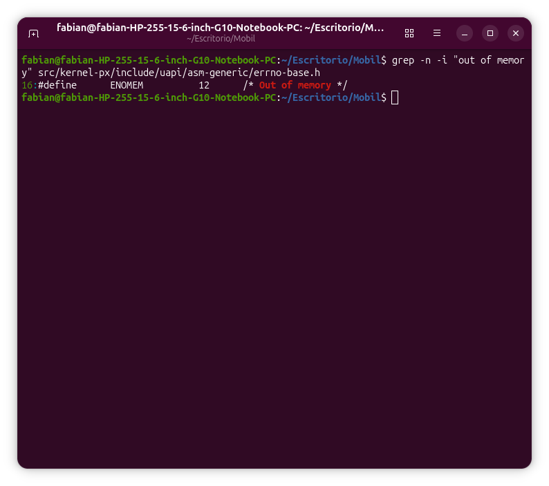

**07 — Compila con `/proc` y nueve símbolos `U` (hallazgo #13)**
`LD [M] …/hello_lab.ko`, los nueve símbolos indefinidos y `137176` bytes.
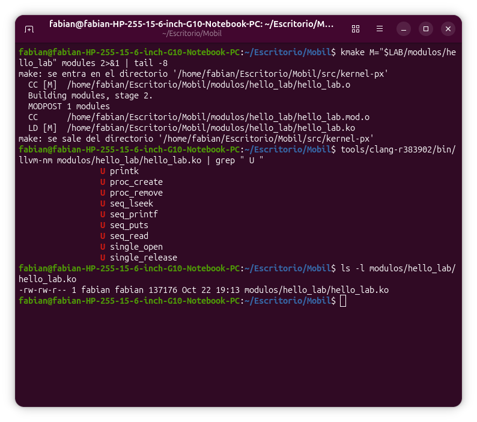

**08 — `strings` sin erratas (hallazgo #14)**
`description=Laboratorio: nodo /proc de solo lectura` y los dos mensajes de `INFO` (`6hello_lab: …`).
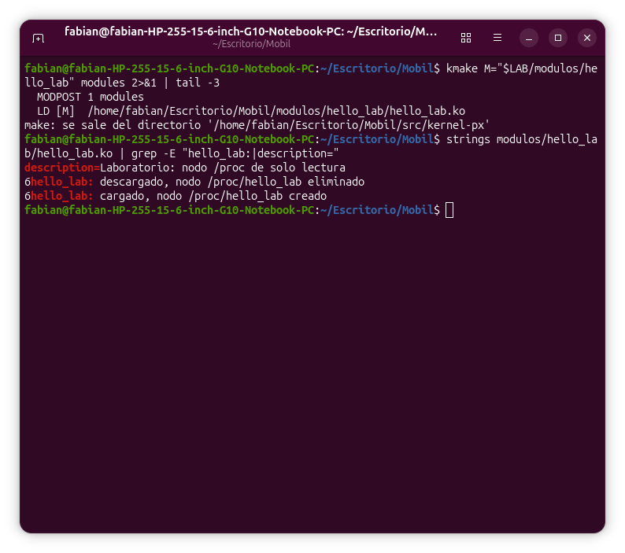

**09 - Integración en el kernel y opción activada (hallazgo #16)**
`ln -s`, la entrada de `Kconfig`, la línea del `Makefile`, `scripts/config --enable`, `olddefconfig`, el enlace visto con `ls -l`, el `tail` del `Makefile` y `CONFIG_HELLO_LAB=y`.
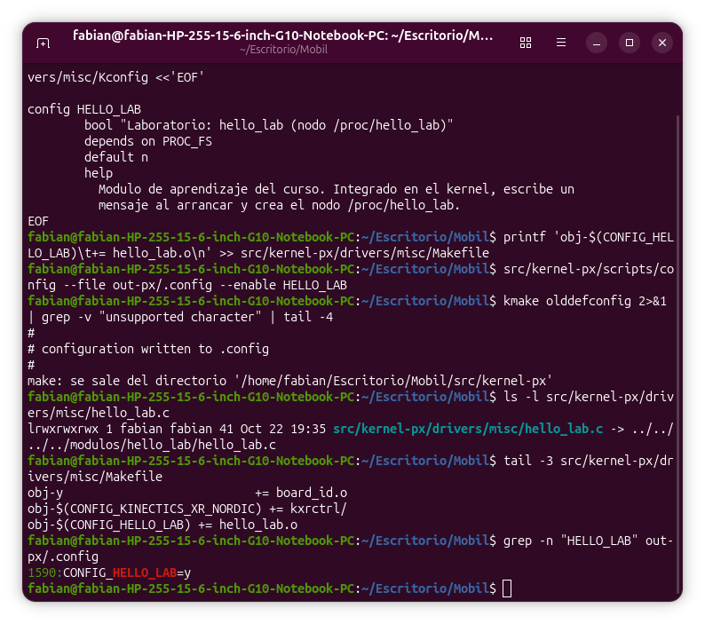

**10 - Recompilación incremental del kernel (hallazgo #17)**
`LD vmlinux`, `OBJCOPY Image`, `GZIP Image.gz`, `real 0m35,8s`, `hello_lab.o` de 115 600 bytes e `Image.gz` de 17 634 827.
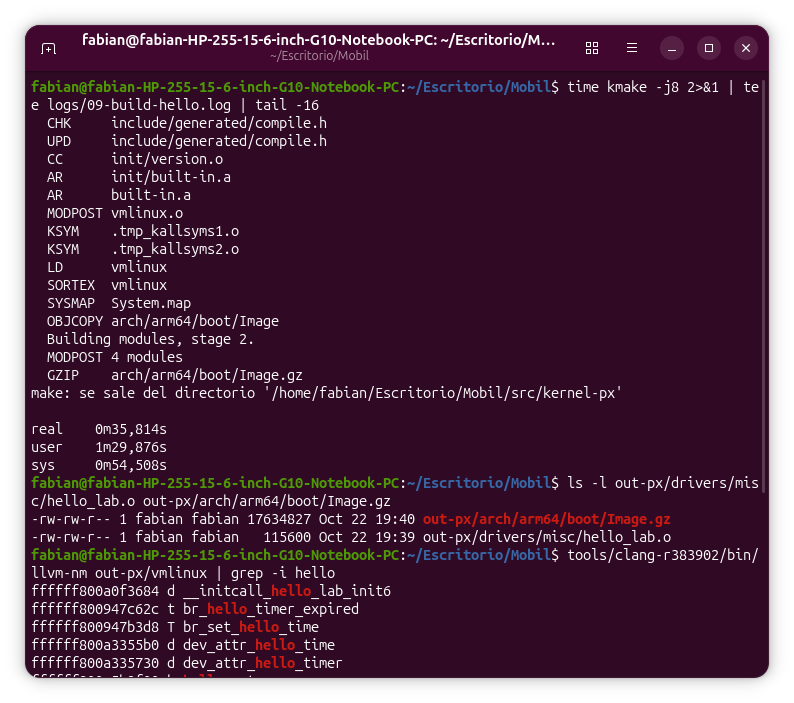

**11 - Tus símbolos dentro de `vmlinux` (hallazgos #18 y #19)**
`__initcall_hello_lab_init6`, `hello_lab_init`, `hello_lab_exit`, `hello_open`, `hello_show`, `hello_fops`, `hello_ent` y las 3 líneas de `System.map`.
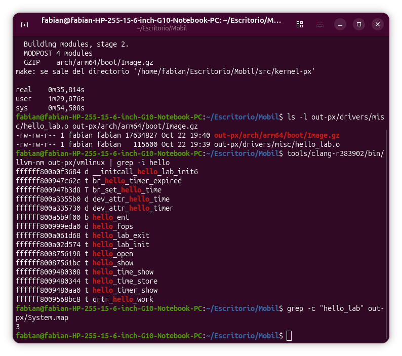

**12 - `cat /proc/hello_lab` denegado (hallazgos #22 y #23)**
Construir la imagen, `sha256sum`, `fastboot boot` con `OKAY` y las dos lecturas con `Permission denied`.
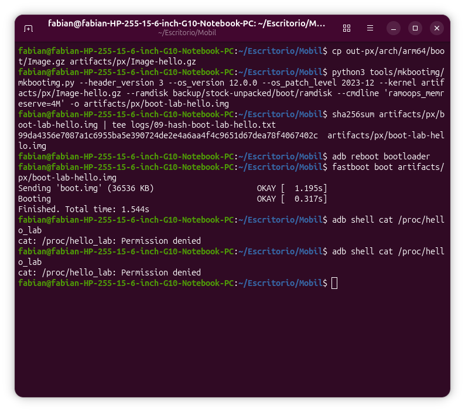

## Pendientes

- [x] Paso 1: `hello_lab.c` escrito a mano y compilado como `hello_lab.ko` (30 168 B).
- [x] Paso 2: `.ko` inspeccionado (`file`, `modinfo`, `llvm-nm`, `llvm-objdump`).
- [x] Paso 3: nodo `/proc/hello_lab` con `seq_file` compilado como `.ko` (137 176 B, 9 símbolos `U`, sin avisos).
- [x] Paso 4: módulo integrado en el kernel (enlace, `Kconfig`, `Makefile`, `CONFIG_HELLO_LAB=y`).
- [x] Paso 5: kernel recompilado (35,8 s) con `hello_lab` dentro de `vmlinux`.
- [x] Paso 6: `fastboot boot` de `boot-lab-hello.img`; el `printk` de `hello_lab` aparece en el `dmesg` a 1,195 s.
- [x] Paso 7: `cat /proc/hello_lab` desde `adb shell`: **no**, SELinux (`avc: denied { read }`, `u:r:shell:s0` contra `u:object_r:proc:s0`); requiere root.
- [ ] (Módulo 13) Cargarlo como `.ko` con `insmod` cuando haya root.
