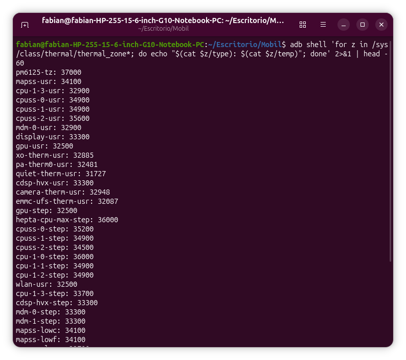
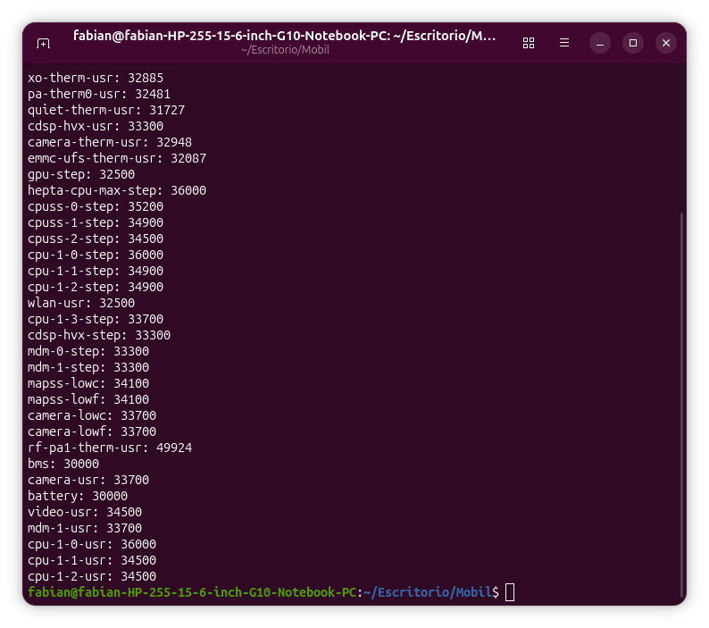
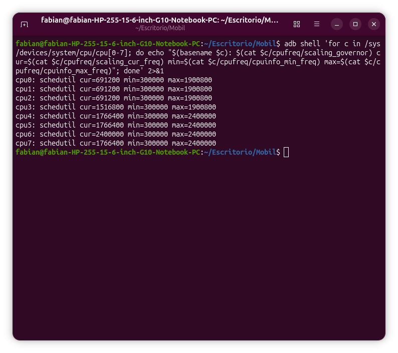
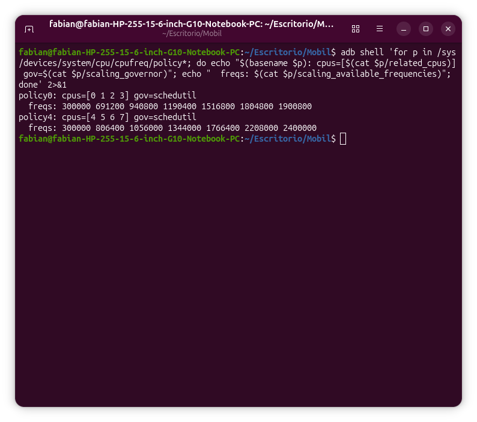
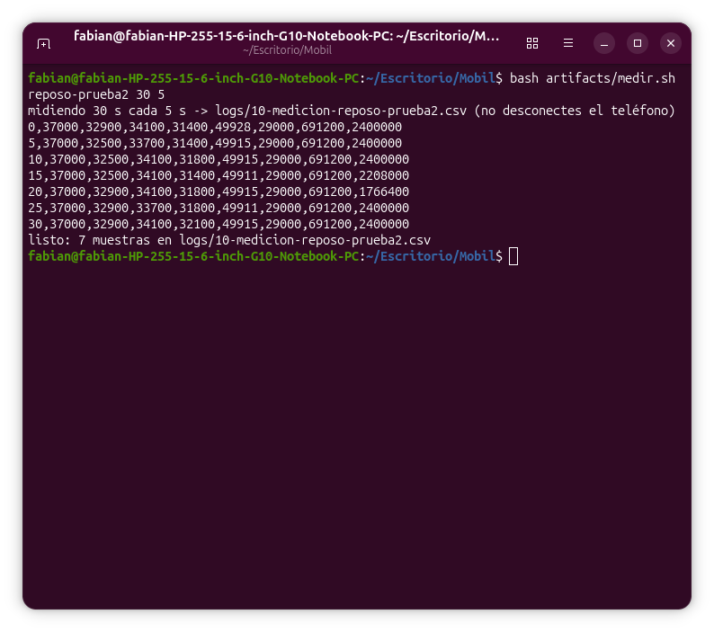
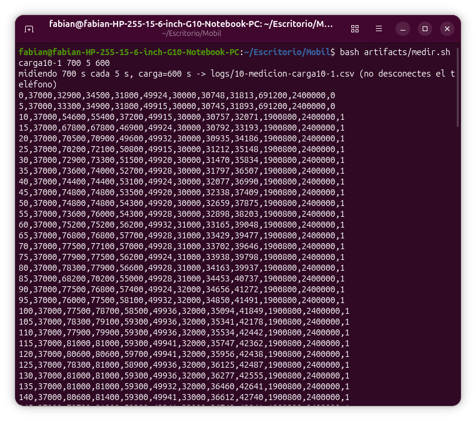
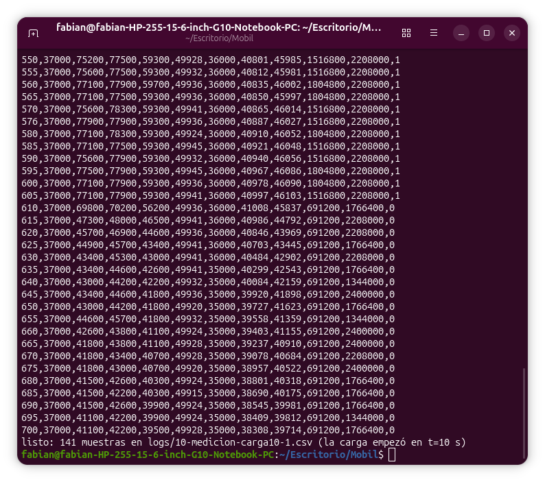
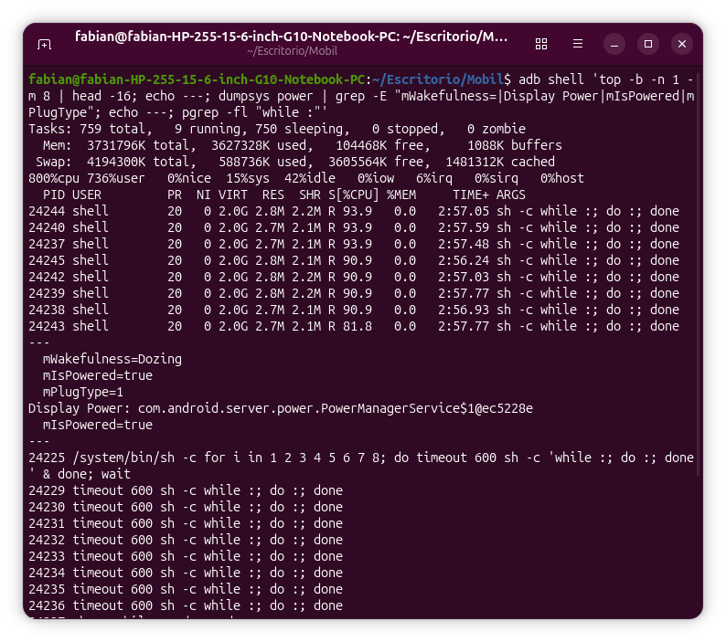
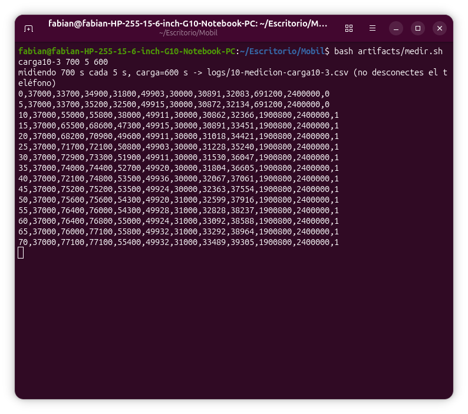

# Módulo 10 — Medir CPU, térmica y GPU

- Estado: Completado (con limitaciones, ver Pendientes)
- Fecha: 2026-10-22
- Teléfono: Redmi Note 11 (`spes`), MIUI V14.0.5.0.TGCMIXM, corriendo **tu kernel** `4.19.297-uvite` (el de `boot-lab-hello.img`, arrancado con `fastboot boot` en el módulo 9; uptime de 9 625 s al comprobarlo a las 22:28, es decir, arrancó a las ~19:48 y no se reinició). Las medidas **no** son del kernel de fábrica.
- Árbol leído: `src/kernel-px` (PixelExperience, 4.19.297), archivo `arch/arm64/boot/dts/vendor/qcom/bengal-thermal.dtsi`
- Objetivo: tener datos antes de cambiar nada (**medir ≠ optimizar**): temperaturas, frecuencias y qué las limita, con tres repeticiones de 10 minutos.

## Concepto

El kernel expone en `/sys` las **zonas térmicas** (`/sys/class/thermal/thermal_zone*/{type,temp}`, en milésimas de grado) y la frecuencia de cada **política de `cpufreq`** (`/sys/devices/system/cpu/cpufreq/policy*`). Un *freno térmico* es una zona con **disparos** (`trips`: una temperatura y una histéresis) unidos a **dispositivos de enfriamiento** (`cooling-device`: limitar la frecuencia de un grupo de núcleos, de la GPU o del módem). Todo se define en el Device Tree.

Todo lo medido aquí se lee **sin root**: `adb shell` puede leer estos nodos. No se tocó ninguna protección térmica ni de batería.

## Práctica guiada

```bash
# Paso 1: lectura base
adb shell 'for z in /sys/class/thermal/thermal_zone*; do echo "$(cat $z/type): $(cat $z/temp)"; done'
adb shell 'for c in /sys/devices/system/cpu/cpu[0-7]; do echo "$(basename $c): $(cat $c/cpufreq/scaling_governor) cur=$(cat $c/cpufreq/scaling_cur_freq) min=$(cat $c/cpufreq/cpuinfo_min_freq) max=$(cat $c/cpufreq/cpuinfo_max_freq)"; done'
adb shell 'for p in /sys/devices/system/cpu/cpufreq/policy*; do echo "$(basename $p): cpus=[$(cat $p/related_cpus)] gov=$(cat $p/scaling_governor)"; echo "  freqs: $(cat $p/scaling_available_frequencies)"; done'

# Paso 2: script de muestreo (artifacts/medir.sh <etiqueta> [segundos] [intervalo] [carga_s])
bash artifacts/medir.sh reposo-prueba2 30 5          # reposo
bash artifacts/medir.sh carga10-1 700 5 600          # 10 min de 8 bucles + 90 s de enfriamiento
bash artifacts/medir.sh carga10-2 700 5 600
bash artifacts/medir.sh carga10-3 700 5 600

# Paso 4: leer los disparos en el DTS (sin modificar nada)
grep -rl "cpu-1-0-step\|cpu-1-0-usr" src/kernel-px/arch/arm64/boot/dts/
awk '/^\tquiet-therm-step \{/,/^\t};/' src/kernel-px/arch/arm64/boot/dts/vendor/qcom/bengal-thermal.dtsi
```

Antes de cada repetición se esperó a que `quiet-therm-usr` bajara a ≈31 °C (teléfono plano, pantalla apagada, cable conectado).

## Hallazgos reales

1. **41 zonas térmicas, todas legibles sin root** (nada de `Permission denied`, a diferencia de `/proc/hello_lab` del módulo 9). En reposo: 30–37 °C casi todas. Familias de nombre: `*-usr` (solo lectura, disparos a 115 y 125 °C), `*-step` (con gobernador `step_wise` y acciones), `*-lowc/lowf` (límites por frío, disparo a 5 °C).
2. **Dos grupos de CPU con reloj propio.** `policy0` = cpus 0-3 (300 MHz a 1,9 GHz, 7 escalones), `policy4` = cpus 4-7 (300 MHz a 2,4 GHz, 7 escalones); gobernador `schedutil` en los 8 núcleos. Cada grupo comparte frecuencia.
3. **La frecuencia leída con `adb shell` en reposo salta.** Los grandes aparecían a 1,34 / 1,77 / 2,21 / 2,40 GHz con el teléfono quieto, y los pequeños siempre a 0,69 GHz. Es compatible con que la propia orden `adb shell` despierte la CPU unos instantes, pero **no está demostrado**. Consecuencia: la frecuencia de **una** lectura no es fiable; hay que promediar muchas.
4. **`pm6125-tz` marca exactamente 37 000 en las 423 muestras de las tres repeticiones** (y en las pruebas), y `rf-pa1-therm-usr` se mueve solo entre 49,90 y 49,96 °C aunque la CPU pase de 33 a 86 °C. No sé si es calor real del módem o un sensor casi fijo; queda como pregunta abierta.
5. **Errores del mentor corregidos durante el módulo (en `artifacts/medir.sh`):** (a) `sleep paso` tras cada lectura daba un intervalo real de ~7 s en vez de 5 (cada `adb shell` tarda ~2 s): ahora las muestras caen en tiempos fijos; (b) abría el CSV con `>` y dos corridas con la misma etiqueta se pisaban: ahora se niega a sobrescribir; (c) no registraba cuándo estaba activa la carga: ahora el propio script la lanza a los 10 s y marca la columna `carga`; (d) al cortar con Ctrl+C la carga seguía viva en el teléfono (su `timeout` era de 600 s) y lo calentó: se encontraron 8 bucles con ~3 min de CPU cada uno (`top`, evidencia 08); ahora una trampa (`trap`) los mata. La repetición 2 abortada quedó guardada como `logs/10-medicion-carga10-2-abortada.csv` y no se usa.
6. **La CPU no frena por su propia temperatura.** En `bengal-thermal.dtsi`, `cpu-1-N-step` y `cpuss-N-step` solo disparan a **110 °C** y su acción es **aislar un núcleo** (`cpuN_isolate`), no bajar la frecuencia; `hepta-cpu-max-step` a 120 °C; GPU a 95/100 °C; módem a 100 °C. Con carga completa la CPU llegó a **86,1 °C** como máximo: nunca se acercó.
7. **El freno real es la zona `quiet-therm-step`** (sensor `pm6125_adc_tm ADC_AMUX_THM2_PU2`, un sensor del chip de energía; el nombre `quiet`/«skin» es lectura mía y no sé qué mide físicamente). Tiene 12 disparos entre 39 y 52 °C. Los que importan aquí: `gold-trip` a **40 000 con histéresis 0** sobre `&CPU4` (los grandes), `silver-trip` a **41 000 con histéresis 0** sobre `&CPU0` (los pequeños), `gpu-trip` a 43 000, `hvx-trip` a 52 000, cuatro disparos de módem (`modem_proc`/`modem_pa`, 40–50 °C) y cuatro de batería (39, 41, 43 y 45 °C, histéresis 2 000).
8. **Los datos encajan con el DTS (3 de 3).** Los grandes bajaron de 2 400 a 2 208 MHz exactamente cuando `quiet` cruzó 40,0 °C (rep. 1: 40,001 → 40,08 °C en t=310 s; rep. 2: 40,009 → 40,027 en t=505 s). En la rep. 3 `quiet` no pasó de 39,53 °C y **no hubo ningún freno** (0 de 120 muestras). Con histéresis 0, el freno se suelta en cuanto `quiet` baja de 40 (rep. 2: 39,96 °C en t=525 s → vuelve a 2 400 MHz).
9. **Las tres repeticiones, con las mismas condiciones, dan resultados distintos.**

| | Rep. 1 | Rep. 2 | Rep. 3 |
|---|---|---|---|
| `quiet` al empezar | 30,75 °C | 30,65 °C | 30,89 °C |
| `quiet` máximo | 41,01 °C | 40,04 °C | 39,53 °C |
| Primera bajada de los grandes | t=310 s | t=505 s | no hubo |
| Muestras bajo carga con grandes < 2 400 MHz | 60 / 120 | 5 / 120 | 0 / 120 |
| Frecuencia media, grandes | 2 304 MHz | 2 392 MHz | 2 400 MHz |
| Frecuencia media, pequeños | 1 799 MHz | 1 901 MHz | 1 901 MHz |
| `cpuss0` máximo | 86,1 °C | 85,7 °C | 85,3 °C |
| `cpuss0` media bajo carga | 78,9 °C | 81,9 °C | 81,7 °C |
| `quiet` a los 700 s | 38,3 °C | 36,5 °C | 36,2 °C |

   Media de la frecuencia de los grandes bajo carga: **2 365 MHz**, rango **2 304–2 400 MHz**. Con **una sola** repetición habríamos escrito «frecuencia sostenida: 2 208 MHz» (rep. 1) o «2 400 MHz» (rep. 3), y las dos habrían sido verdad ese día y falsas como línea base. La causa de la diferencia (ambiente, posición del teléfono, cable) **no se midió**.
10. **Los pequeños limitaron en la rep. 1 antes de lo que dice el DTS.** Empezaron a oscilar (1 517 / 1 805 / 1 901 MHz) con `quiet` en 40,53 °C, y su disparo es a 41,0 °C. Es posible que la zona que leí (`quiet-therm-usr`) no dé exactamente la misma lectura que `quiet-therm-step`, pero **no está comprobado**.
11. **Los sensores de placa se enfrían lento, los de la CPU rápido.** Al parar la carga, `cpuss0` baja de ~85 a ~45 °C en 10 s, mientras que `quiet` tarda unos 5-10 minutos en volver a 31 °C (de 36,5 °C a 30,96 °C ocurrió con el teléfono quieto, sin tiempo medido con precisión).
12. **Corrección del mentor: el kernel medido fue el tuyo, no el de fábrica.** El documento decía «kernel de fábrica `4.19.157-perf`» y no se había comprobado. Al abrir Termux (módulo 11), `uname -r` dio `4.19.297-uvite`, y `/proc/uptime` (9 625 s a las 22:28) lo confirma: el teléfono no se reinició desde el `fastboot boot` del módulo 9. Consecuencias: (a) los **drivers** (cpufreq, térmica, GPU) son los del árbol PixelExperience, y **no se sabe** si el kernel de fábrica se comporta igual; (b) el **DTB** que usó el kernel es el de fábrica (vive en `vendor_boot`, que no tocamos), pero los disparos del hallazgo #7 se leyeron del **DTS del árbol PixelExperience**, no de ese DTB. Los números concuerdan con el umbral de 40 °C, pero queda sin comprobar que sea el mismo archivo.
13. **Condiciones no controladas:** teléfono enchufado durante toda la carga (la batería sube de 29–30 a 35–36 °C y sus propios disparos de 39–45 °C, `batt-trip*`, pueden actuar sobre la carga), no se anotó la temperatura de la habitación.

## Evidencias

**01 y 02 — Las 41 zonas térmicas en reposo (hallazgo #1)**
`type: temp` de cada zona, en milésimas de grado; la más caliente es `rf-pa1-therm-usr` (49 924).



**03 — Gobernador y frecuencia por núcleo (hallazgo #2 y #3)**
`schedutil` en los 8 núcleos, máximos de 1 900 800 (cpu0-3) y 2 400 000 kHz (cpu4-7).


**04 — Las dos políticas de frecuencia (hallazgo #2)**
`policy0` (cpus 0-3) y `policy4` (cpus 4-7) con sus 7 escalones.


**05 — El script en reposo, con 7 muestras a intervalos de 5 s (hallazgo #5)**
Tras corregir el intervalo: t = 0, 5, 10... 30.


**06 y 07 — Repetición 1 de 10 minutos (hallazgos #8 y #9)**
Inicio y final del CSV: la carga activa (columna final 1), la subida de `cpuss0` a ~80 °C y la bajada de los grandes a 2 208 MHz en t=310 s.



**08 — Los 8 bucles de carga seguían vivos tras un Ctrl+C (hallazgo #5d)**
`top` con 736 % de CPU de usuario y `pgrep` con los `timeout 600`: cada bucle llevaba ~2 min 57 s de CPU con el teléfono supuestamente en reposo.


**09 — Repetición 3 en curso (hallazgo #9)**
`quiet` crece lentamente y la frecuencia de los grandes se mantiene en 2 400 000 kHz.


Los datos completos están en `logs/10-medicion-carga10-{1,2,3}.csv` (141 muestras cada uno).

## Pendientes

- [x] Paso 1: lectura base de zonas, gobernadores y políticas.
- [x] Paso 2: script `artifacts/medir.sh` (muestreo a tiempos fijos, carga propia, sin sobrescribir, con `trap`).
- [x] Paso 3: tres repeticiones de 10 minutos con carga, comparadas en la tabla del hallazgo #9.
- [x] Paso 4: disparos térmicos leídos en `bengal-thermal.dtsi` sin modificar nada.
- [ ] Explicar por qué las tres repeticiones calientan a ritmos distintos (temperatura ambiente, posición, cable): repetir anotando la temperatura de la habitación, o con el cable desconectado.
- [ ] Averiguar por qué `pm6125-tz` (37 000) y `rf-pa1-therm-usr` (~49,9 °C) apenas cambian con la carga.
- [ ] Comprobar si `quiet-therm-usr` y `quiet-therm-step` leen lo mismo (hallazgo #10).
- [ ] Leer el DTB original (en `vendor_boot`) y confirmar que los disparos coinciden con los del árbol PixelExperience.
- [ ] Repetir una repetición de 10 minutos con el **kernel de fábrica** (reiniciar el teléfono) para comparar con el `uvite`: ahora mismo la línea base es la de tu kernel.
- [ ] Medir la GPU con una carga gráfica propia (en este módulo solo se lee `gpu-usr`).
