# Módulo 11 — Rust: programas en el teléfono, kernel en QEMU

- Estado: Completado
- Fecha: 2026-10-22 y 2026-10-23
- Teléfono: Redmi Note 11 (`spes`), Termux 0.118.3 (F-Droid), corriendo tu kernel `4.19.297-uvite` (arrancado con `fastboot boot`)
- Laptop: `rustc 1.94.1` (rustup), `bindgen 0.72.1`, `clang`/`ld.lld` 21.1.8, `qemu-system-aarch64 10.2.1`
- Kernel con Rust: **Linux 6.18.58** (LTS), `src/linux-6.18.58`, salida en `out-rust/`, probado en QEMU `virt` (Cortex-A72)
- Objetivo: aprender Rust donde sí se puede. (1) Rust normal, compilado y ejecutado en el ARM64 real del teléfono. (2) Rust **dentro del kernel**, en un kernel moderno, porque el 4.19 del teléfono no lo admite.

## Concepto

Rust impide en tiempo de compilación los errores de memoria típicos de C: usar un valor después de liberarlo, o dos escrituras a la vez sobre el mismo dato. Lo consigue con tres ideas que se vieron aquí con errores reales: **propiedad** (cada valor tiene un único dueño), **préstamo** (`&` para leer, `&mut` para escribir) y **vida** del préstamo (dura hasta el último uso).

Rust en el kernel de Linux existe desde la serie 6.x. El kernel 4.19 del teléfono **no** lo soporta; por eso el módulo en Rust se prueba en un kernel moderno dentro de QEMU, una máquina ARM64 virtual, sin tocar el teléfono. Un módulo en Rust usa la macro `module!` y el rasgo `kernel::Module`; su limpieza no es una función `exit` escrita a mano sino `impl Drop`.

## Práctica guiada

```bash
# --- Parte 1: Rust en el teléfono (dentro de Termux) ---
pkg update; pkg upgrade; pkg install rust
rustc --version; cargo --version; rustc -vV | grep -E "host|LLVM"
cd ~/lab; nano propiedad.rs; rustc propiedad.rs && ./propiedad     # E0382, luego &a
nano prestamo.rs; rustc prestamo.rs && ./prestamo                   # E0425 (typo), E0499, luego reordenado

# --- Parte 2: la laptop ---
sudo apt install qemu-system-arm bindgen          # (bindgen-cli no existe en este Ubuntu)
rustup component add rust-src
mkdir -p downloads && cd downloads
wget https://cdn.kernel.org/pub/linux/kernel/v6.x/linux-6.18.58.tar.xz
wget https://cdn.kernel.org/pub/linux/kernel/v6.x/sha256sums.asc
sha256sum -c sha256sums.asc --ignore-missing; cd ..
tar -xf downloads/linux-6.18.58.tar.xz -C src/
make -C src/linux-6.18.58 LLVM=1 rustavailable                      # Rust is available!

# --- configurar, compilar y arrancar en QEMU ---
make -C src/linux-6.18.58 O=$PWD/out-rust ARCH=arm64 LLVM=1 defconfig
src/linux-6.18.58/scripts/config --file out-rust/.config -e RUST -e SAMPLES -e SAMPLES_RUST -e SAMPLE_RUST_MINIMAL
make -C src/linux-6.18.58 O=$PWD/out-rust ARCH=arm64 LLVM=1 olddefconfig
time make -C src/linux-6.18.58 O=$PWD/out-rust ARCH=arm64 LLVM=1 -j12 Image 2>&1 | tee logs/11-build-rust.log | tail -15
timeout 40 qemu-system-aarch64 -machine virt -cpu cortex-a72 -m 1G -nographic \
  -kernel out-rust/arch/arm64/boot/Image -append "console=ttyAMA0 panic=-1" -no-reboot \
  < /dev/null > logs/11-qemu-arranque.log 2>&1

# --- tu módulo a mano: modulos/rust_lab/rust_lab.rs, integrado con el parche 0002 ---
git apply patches/0002-samples-rust-integrar-rust_lab.patch         # (en src/linux-6.18.58)
src/linux-6.18.58/scripts/config --file out-rust/.config -e SAMPLE_RUST_LAB
make -C src/linux-6.18.58 O=$PWD/out-rust ARCH=arm64 LLVM=1 -j12 Image 2>&1 | tee logs/11-build-rust-lab2.log | tail -5
```

## Hallazgos reales

1. **Termux se instala desde F-Droid, no desde Google Play** (la versión de Play está abandonada). La página de F-Droid listaba tres APK; se usó la marcada **«sugerido»**, 0.118.3 (1002), de 108 MiB, universal (incluye `arm64-v8a`). Las dos betas (0.119.0) se descartaron.
2. **`pkg update` y `pkg upgrade`.** `pkg update` probó unos 30 espejos (varios salían `bad`, normal) y eligió `mirrors.middlendian.com`; bajó 601 kB y avisó de **74 paquetes por actualizar**. `pkg upgrade` descargó 82 paquetes (22,5 MB en 11 min 55 s). **Se quedó parado** en `*** openssl.cnf (Y/I/N/O/D/Z) [default=N] ?`: no estaba colgado, **esperaba respuesta** (Enter = mantener la versión actual).
3. **Termux corre sobre el kernel del teléfono, y era el tuyo.** `uname -m` dio `aarch64` y `uname -r` dio **`4.19.297-uvite`**, no el de fábrica. Así se descubrió que **las medidas del módulo 10 también eran de `uvite`** (se corrigió en ese módulo, hallazgo #12; confirmado con `/proc/uptime` = 9 625 s). Quedaban 85 GB libres.
4. **Rust instalado en el teléfono:** `rustc 1.99.1 (58cf8f9c3 2026-10-13)`, `cargo 1.99.1`, **`host: aarch64-linux-android`**, LLVM 21.1.8. Descarga de 218 MB en 11 min 18 s. `pkg` arrastró `clang 21.1.8`, `lld`, `llvm`, `ndk-sysroot (30)` y `rust-std-aarch64-linux-android`, porque Rust usa `clang` como enlazador en Android. El binario compilado corre directamente en el ARM64 del teléfono, sin emulador.
5. **Error `E0382` (`borrow of moved value: 'a'`).** `let a = String::from("hola kernel"); let b = a; println!("{}", a);` no compila: `String` no es `Copy`, `let b = a;` **mueve** el valor a `b` y `a` queda inválido (el compilador marca la línea del movimiento y la del uso posterior). Cambiar a `let b = &a;` **presta** el valor y compila (con el aviso `unused variable: 'b'`, que no impide nada).
6. **Typos del usuario, como en el módulo 9.** (a) `rustc propiedad.r` en vez de `.rs`: el compilador acierta y sugiere `propiedad.rs`. (b) En `prestamo.rs` se escribió dos veces `let r1 = &mut s;` y nunca `r2`: salió `error[E0425]: cannot find value 'r2'` y no el `E0499` buscado. **La sugerencia del compilador (`cambia r2 por r1`) habría compilado pero cambiado el programa**: arreglar el síntoma no es arreglar la causa.
7. **Error `E0499` (`cannot borrow 's' as mutable more than once at a time`).** Con `let r1 = &mut s; let r2 = &mut s; r1.push_str(...)`, el compilador marca el primer préstamo, el segundo y el uso posterior del primero. Reordenado (`r1` se usa **antes** de crear `r2`), compila e imprime `hola kernel!`: **el préstamo dura hasta el último uso, no hasta el final de la función**. Es la versión comprobada por el compilador de una condición de carrera.
8. **Comandos de la laptop escritos en Termux** (el mentor no dejó claro el terminal): `sudo: not installed` y `rustup: not found`. No se rompió nada. En Termux no hay `sudo` ni `rustup`: Rust se instala con `pkg`.
9. **En la laptop, `apt` abortó toda la orden** porque `bindgen-cli` **no existe** en este Ubuntu (el nombre correcto es `bindgen`; el mentor lo había supuesto): por eso **QEMU tampoco se instaló** en el primer intento. Ya con `sudo apt install qemu-system-arm bindgen` se instaló `bindgen 0.72.1` y `qemu 10.2.1`, y **arrastró un `rustc`/`cargo 1.93.1` de Ubuntu** en `/usr/bin`. No estorba: `~/.cargo/bin` está antes en el `PATH` (entrada 15 frente a 21) y sigue mandando `rustc 1.94.1` de `rustup`.
10. **Kernel elegido: Linux 6.18.58 (LTS).** Descarga de 148 MB (65 s) y `sha256sum -c`: **`linux-6.18.58.tar.xz: OK`** (con un aviso `17 lines are improperly formatted`: son las líneas de firma PGP del `.asc`). **Solo prueba integridad, no autenticidad**: el hash viene del mismo servidor y **no se verificó la firma PGP**. Mínimos que pide ese kernel (`Documentation/process/changes.rst`): `rustc 1.78.0`, `bindgen 0.65.1`, `clang 15.0.0`; la laptop tiene 1.94.1, 0.72.1 y 21.1.8. **`make LLVM=1 rustavailable` → `Rust is available!`**.
11. **Compilación con Rust: 13 min 30 s reales** (`user 139m`, 12 hilos): 5 553 líneas de registro, 11 pasos `RUSTC`, 3 `BINDGEN`, 8 bibliotecas, **0 avisos y 0 errores**. `arch/arm64/boot/Image` de **41 056 768 bytes**. En `vmlinux` están los símbolos de Rust (`RustMinimal::init`, `__rust_minimal_init`, `__rust_minimal_exit`, con nombres decorados `_RNv…`) junto a decenas de `core`/`alloc`/`kernel`.
12. **Error del mentor con QEMU.** La primera orden usaba `| head -80` y **cortó la salida a las 80 líneas**, antes de llegar a Rust: `head` cierra la tubería y mata QEMU. Repetido con `timeout 40 … > log` salieron 277 líneas completas.
13. **Primer código Rust corriendo dentro del kernel:** `[0.619704] rust_minimal: Rust minimal sample (init)` y `Am I built-in? true`, en la fase de *initcalls*, unos 60 ms antes de un pánico **esperado** (`VFS: Unable to mount root fs on unknown-block(0,0)`, por no haber sistema de archivos raíz). El mentor había anunciado `My numbers are [72, 108, 200]`, pero **no aparece**: está en `impl Drop`, que solo corre al **descargar** el módulo, y estando integrado (`built-in? true`) nunca se descarga (igual que `hello_lab_exit` en el módulo 9, hallazgo #19). El prefijo `rust_minimal:` lo añade el kernel solo.
14. **Rust frente a C, en el mismo módulo.** En C (`hello_lab.c`) la limpieza era obligatoria y manual (`proc_remove`). En Rust el vector `numbers` pertenece a la estructura y se libera al destruirse (`Drop`), sin una línea de limpieza; y `numbers.push(72, GFP_KERNEL)?` equivale al `if (!hello_ent) return -ENOMEM;` del módulo 9: «si falló, devuelve el error ahora».
15. **`rust_lab`, a mano, con tres typos.** Copia de `rust_minimal.rs` con cambios. En la revisión previa a compilar se vieron: `name: "rust:lab"` (dos puntos en lugar de `_`; el mentor supuso que rompería los nombres de funciones que genera la macro, pero **no se comprobó**, porque se corrigió antes de compilar) y `"Fabia"` en lugar de `"Fabian"` (texto entre comillas: **el compilador nunca lo detecta**). Al compilar salió un **tercero que el mentor no vio**: `ñ` en `authors: ["Fabian Beleño"]` → **`error: proc macro panicked … Expected ASCII string`**, y a continuación **cinco** `error[E0425]: cannot find value '__LOG_PREFIX'` (uno por cada `pr_info!`). **Solo el primero era la causa**: `module!` se rompió y no generó `__LOG_PREFIX`; los otros cinco eran consecuencias. Corregido con `"Fabian Beleno"` (ASCII), compiló en 20,9 s.
16. **`rust_lab` con bucle y suma.** Se sustituyeron los tres `push` por `for i in 0..5 { numbers.push(i * 10, GFP_KERNEL)?; }` y un segundo bucle `for n in numbers.iter() { total += *n; }`. La revisión previa detectó que faltaba el `;` al final de `pr_info!("suma: {}\n", total)` (línea 32). Compiló con 0 errores y 0 avisos, y QEMU imprimió **`rust_lab: suma: 100`** y **`rust_lab: numeros [0, 10, 20, 30, 40]`** a 0,633 s, justo después de `rust_minimal`.
17. **Integración reproducible.** `patches/0002-samples-rust-integrar-rust_lab.patch` (36 líneas): entrada `config SAMPLE_RUST_LAB` en `samples/rust/Kconfig` (antes de `endif # SAMPLES_RUST`), línea `obj-$(CONFIG_SAMPLE_RUST_LAB) += rust_lab.o` en el `Makefile` y enlace simbólico `samples/rust/rust_lab.rs -> ../../../../modulos/rust_lab/rust_lab.rs`. Verificado: aplica limpio sobre el árbol virgen y se rechaza al aplicarlo dos veces.

## Evidencias

**01 y 02 — Termux: actualizar paquetes (hallazgo #2)**
Espejo elegido y 74 paquetes por actualizar; y la pregunta de `openssl.cnf` que parecía un cuelgue.
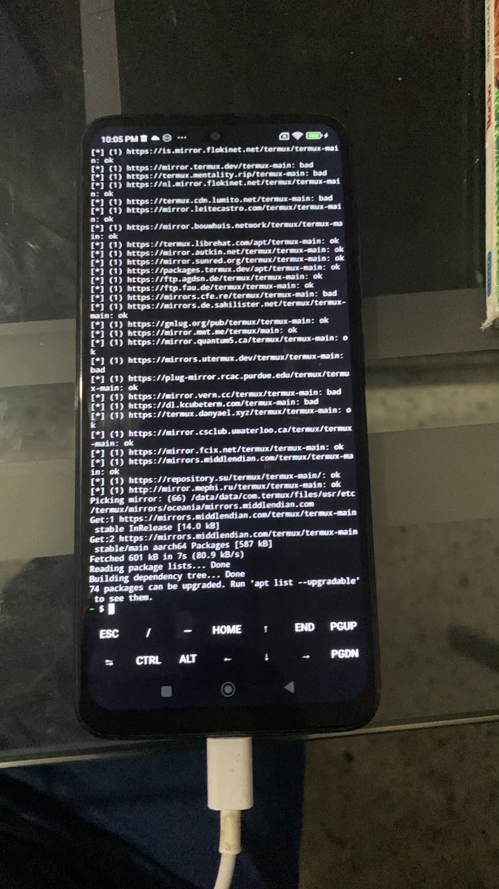
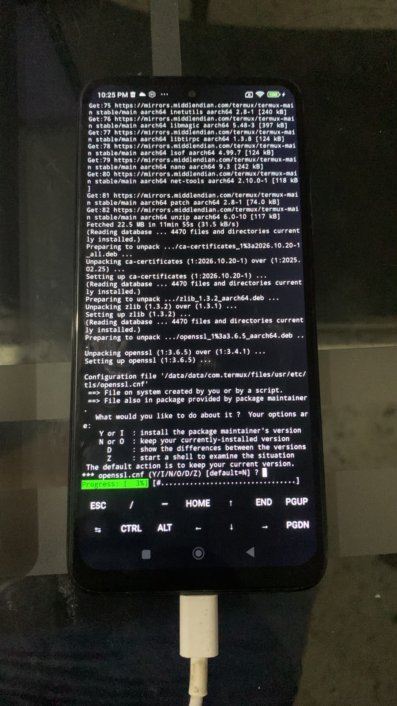

**03 — Termux corre sobre tu kernel (hallazgo #3)**
`aarch64`, `4.19.297-uvite` y 85 GB libres.
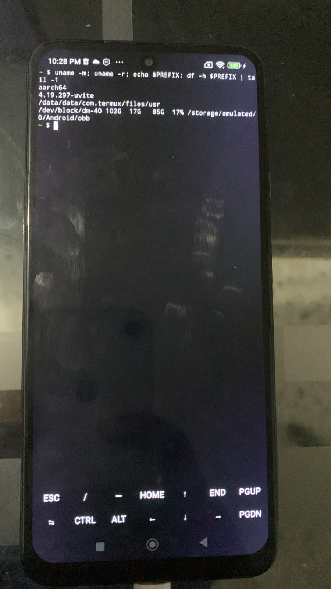

**04 y 05 — Rust instalado en el teléfono (hallazgo #4)**
`Setting up rust (1.99.1)` y las versiones con `host: aarch64-linux-android`.
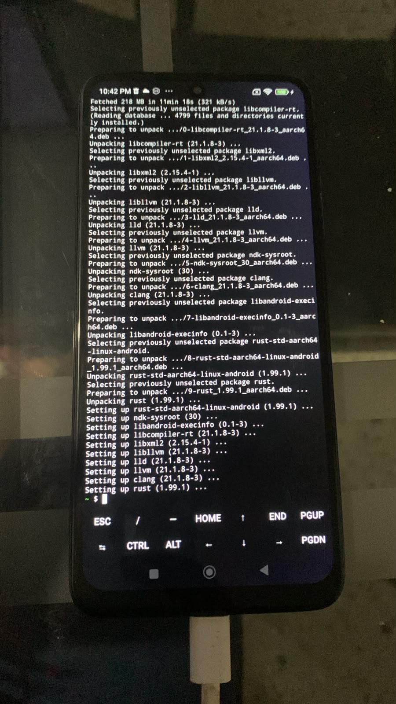
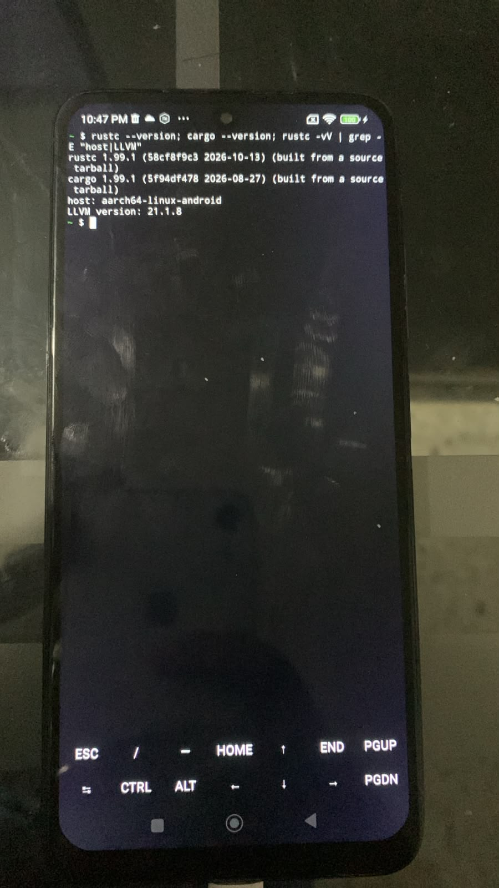

**06 y 07 — Propiedad y préstamo (hallazgo #5)**
El error `E0382` y el programa que compila con `&a`.
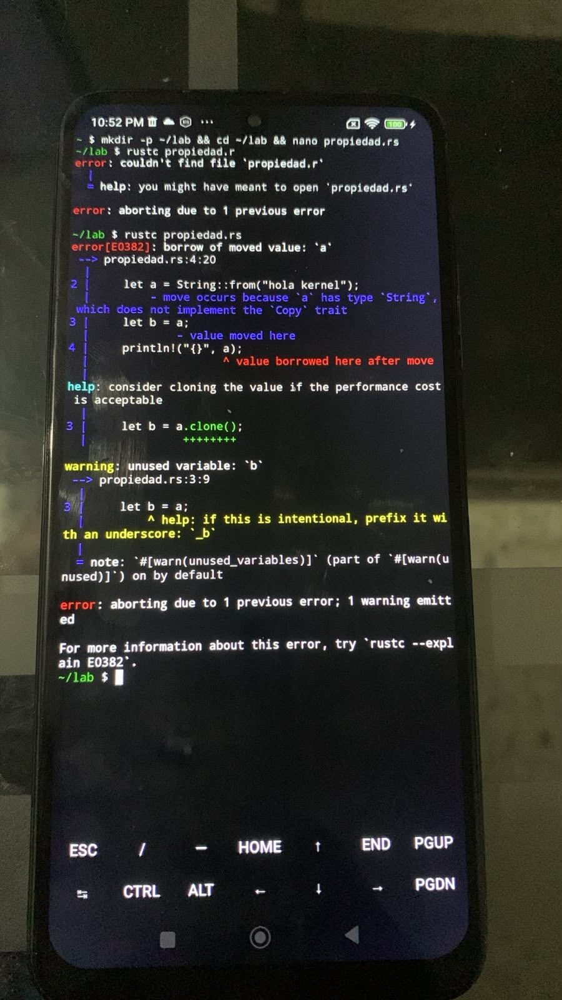
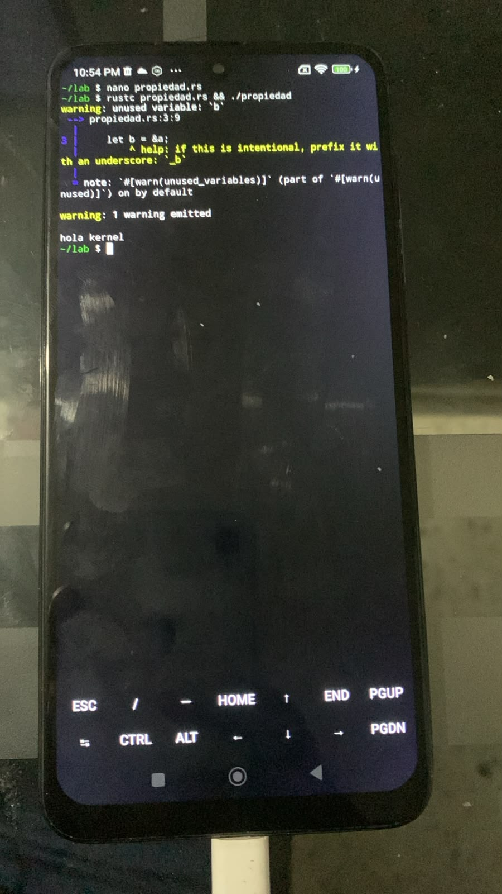

**08, 09 y 10 — Préstamo mutable (hallazgos #6 y #7)**
El `E0425` por el typo `r1`/`r2`, el `E0499` buscado y el programa reordenado que compila.
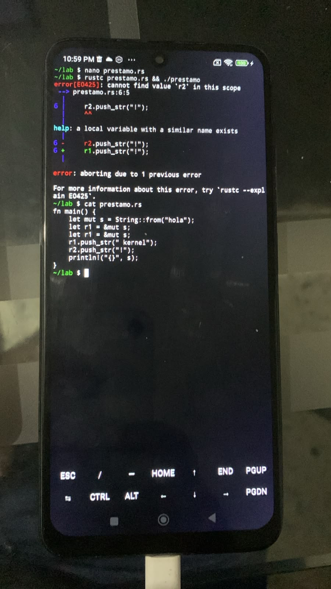
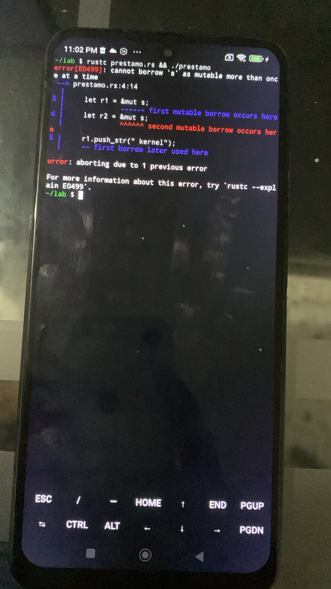
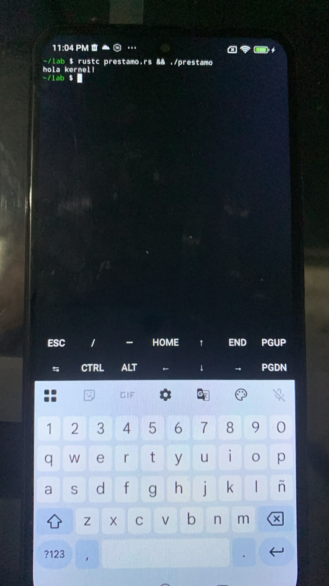

**11 — Comandos de la laptop en Termux (hallazgo #8)**
`sudo is not installed` y `No command rustup found`.
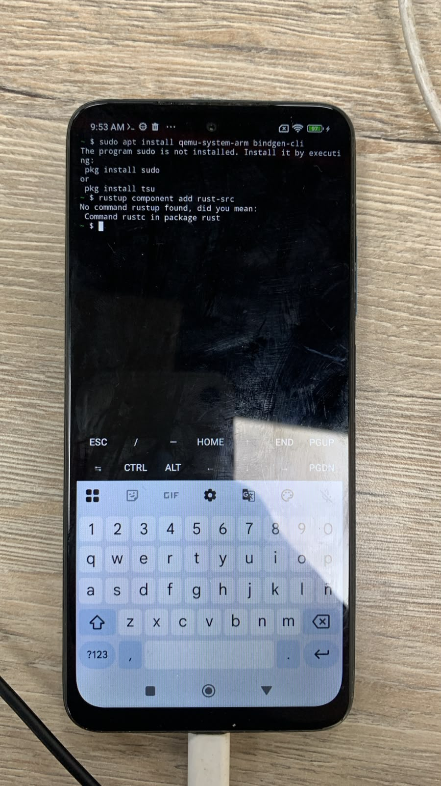

**12 y 13 — Herramientas en la laptop (hallazgo #9)**
`bindgen-cli` no existe y luego la instalación de `qemu-system-arm` y `bindgen`.
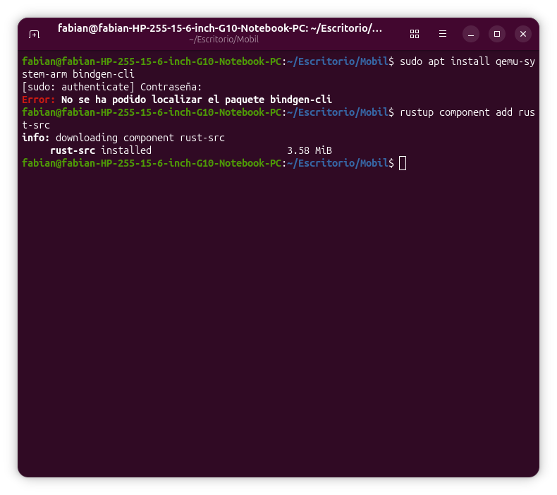
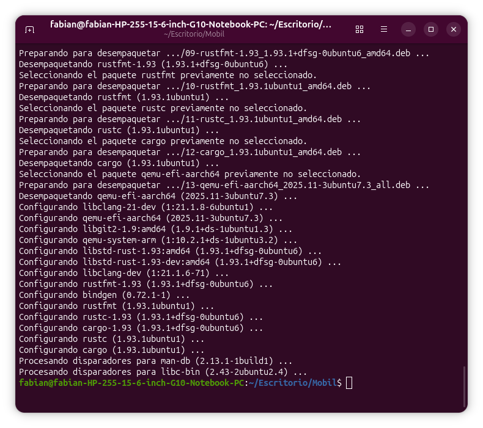

**14 — Kernel 6.18.58 descargado y verificado (hallazgo #10)**
Descarga de 148 MB y el hash del `.asc`.
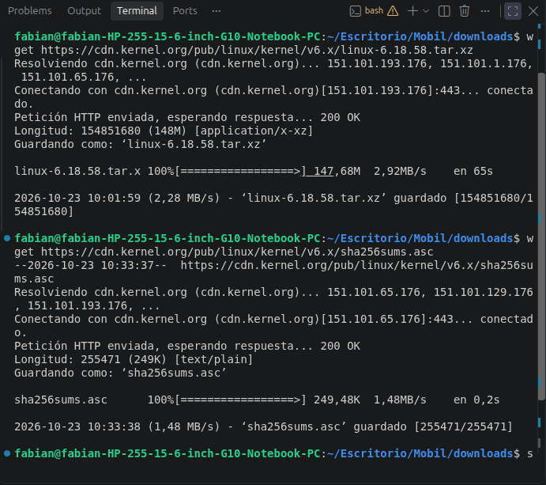

**15 y 16 — Configuración y compilación con Rust (hallazgo #11)**
`CONFIG_RUST=y` y `OBJCOPY arch/arm64/boot/Image`, `real 13m30,037s`.
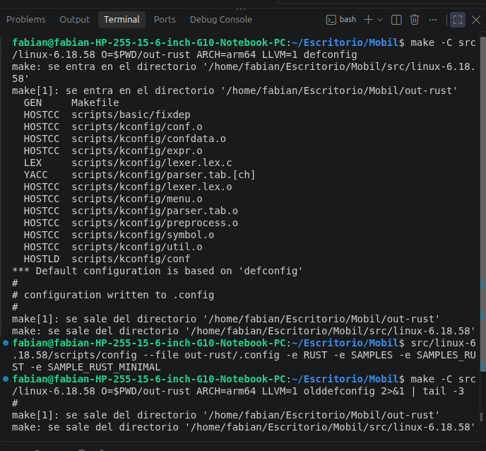
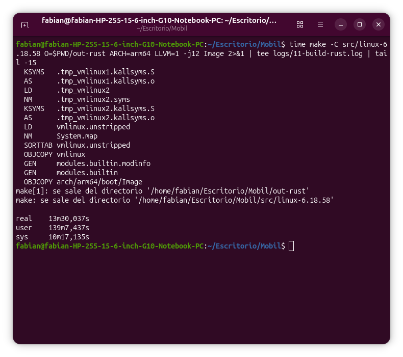

**17 — El arranque en QEMU, cortado por `head` (hallazgo #12)**
La salida se corta en la línea 80, antes de llegar a Rust.
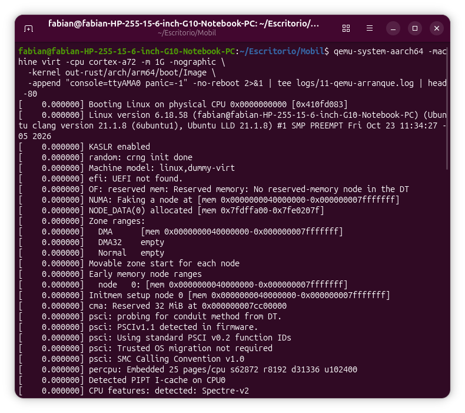

Los registros completos están en `logs/11-build-rust.log`, `logs/11-qemu-arranque.log` (primer módulo en Rust: línea 233), `logs/11-build-rust-lab2.log` y `logs/11-qemu-rust-lab2.log` (`rust_lab: suma: 100`, línea 237).

## Pendientes

- [x] Paso 1: Rust en Termux; ownership, borrowing y sus errores reales.
- [x] Paso 2: toolchain de la laptop comprobada con `make LLVM=1 rustavailable`.
- [x] Paso 3: kernel 6.18.58 con `CONFIG_RUST=y` compilado para ARM64.
- [x] Paso 4: arrancado en QEMU; `rust_minimal` corriendo dentro del kernel.
- [x] Paso 5: `rust_lab` escrito a mano, integrado con el parche 0002 y funcionando (`suma: 100`).
- [ ] Verificar la **firma PGP** del tarball del kernel (solo se comprobó el hash).
- [ ] Dar a QEMU un sistema de archivos raíz mínimo (*initramfs*) para que el kernel arranque sin pánico (módulo 14).
- [ ] Compilar `rust_lab` como módulo `=m` y cargarlo con `insmod`/`rmmod` en QEMU, para que sí corra el `Drop`.
- [ ] Probar el `Drop` visible: `My numbers are [...]` solo se verá al descargar el módulo.
