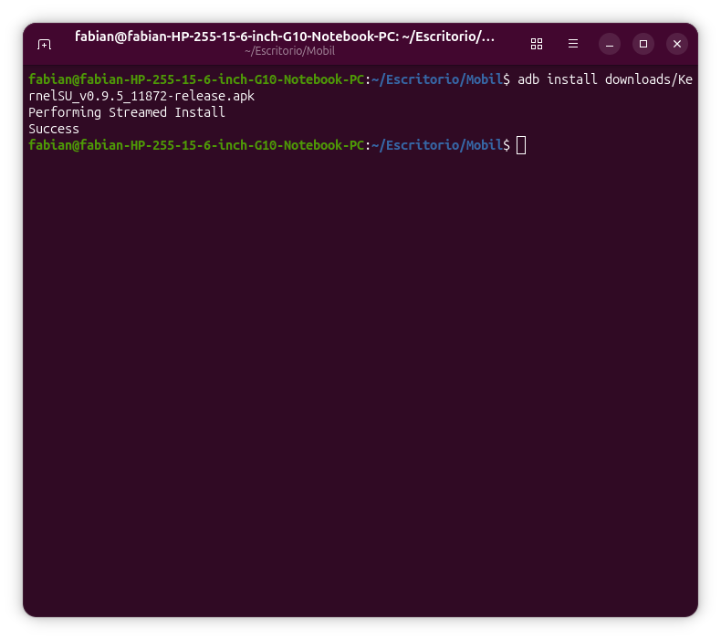
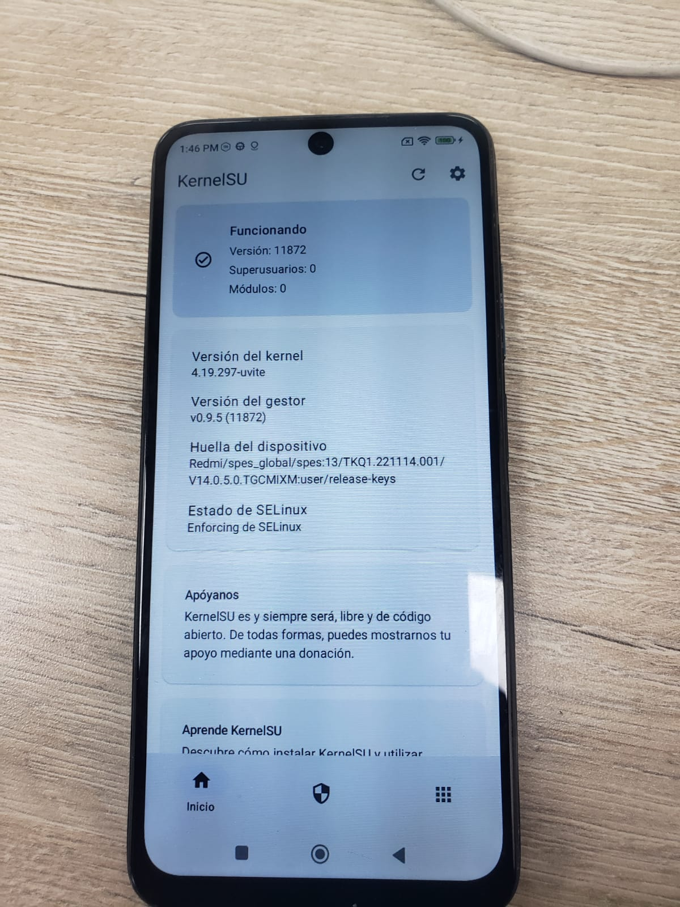
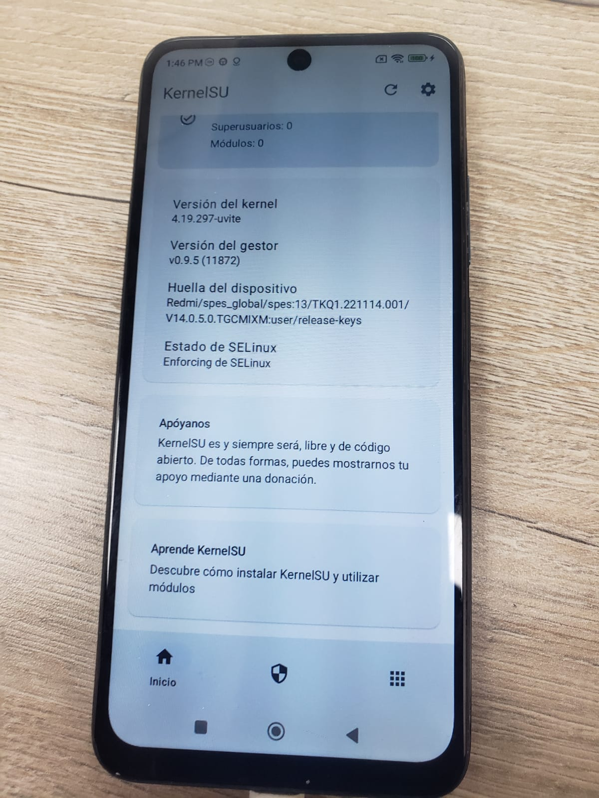
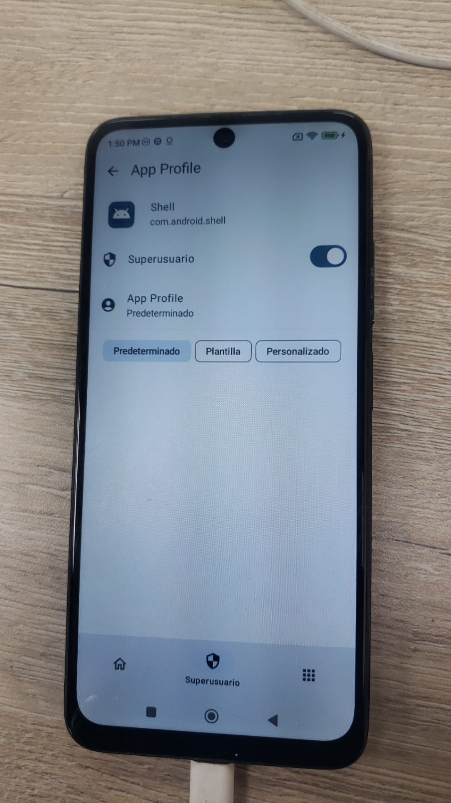

# Módulo 13 — KernelSU (opcional)

- Estado: Completado (checkpoint cumplido: root funcional con tu kernel y `dmesg` limpio; límites en el hallazgo #23)
- Fecha: 2026-10-23
- Kernel: `4.19.297-uvite` (`src/kernel-px`, rama `lab/ksu-01-integracion`, parte de `lab/cambio-02-kernel-init`)
- KernelSU: **v0.9.5**, commit `b766b98513b5a7eb33bc1c4a76b5702bf1288f07` (29-may-2024), clonado en `src/ksu-official` (ignorado por Git)
- Objetivo: tener root/observación en vivo en el teléfono de laboratorio (aislado, sin cuentas ni apps personales), integrando KernelSU **a mano** en un kernel 4.19 que no es GKI, con cada cambio en su propio commit.

## Concepto

KernelSU concede root desde dentro del kernel: un módulo del propio kernel decide qué aplicaciones pueden ejecutar `su`. Lo hace en dos mitades: (1) una parte que **vigila** (a través de los *hooks* de seguridad del kernel, LSM) cuándo cambia la lista de aplicaciones y busca la **app gestora oficial** comparando su firma con la fijada al compilar; (2) una parte que **concede el root**, que necesita *ganchos* en funciones del kernel (`do_execveat_common`, `do_faccessat`, `vfs_read`, `vfs_statx`, `input_handle_event`). En kernels GKI esos ganchos usan `kprobes`; en uno 4.19 no GKI se pueden usar `kprobes` o insertarlos a mano en el código fuente (vía manual, con `CONFIG_KPROBES` apagado).

**Riesgo asumido:** root total sobre el teléfono. Solo se hace en un teléfono de laboratorio, sin cuentas personales ni apps bancarias.

## Práctica guiada

```bash
# Paso 0: traer el código desde otra red (esta bloquea GitHub) y fijarlo a v0.9.5; NO se ejecuta setup.sh
cd ~/Escritorio/Mobil/src && git clone https://github.com/tiann/KernelSU.git ksu-official
cd ksu-official && git checkout v0.9.5 && git log -1 --format='%H%n%an%n%ad%n%s'

# Paso 1: integración a mano (las 3 piezas que haría setup.sh), rama aparte, sin ganchos
cd ~/Escritorio/Mobil/src/kernel-px && git checkout -b lab/ksu-01-integracion
ln -s ../../ksu-official/kernel drivers/kernelsu
#   drivers/Kconfig:  source "drivers/kernelsu/Kconfig"      (antes del endmenu)
#   drivers/Makefile: obj-$(CONFIG_KSU) += kernelsu/
git add drivers/Kconfig drivers/Makefile drivers/kernelsu && git commit -m "lab: integrar KernelSU v0.9.5 en drivers/kernelsu (sin ganchos)"   # 89acccabe
cd ~/Escritorio/Mobil && source artifacts/entorno-px.sh
src/kernel-px/scripts/config --file out-px/.config -e KSU
kmake olddefconfig 2>&1 | grep -v "unsupported character" | tail -3; grep -n "CONFIG_KSU" out-px/.config     # CONFIG_KSU=y
time kmake -j12 2>&1 | tee logs/13-build-ksu01.log | tail -8                                                     # real 34,3 s
cp out-px/arch/arm64/boot/Image.gz artifacts/px/Image-ksu01.gz
python3 tools/mkbootimg/mkbootimg.py --header_version 3 --os_version 12.0.0 --os_patch_level 2023-12 --kernel artifacts/px/Image-ksu01.gz --ramdisk backup/stock-unpacked/boot/ramdisk --cmdline 'ramoops_memreserve=4M' -o artifacts/px/boot-lab-ksu01.img
sha256sum artifacts/px/boot-lab-ksu01.img | tee logs/13-hash-boot-lab-ksu01.txt
adb reboot bootloader && fastboot boot artifacts/px/boot-lab-ksu01.img
adb shell 'su -c id'                                        # su: inaccessible or not found (esperado)
bash artifacts/capturar-dmesg.sh ksu01                      # logs/08-dmesg-ksu01.txt
grep -n -i "kernelsu" logs/08-dmesg-ksu01.txt | head
# Paso 2: los 5 ganchos manuales, uno por commit, cada uno compilado antes de comitar (21-23 s cada compilacion)
#   fs/exec.c           do_execveat_common  -> ksu_handle_execveat / ksu_handle_execveat_sucompat   (1fe0e62fa)
#   fs/open.c           do_faccessat        -> ksu_handle_faccessat                                (69d9a13b0)
#   fs/read_write.c     vfs_read            -> ksu_handle_vfs_read                                 (8bf47d179)
#   fs/stat.c           vfs_statx           -> ksu_handle_stat                                     (ad8d8e10b)
#   drivers/input/input.c input_handle_event -> ksu_handle_input_handle_event (modo seguro)        (a2a37a2c4)
llvm-objdump -d --no-show-raw-insn out-px/vmlinux --disassemble-symbols=do_execveat_common | grep "bl.*ksu_"   # comprueba la llamada enlazada
cp out-px/arch/arm64/boot/Image.gz artifacts/px/Image-ksu02.gz
python3 tools/mkbootimg/mkbootimg.py --header_version 3 --os_version 12.0.0 --os_patch_level 2023-12 --kernel artifacts/px/Image-ksu02.gz --ramdisk backup/stock-unpacked/boot/ramdisk --cmdline 'ramoops_memreserve=4M' -o artifacts/px/boot-lab-ksu02.img
adb reboot bootloader && fastboot boot artifacts/px/boot-lab-ksu02.img && bash artifacts/capturar-dmesg.sh ksu02

# Paso 3: app gestora oficial, con su firma comprobada antes
curl -sL -o downloads/KernelSU_v0.9.5_11872-release.apk https://github.com/tiann/KernelSU/releases/download/v0.9.5/KernelSU_v0.9.5_11872-release.apk
sha256sum downloads/KernelSU_v0.9.5_11872-release.apk | tee logs/13-hash-manager-apk.txt
python3 -I artifacts/verificar-firma-apk.py downloads/KernelSU_v0.9.5_11872-release.apk    # 827 bytes (0x033b), c371061b...
adb install downloads/KernelSU_v0.9.5_11872-release.apk                                   # Success
#   en el teléfono: app KernelSU > Superusuario > mostrar apps del sistema > Shell > interruptor
adb shell 'id'; adb shell 'su -c id'                                                        # uid=2000(shell) / uid=0(root) context=u:r:su:s0
adb shell 'su -c "cat /proc/hello_lab"'                                                     # modulo 9: ahora se lee

# Con root: lo que shell no podia
adb shell 'su -c "cat /sys/block/sda/queue/read_ahead_kb /sys/block/sda/queue/scheduler /proc/sys/kernel/sched_latency_ns; ls -l /proc/sys/vm/drop_caches"'
adb shell 'su -c "dmesg | grep -i kernelsu | tail -5"'                                    # dmesg directo, sin bugreport
# Cargar modulos como .ko con root (pendiente desde el modulo 9)
sed 's/hello_lab/hello_mod/g' modulos/hello_lab/hello_lab.c > modulos/hello_mod/hello_mod.c     # misma fuente, otro nombre
source artifacts/entorno-px.sh; for m in hello_lab hello_mod; do kmake M="$PWD/modulos/$m" modules; done
adb push modulos/hello_lab/hello_lab.ko modulos/hello_mod/hello_mod.ko /data/local/tmp/
adb shell 'su -c "insmod /data/local/tmp/hello_lab.ko"'      # Out of memory (el nodo /proc/hello_lab ya existe)
adb shell 'su -c "insmod /data/local/tmp/hello_mod.ko; lsmod; cat /proc/hello_mod; rmmod hello_mod; dmesg | grep hello_mod | tail -2"'

# La serie de parches del kernel (0002 es del modulo 11 y de otro arbol)
git -C src/kernel-px format-patch lab/cambio-02-kernel-init..lab/ksu-01-integracion -o patches --start-number 4    # 0004..0009
```

## Hallazgos reales

1. **KernelSU oficial ya no da soporte a kernels no GKI.** Su guía (archivada) dice que desde la v1.0 se dejó de soportar y que la última versión que lo hacía es la **v0.9.5**. Para 4.19 no hay tutorial oficial: lo más detallado está en forks de terceros, que se descartaron por ser código ajeno con acceso a root.
2. **Esta red bloqueaba GitHub** (`ssl_verify=20` en `curl`, el mismo cortafuegos que bloqueaba el `git push`); no se desactivó la verificación de certificados. El código se descargó desde otra red (`github.com` → `HTTP 200`, `ssl_verify=0`).
3. **La etiqueta `v0.9.5` es ligera** (apunta a un commit, no está firmada: `cannot verify a non-tag object of type commit`) y su último commit es un arreglo de un typo de la web, lo cual extrañó. Se comprobó con las fechas: `v0.9.4` 9-may, **`v0.9.5` 29-may**, `v1.0.0` 1-jun-2024, y los últimos cambios dentro de `kernel/` son del 26-27 de mayo. Coherente.
4. **`setup.sh` leído línea a línea antes de usarlo, y no se ejecutó.** Hace solo: `git clone`/`git pull` del repositorio dentro del árbol, enlace simbólico `drivers/kernelsu`, la línea `obj-$(CONFIG_KSU) += kernelsu/` en `drivers/Makefile` y `source "drivers/kernelsu/Kconfig"` antes del `endmenu` de `drivers/Kconfig`. Se reprodujeron las tres piezas a mano.
5. **Revisión del código del kernel de KernelSU** (5 521 líneas en `kernel/`): sin `socket`, `kernel_connect`, `call_usermodehelper` ni accesos a red (las coincidencias con `http` eran comentarios). El root solo se concede a la app cuya firma coincide con `KSU_EXPECTED_SIZE := 0x033b` y `KSU_EXPECTED_HASH := c371061b19d8c7d7d6133c6a9bafe198fa944e50c1b31c9d8daa8d7f1fc2d2d6` (el `Makefile` del módulo) y a las apps que ese gestor autorice.
6. **Estado de tu kernel frente a la vía manual:** las seis funciones de los ganchos existen (`do_execveat_common`, `do_faccessat`, `vfs_read`, `vfs_statx`, `input_handle_event`, `devpts_get_priv`); falta `path_umount` (backport de la 5.9, solo para «desmontar módulos», opcional). `CONFIG_KPROBES` no estaba activado (solo `HAVE_KPROBES=y`), que es lo correcto para la vía manual. `CONFIG_OVERLAY_FS=y`, que `Kconfig` de KernelSU exige. Ningún gancho de KernelSU en el árbol de partida.
7. **Integración (paso 1): commit `89acccabe`, 3 archivos, 4 líneas** (`create mode 120000 drivers/kernelsu`). Compila **sin errores ni avisos** a la primera: 34,3 s, 12 archivos en `drivers/kernelsu/` (`ksu.o`, `core_hook.o`, `sucompat.o`, `apk_sign.o`, `throne_tracker.o`...), **82 símbolos `ksu_…`** en `vmlinux` y la firma del gestor impresa en el registro. Un primer recuento con `grep ksu` dio 170 símbolos y era falso (coincidía con `ch**ksu**m`).
8. **Con KernelSU dentro y sin ganchos, el teléfono arranca normal y no hay root** (`su: inaccessible or not found`). `boot-lab-ksu01.img`, SHA-256 `167bf1a0e9b4bb3fb09618c85b0b2e3986121838cb2f3066913042493186b686`; `fastboot boot` `OKAY [0.869s]` / `OKAY [0.318s]`; arrancó con `4.19.297-uvite`.
9. **Aun sin ganchos, KernelSU ya funciona a medias.** En el `dmesg`: `[2.001963] KernelSU: KPROBES is disabled, KernelSU may not work…` y, a los 14 s, `renameat: packages.list.tmp -> packages.list`, `Searching manager...` y 94 líneas `Found new base.apk at path: …, is_manager: 0`. La parte que **vigila** funciona por los *hooks* de seguridad (LSM), sin `kprobes` ni ganchos manuales; la que **concede root** (`su`) no. Ninguna app es el gestor (`is_manager: 0`), como corresponde.
10. **Fuga que el mentor casi deja pasar:** KernelSU imprime la ruta de cada app y **87 de esas líneas llevaban carpetas aleatorias propias del teléfono** (`/data/app/~~<aleatorio>==/<paquete>-<aleatorio>==/base.apk`). Se añadió al extractor una regla que las cambia por `[APP-TAPADA]` y a la prueba de fugas el contador `APPS`; el registro se regeneró desde su `.zip` (0 rutas `~~` restantes, 87 tapadas) **antes** de versionarlo. Los ocho registros anteriores tenían 0 de esas rutas.
11. **Limitación conocida de privacidad (no corregida):** los mensajes de SELinux (`avc: granted/denied`) citan rutas como `/data/data/com.facebook.katana/…` (paquetes comunes, aquí preinstalados en la ROM). Aparecen también en los registros ya publicados (4 a 13 líneas cada uno). Tapar esos nombres exigiría reescribir lo publicado.

12. **Los cinco ganchos manuales, un commit cada uno**, y cada uno **compilado antes de comitar** (0 errores, 0 avisos, 21-23 s por compilación): `1fe0e62fa` `do_execveat_common` (`fs/exec.c`, 13 líneas), `69d9a13b0` `do_faccessat` (`fs/open.c`, 7), `8bf47d179` `vfs_read` (`fs/read_write.c`, 8), `ad8d8e10b` `vfs_statx` (`fs/stat.c`, 7), `a2a37a2c4` `input_handle_event` (`drivers/input/input.c`, 9; es el del **modo seguro**, que la documentación recomienda mucho contra bucles de arranque). Los parches de referencia de la guía encajaron **tal cual** en 4.19.297 (mismo `do_execveat_common` que solo llama a `__do_execve_file`, mismo `do_faccessat`...), y se comprobó antes que las firmas completas de las funciones `ksu_handle_*` del código `v0.9.5` coinciden con las que declaran. Error del mentor: un `grep ^ssize_t vfs_read` coincidió con dos funciones y falló el `sed` con aritmética; se repitió con `^ssize_t vfs_read(`.
13. **Las cinco llamadas están realmente enlazadas en `vmlinux`:** `llvm-objdump` muestra `bl <ksu_handle_execveat>` y `<ksu_handle_execveat_sucompat>` dentro de `do_execveat_common`, `<ksu_handle_faccessat>` en `do_faccessat`, `<ksu_handle_vfs_read>`, `<ksu_handle_stat>` y `<ksu_handle_input_handle_event>`. `CONFIG_KPROBES` sigue apagado (`# CONFIG_KPROBES is not set`), como exige la vía manual.
14. **Arranque con los cinco ganchos** (`boot-lab-ksu02.img`, SHA-256 `6c046ffdd6822e9fe6fd617b307654a1d064357b6abf0643dc0eaedff97bb17e`, uptime 131 s, `su: inaccessible or not found`): en el `dmesg` KernelSU **ya ve el arranque de Android** (`/init argc: 1`, `/system/bin/init first arg: selinux_setup`, `second_stage executed`), lo cual es el gancho de `do_execveat_common` funcionando; sin ganchos (`ksu01`) esas líneas no existían. `KPROBES is disabled` sigue saliendo (el aviso no sabe que hay ganchos manuales) y `load_allow_list open file failed: -2` es normal (aún no hay lista de apps con permiso).
15. **El APK del gestor y su firma.** La publicación `v0.9.5` tiene 98 archivos (casi todos imágenes `boot.img` para kernels GKI, que no sirven); el gestor es `KernelSU_v0.9.5_11872-release.apk` (8 527 498 bytes, SHA-256 `8384b08fb8c4cf1314fa87aff80839faf284d22eeff41a8319e8eaa1336f1e7b`) y su `11872` coincide con el `KernelSU version: 11872` del kernel compilado. **No tiene firma v1** (`META-INF/*.RSA` vacío), así que se escribió `artifacts/verificar-firma-apk.py`, que solo lee el bloque de firma v2 del APK: primer certificado de **827 bytes (`0x033b`)** y SHA-256 **`c371061b…2d6`**, **idénticos** a `KSU_EXPECTED_SIZE`/`KSU_EXPECTED_HASH` fijados en el kernel. Limitación: eso prueba que APK y kernel **concuerdan entre sí**; ambos vienen del mismo repositorio de GitHub, así que no demuestra por sí solo que la clave sea la del autor legítimo.
16. **Instalación y estado.** `adb install` → `Success` (MIUI **no** bloqueó la instalación por USB). La app muestra **«Funcionando», versión 11872, Superusuarios 0, Módulos 0**, kernel `4.19.297-uvite`, gestor `v0.9.5 (11872)` y **SELinux Enforcing** (no se tocó).
17. **Root concedido a `shell` (y solo a `shell`).** En la app: Superusuario > mostrar apps del sistema > `Shell (com.android.shell)` > interruptor. Resultado: `adb shell id` → `uid=2000(shell) … context=u:r:shell:s0`; **`adb shell 'su -c id'` → `uid=0(root) gid=0(root) context=u:r:su:s0`**. Consecuencia asumida: mientras ese permiso esté activo, **cualquier sesión de `adb` en este teléfono puede ser root**; se revierte quitando el interruptor en la misma pantalla. El `dmesg` leído directamente (`su -c dmesg`) muestra los ganchos en acción: `KernelSU: faccessat su->sh!`, `do_execveat_common su found`, `newfstatat su->sh!`.
18. **Pendiente del módulo 9 cobrado:** con `su`, **`cat /proc/hello_lab` funciona** y devuelve `hola desde el kernel del Redmi Note 11` y `lecturas: 1`, y en la segunda lectura `lecturas: 2` (el contador sube, como programó `hello_show`); el archivo es `-r--r--r-- root root u:object_r:proc:s0`. Como `shell` sigue recibiendo `Permission denied`, queda confirmado que el bloqueo era SELinux y no un fallo del módulo.
19. **Lo que el root deja ver (para el paso 6 diferido del módulo 12):** `/sys/block/sda/queue/read_ahead_kb = 128`, `scheduler = noop [cfq]`, `sched_latency_ns = 10000000`, `sched_min_granularity_ns = 3000000`, y `/proc/sys/vm/drop_caches` **escribible** (`--w-------`). Para los módulos: `/proc/modules` existe, `modules_disabled = 0`, y están `/system/bin/insmod` y `/system/bin/lsmod`.

20. **`insmod hello_lab.ko` falla, y el mensaje miente.** Con la versión integrada ya cargada, `insmod` da `failed to load … hello_lab.ko: Out of memory` (código 1). **No es falta de memoria:** es el `return -ENOMEM` que tu `hello_lab_init` devuelve cuando `proc_create` falla, y el `dmesg` revela la causa verdadera: `proc_dir_entry '/proc/hello_lab' already registered` (con el rastro `proc_register+0x120`, `init_module+0x24 [hello_lab]`, `Modules linked in: hello_lab(O+)`). `lsmod` quedó vacío: el módulo no se cargó. Es una trampa real del código del módulo 9: un nodo duplicado (`-EEXIST`) se disfraza de `-ENOMEM`.
21. **Ciclo completo con `hello_mod`** (la misma fuente con otro nombre de nodo; `diff` de `sed` sin otra diferencia). Los dos `.ko` compilaron sin avisos (138 536 bytes) con `vermagic=4.19.297-uvite SMP preempt mod_unload modversions aarch64`, idéntico al del kernel en marcha. `insmod` → código 0; `lsmod` → `hello_mod 16384 0`; `cat /proc/hello_mod` ×2 → `lecturas: 1` y `lecturas: 2`; `dmesg` → `hello_mod: cargado, nodo /proc/hello_mod creado (cpus=8, HZ=250)`; `rmmod` → código 0, `/proc/hello_mod: No such file or directory` y **`hello_mod: descargado, nodo /proc/hello_mod eliminado`**. Es la primera vez que corre la función de salida de un módulo tuyo: como código integrado, `hello_lab_exit` no se ejecutaba nunca (módulo 9, hallazgo #19). Registro crudo: `logs/13-insmod-rmmod.txt`.
22. **La serie de parches del kernel es reproducible.** `patches/0004` a `0009` (integración y los cinco ganchos) salen de `git format-patch lab/cambio-02-kernel-init..lab/ksu-01-integracion --start-number 4`; el `0002` es del módulo 11 y de otro árbol (Rust), por eso la serie del kernel es `0001`, `0003`, `0004`…`0009`. Verificado: aplicados **en ese orden** sobre los archivos originales de `fourteen`, los diez archivos resultantes son **idénticos byte a byte** a los de la rama `lab/ksu-01-integracion`.
23. **Qué NO se hizo, y conviene no dar por hecho:** el root existe solo mientras se usa `fastboot boot` (no se escribió nada en el teléfono: al reiniciar vuelve el kernel de fábrica y la app de KernelSU queda instalada pero inactiva); no se probó `ftrace`/`kprobes`; no se probó revertir cada gancho con `git revert` ni el modo seguro (volumen abajo al arrancar); `fs/devpts/inode.c` y `path_umount` no se añadieron.

## Evidencias

Registros guardados:
- `logs/13-build-ksu01.log` — compilación con KernelSU integrado, sin ganchos.
- `logs/13-hash-boot-lab-ksu01.txt` — SHA-256 de la imagen probada.
- `logs/08-dmesg-ksu01.txt` — `dmesg` del arranque (línea 835: `KPROBES is disabled`; líneas 3539 en adelante: `Searching manager...`).
- `logs/13-build-ksu02a-exec.log`, `…02b-open.log`, `…02c-read.log`, `…02d-stat.log`, `…02e-input.log` — la compilación tras cada gancho (hallazgo #12).
- `logs/13-hash-boot-lab-ksu02.txt`, `logs/08-dmesg-ksu02.txt` — arranque con los cinco ganchos (líneas 1266 a 1490: `/init argc`, `second_stage executed`).
- `logs/13-hash-manager-apk.txt` y `artifacts/verificar-firma-apk.py` — hash del APK y el analizador de su firma.
- `logs/13-insmod-rmmod.txt` — `insmod` fallido de `hello_lab.ko` y ciclo completo de `hello_mod.ko` (hallazgos #20 y #21).
- `patches/0004` a `0009` — la serie de KernelSU (hallazgo #22).
Capturas (fotos del teléfono):

**00 — `adb install` del gestor (hallazgo #16)**
`Performing Streamed Install` → `Success`.


**01 y 02 — KernelSU «Funcionando» (hallazgo #16)**
Estado, versión 11872, 0 superusuarios, kernel `4.19.297-uvite`, gestor `v0.9.5 (11872)` y SELinux Enforcing.



**03 — Permiso de superusuario solo para Shell (hallazgo #17)**
`com.android.shell` con el interruptor activado y perfil «Predeterminado».


## Pendientes

- [x] Paso 0: código de KernelSU v0.9.5 descargado y fijado; `setup.sh` leído.
- [x] Paso 1: integración sin ganchos, compilada, arrancada, sin root (esperado).
- [x] Paso 2: los cinco ganchos manuales, uno por commit y compilados uno a uno (`fs/devpts/inode.c` no hizo falta por ahora).
- [x] Paso 3: app gestora oficial v0.9.5 instalada **tras comprobar que su firma coincide**; root solo para `shell`.
- [x] Paso 4 (parte 1): `insmod`/`rmmod` de un `.ko`, y `/proc/hello_lab` leído con root.
- [ ] Paso 4 (parte 2): el paso 6 diferido del módulo 12 (cambio de rendimiento medido antes y después con `drop_caches`).
- [ ] Probar la reversibilidad de cada gancho con `git revert`.
