# Módulo 14 — Más allá de Android: Linux móvil

- Estado: En progreso (investigación de compatibilidad y respaldos hechos; QEMU pendiente)
- Fecha: 2026-10-23
- Teléfono: Redmi Note 11 (`spes`), modelo `2201117TL`, variante **`spes-sm5602`** (`qcom,board-id` = `0004 0022`), kernel `4.19.297-uvite` con root de KernelSU (módulo 13, solo mientras dure el `fastboot boot`)
- Objetivo: entender el sistema completo, no solo el kernel, y averiguar **si este teléfono puede correr un Linux móvil** antes de cambiarle nada. Se hace en etapas, de menos a más riesgo, y **primero en QEMU**.

## Concepto

Android es un sistema de espacio de usuario (`system`, `vendor`, `product` dentro de la partición `super`) sobre un kernel Linux. Un «Linux móvil» (postmarketOS/Nura, Mobian, Ubuntu Touch...) sustituye ese espacio de usuario por uno basado en una distribución de escritorio (Alpine, Debian...), con una interfaz táctil (Phosh, Plasma Mobile...). Puede ir sobre el **kernel del fabricante** (el 4.19, con todos los controladores de Xiaomi pero abandonado) o sobre un **kernel principal moderno** (*mainline*), que exige que cada pieza de hardware tenga controlador en el Linux oficial.

## Práctica guiada

```bash
# Paso 1: ¿qué dice el proyecto de dispositivos? (la web esta tras un anti-bots; git si pasa)
git ls-remote https://gitlab.postmarketos.org/postmarketOS/pmaports.git HEAD
mkdir /tmp/pmaports-spes && cd /tmp/pmaports-spes && git init -q . && git remote add o https://gitlab.postmarketos.org/postmarketOS/pmaports.git
git config core.sparseCheckout true && printf 'device/*/device-xiaomi-spes/\ndevice/*/linux-xiaomi-spes/\n' > .git/info/sparse-checkout
git fetch -q --depth 1 o HEAD && git checkout -q FETCH_HEAD && find device -type f          # device/archived/...
cat device/archived/device-xiaomi-spes/{APKBUILD,deviceinfo}
grep "idVendor" device/archived/device-xiaomi-spes/deviceinfo | xxd                          # 0x05 d1 81 36: la "c" es U+0441

# Paso 2: ¿que variante es MI telefono? (con root)
adb shell 'su -c "od -An -tx1 /sys/firmware/devicetree/base/qcom,board-id"'                 # 00 04 00 22 -> spes-sm5602
adb shell getprop ro.product.model                                                          # 2201117TL

# Paso 3: mapa de particiones (solo lectura), con el tamano calculado en la laptop
adb shell 'su -c "cd /dev/block/bootdevice/by-name; for n in *; do b=\$(basename \$(readlink -f \$n)); echo \$n \$b \$(cat /sys/class/block/\$b/size); done"'

# Paso 4: respaldo de lo que no vuelve con la ROM de fabrica (solo lectura, verificado por hash)
bash artifacts/respaldar-particiones.sh                                                      # 14 OK, fallos: 0
# Etapa 1, paso 1 (QEMU): tu propio PID 1 en un initramfs de 4 entradas
cat modulos/mi_init/mi_init.c                                   # escrito a mano: mount /proc, getpid(), uptime, version, reboot(RB_POWER_OFF)
bash modulos/mi_init/construir.sh                               # gcc -static (aarch64) + gen_init_cpio + gzip -> out-initramfs/mi_init.cpio.gz
timeout 40 qemu-system-aarch64 -machine virt -cpu cortex-a72 -m 1G -nographic -kernel out-rust/arch/arm64/boot/Image -initrd out-initramfs/mi_init.cpio.gz -append "console=ttyAMA0 panic=-1" -no-reboot < /dev/null > logs/14-qemu-mi-init.log 2>&1; echo $?
# Etapa 1, paso 2 (QEMU): tu PID 1 lanza y espera a un hijo (fork/exec/waitpid)
bash modulos/mi_init/construir.sh      # ahora compila mi_init y hijo, 5 entradas en el initramfs
timeout 40 qemu-system-aarch64 ... -initrd out-initramfs/mi_init.cpio.gz ... > logs/14-qemu-mi-init2.log 2>&1
# Etapa 1, paso 3: un Alpine real (minirootfs 3.24.3) con tu inittab y tu propio servicio
wget https://dl-cdn.alpinelinux.org/alpine/v3.24/releases/aarch64/alpine-minirootfs-3.24.3-aarch64.tar.gz
echo "4d3f80afaebd447c5591a63a73bde380a149fe8b2d85488cafabb2ff97551f50  alpine-minirootfs-3.24.3-aarch64.tar.gz" | sha256sum -c     # OK
mkdir -p src/alpine-rootfs && tar -xzf downloads/alpine-minirootfs-3.24.3-aarch64.tar.gz -C src/alpine-rootfs --no-same-owner
bash modulos/mi_alpine/construir.sh    # carpeta + overlay -> gen_initramfs.sh -u squash -g squash -> out-initramfs/mi_alpine.cpio.gz
timeout 60 qemu-system-aarch64 -machine virt -cpu cortex-a72 -m 1G -nographic -kernel out-rust/arch/arm64/boot/Image -initrd out-initramfs/mi_alpine.cpio.gz -append "console=ttyAMA0 panic=-1 lab=auto" -no-reboot < /dev/null > logs/14-qemu-alpine.log 2>&1
sed -n '/=== prueba automatica/,/=== fin/p' logs/14-qemu-alpine.log
# Etapa 1, paso 4 (QEMU con red): instalar un paquete de verdad con apk
bash modulos/mi_alpine/construir.sh    # incluye usr/local/bin/prueba-red (se activa con lab=red)
timeout 150 qemu-system-aarch64 -machine virt -cpu cortex-a72 -m 1G -nographic -kernel out-rust/arch/arm64/boot/Image -initrd out-initramfs/mi_alpine.cpio.gz -nic user,model=virtio-net-pci -append "console=ttyAMA0 panic=-1 lab=red" -no-reboot < /dev/null > logs/14-qemu-red.log 2>&1
sed -n '/=== prueba de red/,/=== fin/p' logs/14-qemu-red.log
# Etapa 1, paso 5 (QEMU con red): tu servicio como servicio de OpenRC, supervisado
#   modulos/mi_alpine/overlay/etc/init.d/mi-latido  (#!/sbin/openrc-run, supervisor="supervise-daemon", need localmount)
#   modulos/mi_alpine/overlay/usr/local/bin/mi-latido  (un latido por segundo, no termina nunca)
bash modulos/mi_alpine/construir.sh
timeout 150 qemu-system-aarch64 -machine virt -cpu cortex-a72 -m 1G -nographic -kernel out-rust/arch/arm64/boot/Image -initrd out-initramfs/mi_alpine.cpio.gz -nic user,model=virtio-net-pci -append "console=ttyAMA0 panic=-1 lab=red" -no-reboot < /dev/null > logs/14-qemu-openrc.log 2>&1
sed -n '/--- servicio de OpenRC/,/=== fin/p' logs/14-qemu-openrc.log
# Etapa 1, paso 6 (QEMU): namespaces con unshare, comparados desde fuera y desde dentro
#   modulos/mi_alpine/overlay/usr/local/bin/prueba-ns   (se activa con lab=ns)
bash modulos/mi_alpine/construir.sh
timeout 60 qemu-system-aarch64 -machine virt -cpu cortex-a72 -m 1G -nographic -kernel out-rust/arch/arm64/boot/Image -initrd out-initramfs/mi_alpine.cpio.gz -append "console=ttyAMA0 panic=-1 lab=ns" -no-reboot < /dev/null > logs/14-qemu-ns.log 2>&1
sed -n '/=== prueba de namespaces/,/=== fin/p' logs/14-qemu-ns.log
grep -n "_NS_INIT_INO" src/linux-6.18.58/include/uapi/linux/nsfs.h            # los inodos de los namespaces iniciales
# Etapa 1, paso 7 (QEMU): cgroup2, limite de memoria de 20 MiB
cat modulos/mi_alpine/hog.c                        # escrito a mano: reserva y TOCA 1 MiB en bucle
bash modulos/mi_alpine/construir.sh                # compila hog (estatico) dentro del sistema; prueba-cg se activa con lab=cg
timeout 60 qemu-system-aarch64 -machine virt -cpu cortex-a72 -m 1G -nographic -kernel out-rust/arch/arm64/boot/Image -initrd out-initramfs/mi_alpine.cpio.gz -append "console=ttyAMA0 panic=-1 lab=cg" -no-reboot < /dev/null > logs/14-qemu-cg.log 2>&1
sed -n '/=== prueba de cgroups/,/=== fin/p' logs/14-qemu-cg.log
```

```bash
# Etapa 2 (sin tocar el telefono): el kernel principal del SM6225 y su arbol de dispositivo
git clone --depth 1 --single-branch --branch v7.2.1-sm6225 https://gitlab.postmarketos.org/sm6225-mainline/kernels/linux-v.7.2.1.git src/linux-sm6225    # 11 min 37 s
ls src/linux-sm6225/arch/arm64/boot/dts/qcom/ | grep -E "sm6225|spes"          # sm6225-xiaomi-spes-sm5602.dts, sm6225-xiaomi-spesn.dts, sm6225.dtsi
grep -E "msm-id|board-id" src/linux-sm6225/arch/arm64/boot/dts/qcom/sm6225-xiaomi-spes-sm5602.dts
adb shell 'su -c "od -An -tx1 /sys/firmware/devicetree/base/qcom,msm-id /sys/firmware/devicetree/base/qcom,board-id"'
adb shell 'su -c "cd /dev/block/bootdevice/by-name; sha256sum boot_a boot_b vendor_boot_a vendor_boot_b dtbo_a dtbo_b"'     # solo lectura
```

```bash
# Etapa 2b: compilar el kernel principal con nuestro Clang (solo laptop)
make -C src/linux-sm6225 O=$PWD/out-sm6225 ARCH=arm64 LLVM=1 sm6225_defconfig
( time make -C src/linux-sm6225 O=$PWD/out-sm6225 ARCH=arm64 LLVM=1 -j12 Image dtbs ) > logs/14-build-sm6225.log 2>&1      # 15 min 37 s, make sale con 2
grep -n -E "\*\*\*|error:" logs/14-build-sm6225.log | head                        # primer error: falta panel-xiaomi-k7-38-0c-0b.o
src/linux-sm6225/scripts/config --file out-sm6225/.config -d DRM_PANEL_XIAOMI_K7_38_0C_0B
make -C src/linux-sm6225 O=$PWD/out-sm6225 ARCH=arm64 LLVM=1 olddefconfig
( time make -C src/linux-sm6225 O=$PWD/out-sm6225 ARCH=arm64 LLVM=1 -j12 Image dtbs ) > logs/14-build-sm6225-b.log 2>&1    # 33,8 s, salida 0
dtc -I dtb -O dts out-sm6225/arch/arm64/boot/dts/qcom/sm6225-xiaomi-spes-sm5602.dtb | grep -E "model|compatible|msm-id|board-id"
fastboot --help | grep -E "dtb|header-version"                                                 # --dtb DTB (header v2), --header-version
```

```bash
# Etapa 3, primera prueba en el telefono: kernel principal 7.2.1 con su DTB, imagen v2, desde RAM
bash modulos/mi_alpine/construir.sh telefono        # initramfs con consola en pantalla (tty1): out-initramfs/mi_alpine_tel.cpio.gz
gzip -9 -c out-sm6225/arch/arm64/boot/Image > out-initramfs/Image-sm6225.gz                 # 18 143 860 bytes
python3 tools/mkbootimg/mkbootimg.py --header_version 2 --kernel out-initramfs/Image-sm6225.gz --ramdisk out-initramfs/mi_alpine_tel.cpio.gz --dtb out-sm6225/arch/arm64/boot/dts/qcom/sm6225-xiaomi-spes-sm5602.dtb --cmdline "console=tty0 loglevel=7 rdinit=/init" --base 0 --kernel_offset 0x8000 --ramdisk_offset 0x1000000 --second_offset 0x8000 --tags_offset 0x100 --dtb_offset 0x1f00000 --pagesize 4096 -o artifacts/px/boot-sm6225-v2.img    # 22 560 768 bytes
adb reboot bootloader && fastboot boot artifacts/px/boot-sm6225-v2.img                      # OKAY / OKAY, pero el telefono NO sale de fastboot
lsusb | grep 18d1; fastboot devices; fastboot getvar product; fastboot getvar current-slot  # sigue en fastboot, vivo
fastboot reboot                                                                              # Android de fabrica, kernel 4.19.157-perf
# Prueba de control: separar el DTB base de fabrica de vendor_boot
python3 tools/mkbootimg/unpack_bootimg.py --boot_img backup/stock/vendor_boot.img --out /tmp/vb   # 18 DTB, 5 598 424 bytes
```

```bash
# Prueba de control y diagnostico (hallazgos 44 a 48)
fastboot boot artifacts/px/boot-4_19-v2.img                        # logo, se apaga, vuelve a fastboot
fastboot boot artifacts/px/boot-lab-ksu02.img                      # Android con tu kernel y root
adb shell 'su -c "cat /sys/fs/pstore/console-ramoops-0"' > /tmp/pstore-control.txt        # 1304 lineas del arranque anterior
grep -m1 "Linux version" /tmp/pstore-control.txt; grep -m1 "Machine model" /tmp/pstore-control.txt; tail -30 /tmp/pstore-control.txt
dtc -I dtb -O dts artifacts/px/dtb-base-khaje.dtb | grep -c __symbols__                   # 1
dtc -I dtb -O dts out-sm6225/arch/arm64/boot/dts/qcom/sm6225-xiaomi-spes-sm5602.dtb | grep -c __symbols__    # 0
# la tabla dtbo de fabrica (40 capas) y la capa nº 31 de tu placa
python3 -c "... separar backup/stock/dtbo.img por su cabecera 0xd7b7ab1e ..."
fdtoverlay -i artifacts/px/dtb-base-khaje.dtb -o /tmp/ov.dtb /tmp/dtbo/31.dtbo             # codigo 0: se aplica
fdtoverlay -i sm6225-xiaomi-spes-sm5602.dtb -o /tmp/ov.dtb /tmp/dtbo/31.dtbo               # FDT_ERR_BADOFFSET: sin __symbols__
make ... DTC_FLAGS="-@" qcom/sm6225-xiaomi-spes-sm5602.dtb && fdtoverlay ...                # FDT_ERR_NOTFOUND
```

```bash
# Etapa 3b: preparar el salto con kexec desde tu 4.19 al kernel principal (sin tocar el telefono todavia)
cd src/kernel-px && git checkout -b lab/kexec-01          # rama aparte; CONFIG_KEXEC=y en spes-perf_defconfig y arreglo de proc-fns.h
cd ~/Escritorio/Mobil && source artifacts/entorno-px.sh && kmake -j12                              # 11 min 24 s, 0 errores
llvm-nm out-px/vmlinux | grep -E "sys_kexec_load|machine_kexec|kernel_kexec"                        # __arm64_sys_kexec_load, machine_kexec, kernel_kexec
python3 tools/mkbootimg/mkbootimg.py --header_version 3 --os_version 12.0.0 --os_patch_level 2023-12 --kernel artifacts/px/Image-kexec.gz --ramdisk backup/stock-unpacked/boot/ramdisk --cmdline 'ramoops_memreserve=4M' -o artifacts/px/boot-lab-kexec.img
# kexec-tools 2.0.32 para ARM64, estatico
wget https://cdn.kernel.org/pub/linux/utils/kernel/kexec/kexec-tools-2.0.32.tar.xz; sha256sum -c sha256sums.asc.1 --ignore-missing
cd src/kexec-tools && ./configure --host=aarch64-linux-gnu CFLAGS="-O2 -static" LDFLAGS="-static" && make -j12      # build/sbin/kexec, 1 005 000 bytes
# kernel principal con pstore integrado y DTB de laboratorio
src/linux-sm6225/scripts/config --file out-sm6225/.config -e PSTORE_CONSOLE -e PSTORE_RAM -e PSTORE_PMSG
make -C src/linux-sm6225 O=$PWD/out-sm6225 ARCH=arm64 LLVM=1 -j12 Image                              # 3 min 54 s
bash modulos/sm6225/construir-dtb.sh                                                                 # out-sm6225/lab.dtb
git -C src/kernel-px format-patch lab/ksu-01-integracion..lab/kexec-01 -o patches --start-number 10  # 0010 y 0011
```

```bash
# Etapa 3c: el salto con kexec (tres intentos), con Volumen Abajo pulsado para entrar en fastboot al reiniciar
adb reboot bootloader && fastboot boot artifacts/px/boot-lab-kexec.img                      # Android con tu 4.19 + KEXEC
adb push out-kexec/{kexec,Image-sm6225,lab.dtb,initramfs.cpio.gz} /data/local/tmp/kx/       # 55 003 552 bytes; hashes iguales en el telefono
adb shell 'su -c "kexec -c -l Image-sm6225 --dtb=lab.dtb --initrd=initramfs.cpio.gz --append=\"console=tty0 loglevel=8 ignore_loglevel rdinit=/init panic=5 printk.time=1 clk_ignore_unused pd_ignore_unused\" --mem-min=0x80000000 --mem-max=0x13fffffff"'   # kexec_loaded = 1
adb shell 'su -c "kexec -e"'                                                                  # intento 2: BUG en machine_kexec
adb shell 'su -c "for c in 7 6 5 4 3 2 1; do echo 0 > /sys/devices/system/cpu/cpu$c/online; done; kexec -e"'     # intento 3
fastboot boot artifacts/px/boot-lab-kexec.img && adb shell 'su -c "cat /sys/fs/pstore/console-ramoops-0"'      # registro del arranque anterior
```

## Hallazgos reales

1. **La búsqueda web estaba desactualizada.** Decía que el paquete `device-xiaomi-spes` de postmarketOS estaba en `testing`. El repositorio real (`pmaports`, commit `c7940da`, 23-oct-2026) lo tiene en **`device/archived/`**, y el `APKBUILD` de dispositivo y de kernel empiezan con **`# Archived: unmaintained`** y `maintainer=""`: archivado y sin mantenedor.
2. **postmarketOS ahora se llama «Nura»** (cambio anunciado en septiembre de 2026; sitio nuevo `nura.eco`). Las páginas oficiales antiguas redirigían a ese dominio y **no se siguió el redirect hasta confirmarlo con fuentes independientes** (Notebookcheck, Linuxiac, It's FOSS). Las referencias a «postmarketOS» persisten en paquetes y documentación.
3. **Las webs del proyecto están tras un anti-bots (Anubis)** que bloquea a las herramientas automáticas (`Making sure you're not a bot!`), y la página de paquetes daba error 500. **`git` sí pasa**: `git ls-remote` devolvió el commit, y un clon **superficial y parcial** (`sparse-checkout`, `--depth 1`) trajo solo los archivos de `spes`.
4. **El paquete archivado es de kernel de fabricante.** `linux-xiaomi-spes` 4.19.325 construido de un fork personal de GitHub (`muralivijay/kernel_xiaomi_spes`, commit `ae003d9a…`) con la configuración de `spes-perf_defconfig`; `device-xiaomi-spes` usa `fastboot`, cabecera de `boot.img` **versión 3** y `postmarketos-base-downstream`. Es de la misma familia que el kernel 4.19 que ya compilaste (el tuyo es PixelExperience 4.19.297).
5. **Un typo real en el paquete archivado:** `deviceinfo_usb_idVendor="0x05с6"` lleva una **«с» cirílica (U+0441, bytes `d1 81`)** en lugar de la `c` ASCII del identificador USB de Qualcomm (`0x05c6`). Se vio porque `xxd` mostró dos bytes donde debía haber uno; lo mismo que `ñ` en el módulo 11.
6. **La página del dispositivo en la wiki** (que pegó el usuario; está traducida por máquina y **perdió algunas etiquetas de la tabla**, así que solo se citan las que se leen con claridad): «probado con Nura, pero su paquete aún no se ha añadido a los repositorios» (no se puede elegir en `pmbootstrap`), categoría «pruebas», kernel principal **7.2.9**, con Phosh funcionando. **Funciona:** pantalla táctil, aceleración 3D (Adreno 610), Wi-Fi, Bluetooth, háptica y el módem (**llamadas, SMS y datos móviles**). **Parcial:** cámara. **Roto:** flash de cámara, infrarrojo y sensor de proximidad. **Sin aclarar por la traducción:** GPS y otros sensores. **Audio «realmente malo»:** solo el altavoz inferior y un canal auxiliar, entrecortado y con ruido. El kernel principal está en `gitlab.postmarketos.org/sm6225-mainline/kernels/linux-v.7.2.1`. Un usuario de la lista usa **/e/OS a diario y Linux en una segunda partición**.
7. **Instalación según la página (vía kernel 4.19):** `pmbootstrap export`, desempaquetar el `boot.img`, **cambiar la cabecera de versión 0 a 3**, reempaquetar, **`fastboot flash boot`**, y **`pmbootstrap flasher flash_rootfs`**. Es la primera vez en el curso que aparece `flash` en lugar de `fastboot boot`. **No se verificó a qué partición va el sistema de archivos por defecto ni si Android sigue arrancando después.**
8. **Tres variantes del Redmi Note 11, y la tuya es la mejor soportada.** La página las distingue por `qcom,board-id`: `0002 0022` (MAX77729), `0003 0022` (`spesn`, NFC), `0004 0022` (`spes-sm5602`). El teléfono tiene **`00 04 00 22`** = `spes-sm5602`, modelo `2201117TL` (está en la lista de la página). El `dmesg` lo confirma: **3 307 menciones de `sm5602`**, cargador `nopmi_chg` y `sc8551`, y `st21nfc_dev_init: not supports NFC`. La desarrolladora del puerto principal dice poder probar solo las variantes SM5602 y no la de MAX77729.
9. **Mapa de particiones** (95 entradas, A/B para `boot`, `vendor_boot`, `modem`, `dsp`, `vbmeta`, `dtbo`...). **`userdata` = 102,3 GiB** (Android y, normalmente, el sistema de Linux), **`super` = 8,5 GiB** (`system`, `vendor`, `product`), `cust` = 2 GiB, `persist` = 32 MiB. **Error del mentor:** la primera lista salió con tamaños **negativos** (`userdata -1780 MiB`) porque el `sh` de Android calcula con 32 bits; se repitió pasando los sectores crudos y calculando en la laptop.
10. **Respaldo de lo que no vuelve con la ROM de fábrica.** `artifacts/respaldar-particiones.sh` copia con `dd` (`adb exec-out`, binario sin alterar) 14 particiones propias del teléfono a `backup/particiones/` (63 MiB), y **solo acepta cada copia si el SHA-256 y el tamaño coinciden entre el teléfono y la laptop**: **14 `OK`, `fallos: 0`**. Contenido real: `modemst1`, `modemst2` y `fsg` al 99,6 % de bytes no nulos, `persist` al 2,8 %; el resto está casi vacío (menos de un 0,1 %), coherente con un teléfono restablecido de fábrica. **Esas copias contienen datos personales del teléfono (IMEI, MAC, calibraciones): `backup/` está ignorado por Git y el script se niega a ejecutarse si no lo estuviera. Solo se versiona `logs/14-hash-particiones.txt` (nombres y hashes).**
11. **Veredicto de compatibilidad.** **Apto, con límites.** A favor: bootloader desbloqueado, `boot.img` v3, `fastboot`, variante bien soportada, el módem funciona. En contra: el paquete oficial está **archivado**, el nuevo **aún no está en los repositorios**, no hay buen audio ni cámara completa, y la instalación **escribe** en el teléfono. Como teléfono de uso diario es flojo; como equipo de laboratorio, razonable.

12. **Tu propio PID 1 arranca un sistema operativo de 273 KiB.** `mi_init.c` (31 líneas, escrito a mano, idéntico al dictado y sin avisos con `-Wall -Wextra`) se compila como binario **estático** de ARM64 (597 920 bytes sin símbolos) y se empaqueta con `gen_init_cpio` en un `initramfs` de **cuatro entradas** (`dev`, `dev/console`, `proc`, `init`) comprimido a **279 541 bytes**. Un nodo `/dev/console` es necesario para que el `printf` del PID 1 tenga salida, y normalmente crear un nodo exige root; `gen_init_cpio` lo describe en un archivo de texto (`modulos/mi_init/initramfs.lista`) sin necesitarlo.
13. **Resultado en QEMU** (`logs/14-qemu-mi-init.log`, el mismo kernel 6.18.58 del módulo 11): `[0.781737] Run /init as init process`, **`mi_init: hola, soy el PID 1`**, `/proc/uptime: 0.80 0.00`, `/proc/version: Linux version 6.18.58 …`, `mi_init: apagando`, y **código de salida de QEMU 0** (apagado limpio por `reboot(RB_POWER_OFF)`; 124 habría significado que se agotó el `timeout`). **Sin pánico**, a diferencia del módulo 11. El segundo valor de `/proc/uptime` (CPU inactiva acumulada) es 0,00: en 0,8 s el procesador no tuvo ningún instante libre. Un PID 1 que simplemente terminara habría provocado un pánico del kernel, por eso termina apagando la máquina.

14. **Tu PID 1 lanza y espera a un hijo.** Con `fork`/`execl`/`waitpid` (`mi_init.c` + `hijo.c`; ambos compilan sin avisos con `-Wall -Wextra`): `hijo: soy el PID 53 y mi padre es el PID 1`, `mi_init: el hijo 53 termino con codigo 7`, apagado limpio (código de QEMU 0). **El hijo es el PID 53 y no el 2** porque los PID 2 a 52 los ocupan hilos del propio kernel creados antes de `/init`. El `return 7` de `hijo.c` llega hasta `WEXITSTATUS` en el padre: es lo que usa todo gestor de servicios para saber si algo acabó bien o mal.
15. **La imagen mínima de Alpine no trae OpenRC, aunque su `inittab` lo invoque.** `alpine-minirootfs-3.24.3-aarch64.tar.gz` (4 029 999 bytes, SHA-256 `4d3f80af…1f50` verificado: `OK`; el hash se leyó del mismo servidor de Alpine, así que prueba integridad y no autenticidad, y la firma PGP no se verificó) desempaquetada son 8,9 MB y 515 archivos, **16 paquetes** (`busybox`, `musl`, `apk-tools`, `alpine-baselayout`...) y **ni `/sbin/openrc` ni `/etc/init.d`**; `/sbin/init` es un enlace a `/bin/busybox` (dinámico, con musl). Por eso se usa el `init` de BusyBox con un `inittab` propio, y OpenRC quedaría para instalarlo después con `apk`.
16. **`inittab` propio y servicio propio** (`modulos/mi_alpine/overlay/`): `sysinit` monta `/proc`, `/sys` y `/dev` (devtmpfs) y pone el nombre `fabian-lab`; `respawn` supervisa `mi-servicio` (da 3 latidos y termina) y una consola serie; `once` ejecuta `arranque`, que solo actúa si el kernel recibió `lab=auto`. `gen_initramfs.sh -u squash -g squash` deja todo como root sin ser root, y `extras.lista` aporta `/dev/console` y el enlace `/init -> /sbin/init`. **Error del mentor:** se supuso que `gen_initramfs.sh` buscaba `gen_init_cpio` junto a sí mismo; falló con `usr/gen_init_cpio: not found` porque lo busca con **ruta relativa** a la carpeta de ejecución, y se corrigió ejecutándolo desde `out-rust/`. Resultado: **4 028 819 bytes, 519 entradas**.
17. **Resultado en QEMU** (`logs/14-qemu-alpine.log`): `Linux 6.18.58`, `hostname: fabian-lab`, `uptime: 9.22s`, `Alpine 3.24.3`, apagado limpio (código 0). `ps`: `1 /init` y `2 [kthreadd]` son los únicos sin padre; todos los `[kworker/…]`, `[rcu_preempt]`, `[kswapd0]`... cuelgan del PID 2; de usuario solo `57 {arranque}` y `58 sleep 100000` (padre 1). **El servicio fue supervisado:** `1.16s PID 59 latido 1,2,3` → `5.24s PID 69 latido 1,2,3` → `9.32s PID 82 latido 1`: tres PID distintos para el mismo servicio. Entre una vida y la siguiente pasa **cerca de 1 s** (medido en el registro; no se comprobó si es una espera deliberada de BusyBox). Su ausencia en el `ps` (ejecutado a los ~9,2 s) se debe a que la tercera vida aún no había arrancado.

18. **El kernel de QEMU ya tenía todo lo necesario para la red:** `VIRTIO_NET=y`, `VIRTIO_PCI=y`, `NET`, `INET`, `PACKET`, y también `NAMESPACES` (`PID_NS`, `NET_NS`, `USER_NS`, `UTS_NS`, `IPC_NS`) y `CGROUPS` (`MEMCG`, `CGROUP_PIDS`) para el punto de seguridad de la guía. Corrección del mentor: un `ls … | awk` de `resolv.conf` y `network/interfaces` imprimió «existe el archivo» y parecía que existían; era el mensaje de error («No existe el archivo…») partido por `awk`. **Ninguno de los dos existía**; no hizo falta crearlos porque `udhcpc` genera `resolv.conf` con su `default.script`.
19. **Red y paquetes en QEMU** (`logs/14-qemu-red.log`, `-nic user,model=virtio-net-pci`, `lab=red`): `eth0` (virtio-net) aparece y se levanta; **DHCP** `lease of 10.0.2.15 obtained from 10.0.2.2` (`10.0.2.15/24`, ruta por defecto vía `10.0.2.2`); `nameserver 10.0.2.3`; `apk update` sobre `https://dl-cdn.alpinelinux.org/alpine/v3.24/{main,community}` → **28 570 paquetes disponibles** (`v3.24.3-39-g7e71067f4e8` y `v3.24.3-38-gc3f47567305`). `apk add openrc` instaló **5 paquetes** (`bridge 1.5-r5`, `ifupdown-ng 0.13.0-r0`, `openrc-user`, `libcap2 2.78-r0`, `openrc 0.63.2-r0`): de 16 a **21 paquetes, 12,8 MiB**; `/sbin/openrc` pasó de «No such file or directory» a `-rwxr-xr-x 67440`. Apagado limpio (código de QEMU 0). La descarga fue por HTTPS y no se usó `--allow-untrusted`, así que `apk` aplicó su verificación de firmas normal con las claves de `alpine-keys`; la verificación no se imprime en la salida, solo se infiere de que no se usó la opción para saltarla.
20. **Error del mentor en la propia prueba:** la línea `version de openrc` imprimió la descripción («OpenRC manages the services, startup and shutdown of a host») en lugar del número, porque en `apk` 3 la opción `-v` es «detallado» y muestra la descripción; la versión real es `0.63.2-r0`, visible en la instalación. **Limitación:** el paquete se instaló solo en la memoria de esta ejecución (el `initramfs` vive en RAM); al apagar se pierde. Para conservarlo habría que reconstruir el `initramfs` con los archivos ya instalados o usar un disco.

21. **Un servicio propio de OpenRC, arrancado y supervisado** (`logs/14-qemu-openrc.log`). Se escribió `/etc/init.d/mi-latido` (`#!/sbin/openrc-run`, `supervisor="supervise-daemon"`, `need localmount`) y `usr/local/bin/mi-latido`. `rc-service mi-latido start` imprimió `Remounting filesystems … [ ok ]`, `Mounting local filesystems … [ ok ]` y `Starting mi-latido … [ ok ]`: las dos primeras no las escribió el autor, vienen de **resolver la dependencia `need localmount`** (OpenRC arrancó antes el servicio del que dependía el suyo). `status: started`. Árbol de procesos: `336 1 supervise-daemon mi-latido --start --pidfile /run/mi-latido.pid --respawn-delay 2 --respawn-max 5 --respawn-period 1800 …` (PID 336, hijo del PID 1) y `338 336 {mi-latido} /bin/sh /usr/local/bin/mi-latido` (PID 338, hijo del supervisor). **Relanzamiento:** matado el hijo 338 con `kill -9`, el supervisor 336 lanzó el **PID 392** (`26.10s PID 338 latido 5` → `28.51s PID 392 latido 1`, 2,4 s después, coherente con `respawn-delay 2`; inferencia, no medición del supervisor). `rc-service mi-latido stop` → `Stopping mi-latido … [ ok ]`, `status: stopped`; apagado limpio (código 0). **Diferencia con el `respawn` de BusyBox:** `supervise-daemon` limita a **5 relanzamientos cada 1 800 s** por defecto; un servicio que se cae en bucle acaba rindiéndose.
22. **Errores del mentor en esta prueba.** (a) El primer `grep` para elegir a quién matar (`"[m]i-latido$"` con `awk 'NR==1'`) habría escogido al supervisor, porque `supervise-daemon` también termina su línea de comandos en `mi-latido` y tiene un PID menor: se detectó **antes** de ejecutar leyendo la salida de `ps` anterior y se cambió por `"[/]bin/sh /usr/local/bin/mi-latido"`. (b) `rc-service mi-latido describe` imprimió `reload: no description` en lugar del texto de `description=`; no se investigó. (c) Se preparó a mano `/run/openrc/softlevel` sin saber si OpenRC lo necesitaba sin haber ejecutado su arranque completo; **funcionó**, pero no se comprobó que fuera imprescindible.

23. **Los cinco *namespaces* aislados, comprobados por su huella.** `unshare -p -f --mount-proc -u -n -i` (BusyBox) en QEMU (`logs/14-qemu-ns.log`, sin red): **FUERA** `pid:[4026531836]`, `net:[4026531833]`, `uts:[4026531838]`, `mnt:[4026531832]`, `ipc:[4026531839]`; **DENTRO** `pid:[4026532148]`, `net:[4026532149]`, `uts:[4026532146]`, `mnt:[4026532145]`, `ipc:[4026532147]`: los cinco distintos. Se comprobó en el código (`include/uapi/linux/nsfs.h`, líneas 48-55) que los de «FUERA» son **exactamente los *namespaces* iniciales** (`PID_NS_INIT_INO = 0xEFFFFFFC`, `UTS = 0xEFFFFFFE`, `IPC = 0xEFFFFFFF`, `NET = 0xEFFFFFF9`, `MNT = 0xEFFFFFF8`). Dentro: **`mi PID = 1`**, `hostname = contenedor-lab` (fuera sigue `fabian-lab`), **solo `lo:`** frente a `lo: eth0:` fuera, y `ps` ve **2 procesos** (el `sh` como PID 1 con padre `0`, porque su padre real está fuera del *namespace*, y el propio `ps` con PID 13) frente a 57 líneas fuera. Los PID 2 a 12 los consumieron los `readlink`, `hostname`, `ip`, `awk`, `tr` que lanza el script dentro. No se aisló el *namespace* de usuario (`-U`): en esta prueba ya se es root dentro del sistema de QEMU.
24. **BusyBox trae lo necesario para esto sin instalar nada:** `unshare`, `nsenter`, `ip` y `hostname` (comprobado con `busybox --list`); `--mount-proc` montó un `/proc` propio y por eso `ps` ve solo los procesos del *namespace* nuevo.

25. **El kernel mata a un proceso por pasarse del límite de su grupo, y solo a ese.** `hog.c` (22 líneas, escrito a mano, idéntico al dictado, sin avisos con `-Wall -Wextra`) reserva y **toca** 1 MiB en bucle; se mete en un grupo de `cgroup2` (`mount -t cgroup2`, controladores `cpuset cpu io memory hugetlb pids`, `echo +memory > cgroup.subtree_control`, `mkdir lab`, `memory.max = 20971520`). Resultado (`logs/14-qemu-cg.log`): `hog invoked oom-killer`, **`oom-kill:constraint=CONSTRAINT_MEMCG … oom_memcg=/lab,task_memcg=/lab,task=hog,pid=80`** y `Memory cgroup out of memory: Killed process 80 (hog) total-vm:21656kB, anon-rss:20352kB …`; **código de salida 137** (128 + 9, `SIGKILL`); `memory.events`: `max 35`, `oom 1`, `oom_kill 1`; **`memory.peak = 20971520`** (exactamente el límite). `CONSTRAINT_MEMCG` indica que el criterio fue el límite del grupo y no la memoria del sistema (`MemTotal: 988280 kB`): el resto siguió funcionando y la prueba terminó apagando con normalidad.
26. **La memoria se cuenta al tocarla, no al reservarla.** El rastro de la pila del OOM lo muestra: `do_page_fault → handle_mm_fault → __mem_cgroup_charge → try_charge_memcg → out_of_memory`; el fallo vino de un fallo de página provocado por el `memset`. `hog` imprimió **19 líneas completas** (el archivo tiene 20 y la última es `Killed`, del *shell*): llegó a 19 MiB y murió al tocar el 20º, porque a la cuenta del grupo se suman ~90 KB de memoria del kernel y tablas de páginas (`kernel 90112`, `pagetables 81920`, `anon 20877312` = 19,9 MiB).
27. **Sin recuperación posible antes de matar.** En las estadísticas del grupo `pgscan 0`, `pgsteal 0`, `pswpout 0`: no había páginas de archivo que liberar ni swap adonde enviar la memoria anónima (`dispositivos de swap en ESTE sistema: 0`, `SwapTotal: 0 kB`, **medido dentro de QEMU**). **Error del mentor:** el primer comprobante de swap leyó `/proc/swaps` de la laptop (`/swap.img`) y se comentó como si fuera del sistema de QEMU; se corrigió midiéndolo dentro de la prueba antes de ejecutarla. **Limitaciones:** el informe de OOM trae un *Call trace* completo, normal en un OOM (el kernel dice `Not tainted`); el contador `max 35` de `memory.events` y el `failcnt 18` del informe son contadores distintos y no se averiguó cómo se relacionan; solo se probó el controlador `memory` (no `cpu` ni `pids`).

28. **El objetivo se aclaró: no es un teléfono de uso diario, es un entorno de Linux/servicios de laboratorio con algo de interfaz gráfica.** Con ese uso dejan de importar el audio malo, la cámara y los sensores rotos; importan red, almacenamiento, estabilidad térmica y carga. Recomendación de interfaz: **Phosh** (lo que la wiki muestra funcionando en este modelo, con táctil y aceleración 3D marcados como «funciona», y construido sobre las bibliotecas y aplicaciones de GNOME); el GNOME de escritorio completo se descartó por pesado para 3,56 GiB (`MemTotal: 3731784 kB`) y poco táctil; Sxmo queda como alternativa ligera. **No verificado** cómo rinde Phosh en este teléfono: la wiki muestra una captura.
29. **Tu kernel 4.19 (`out-px/.config`) frente a un Linux sobre él:** presentes `BLK_DEV_INITRD`, `RD_GZIP`, `TMPFS`, `CGROUPS`, `MEMCG`, `UTS_NS`, `NET_NS`, `PSTORE` (con `CONSOLE`, `RAM`, `PMSG`), `SERIAL_MSM_GENI`, `USB_GADGET`, `USB_CONFIGFS`, `USB_CONFIGFS_F_FS` y **`USB_CONFIGFS_NCM=y`**; **ausentes** `DEVTMPFS` (no se puede `mount -t devtmpfs`), `PID_NS`, `USER_NS`, `CGROUP_PIDS`, **`VT`, `FB` y consola de framebuffer** (ni texto en pantalla aunque arranque), `DRM_MSM` (con `DRM=y`) y `USB_CONFIGFS_{ACM,RNDIS,ECM}`. Consecuencia: en el 4.19 un Alpine arrancaría con nodos de `/dev` hechos a mano y se leería por `pstore`, pero no tendría salida visible.
30. **Nura es el nuevo nombre de postmarketOS; el paquete de `spes` no está en sus repositorios.** La página del dispositivo (pegada por el usuario, traducida por máquina) dice: «probado con Nura, pero su paquete aún no se ha añadido a los repositorios», categoría «pruebas», kernel principal 7.2.9, Phosh funcionando; funcionan táctil, aceleración 3D, Wi-Fi, Bluetooth, háptica, llamadas, SMS y datos móviles; cámara parcial; flash, infrarrojo y proximidad rotos; audio muy malo. El paquete archivado es del kernel de fabricante 4.19 (`# Archived: unmaintained`).
31. **El kernel principal del SM6225 existe y se descargó:** `https://gitlab.postmarketos.org/sm6225-mainline/kernels/linux-v.7.2.1`, rama `v7.2.1-sm6225` (`Linux 7.2.1`, commit `0a0f5b67d`, 9-oct-2026, de `SCOS100`), copia superficial en `src/linux-sm6225` (ignorada por Git) en **11 min 37 s**. **Error del mentor:** se estimó «1 o 2 minutos más» con 81 MB descargados; tardó más de 11 minutos en total (94 938 archivos). Contiene `arch/arm64/configs/sm6225_defconfig` y `arch/arm64/boot/dts/qcom/sm6225-xiaomi-spes-sm5602.dts` (1 321 líneas), `sm6225-xiaomi-spesn.dts` y `sm6225.dtsi`. **No hay un archivo para la variante con MAX77729**, lo que confirma que solo dos de las tres están soportadas.
32. **Tu teléfono coincide con ese archivo.** El `.dts` declara `qcom,msm-id = <518 0x10000>` y `qcom,board-id = <0x40022 0>` («required for bootloader to select correct board»); en tu teléfono, con root, `qcom,board-id = 00 04 00 22` (= `0x40022`) y `qcom,msm-id = 00 00 02 06 00 01 00 00` (= 518, rev `0x10000`). El panel del `.dts` es `samsung,s6e3fc-unknown` y el árbol trae `drivers/gpu/drm/panel/panel-samsung-s6e3fc-unknown.c`; el `dmesg` de tu teléfono nombra el panel `qcom,mdss_dsi_panel_k7_38_0c_0a_fhdp_video` (1080×2400, 90 Hz, densidad 440), que la wiki dice que es la única variante de panel que ese controlador cubre (esa equivalencia es de la wiki; no la verifiqué).
33. **Lo que activa el `.dts` de `spes-sm5602`:** GPU (`&gpu`, `&gmu_wrapper`, `&adreno_smmu`), pantalla (`&mdss`, `&mdss_dsi0`), UFS, tarjeta SD (`&sdhc_2`), USB (`&usb`, `&usb_hsphy`, `dr_mode = "otg"`, `maximum-speed = "high-speed"`), Wi-Fi (`&wifi`), módem (`&remoteproc_mpss`), DSP de audio y de cómputo, `&uart3`, botón de encendido y de volumen. **No activa la cámara.**
34. **Carga: bien descrita en el árbol.** `nopmi_chg` (política de carga portada del kernel de Xiaomi) con cargador principal `bq25890`, USB-PD por `rt1711h`, tabla `nopmi,thermal-mitigation` de 5,95 A a 0,3 A, perfiles SW-JEITA (corte a 60 °C) y autenticación de la batería por 1-wire (`ds28e16`). Describirlo en el árbol **no demuestra que funcione bien**.
35. **Térmica: este es el riesgo para un servidor.** `sm6225.dtsi` declara 16 zonas (`cpu0123-thermal`, `cpu45-thermal`, `cpu67-thermal`, `cpu4`…`cpu7-thermal`, `gpu-thermal`, `modem0/1-thermal`, `display-thermal`...) con avisos pasivos a 85, 90, 95, 115 y 125 °C y `critical` a 110 °C, pero **solo existe un `cooling-maps` en todo el archivo, el de la GPU** (`gpu_alert0` con `cooling-device = <&gpu …>`) y un único `#cooling-cells`. **La CPU no tiene ningún dispositivo de enfriamiento asociado**: solo el apagado crítico a 110 °C. Además **no hay ninguna zona equivalente a `quiet-therm`** (los sensores de la placa que hacían frenar al kernel de fábrica a 40 °C, módulo 10). En el módulo 10 la CPU llegó a 86 °C bajo carga con el kernel de fábrica frenando. Con el kernel principal, **una carga sostenida podría subir más sin frenar**; hay que medirlo y limitar a mano la frecuencia (`cpufreq`) antes de dejarlo trabajando.
36. **Cómo arrancar el kernel principal: la pregunta que sigue abierta.** El `.dts` pone `msm-id`/`board-id` «para que el bootloader elija la placa»: el *bootloader* escoge un DTB por esos números, y en este teléfono los DTB viven en `vendor_boot` (módulo 6, un archivo de 5,6 MB con varios DTB). Con `boot.img` v3, `fastboot boot` no lleva DTB propio: **no se sabe si se puede probar un kernel principal sin flashear `vendor_boot`.** Comprobado con root y solo lectura: la ranura activa es `_b`, y **las ranuras `a` y `b` son distintas** en `boot`, `vendor_boot`, `dtbo`, `vbmeta` y `vbmeta_system`; no se sabe si la ranura `a` arrancaría, así que no se puede usar todavía como zona de pruebas.

37. **La compilación del kernel principal falló por un error de la propia rama, no nuestro.** `make … Image dtbs` con `sm6225_defconfig` tardó **15 min 37 s** (170 min de CPU) y terminó con código 2: `No hay ninguna regla para construir el objetivo 'drivers/gpu/drm/panel/panel-xiaomi-k7-38-0c-0b.o'` (línea 7202 del registro; el resto era cascada). `Kconfig` define `DRM_PANEL_XIAOMI_K7_38_0C_0B` (línea 1358), `Makefile` lo usa (línea 134) y `sm6225_defconfig` lo activa (línea 1047), **pero el `.c` no existe en el árbol ni en git**. En ningún `.dts` ni documento aparece `k7-38-0c`: es una opción huérfana de una variante de panel vecina (`0c_0b`; la de este teléfono es `0c_0a`). **Arreglo sin tocar su código:** desactivar la opción solo en nuestro `out-sm6225/.config` y recompilar: **33,8 s, salida 0, 0 errores y 0 avisos**. **Error del mentor:** el `grep` para sacar el contexto buscaba `error:` y el primer fallo real no lleva esa palabra, así que el `sed` posterior recibió una variable vacía y falló.
38. **Resultado de la compilación:** `Image` de **49 502 720 bytes** (magia `ARM\x64` correcta, `image_size` 51 380 224), `sm6225-xiaomi-spes-sm5602.dtb` de **82 060 bytes** y `sm6225-xiaomi-spesn.dtb` de 82 211. El DTB de tu variante lleva `model = "Xiaomi Redmi Note 11 (SM5602)"`, `compatible = "xiaomi,spes", "qcom,sm6225"`, **`qcom,msm-id = <0x206 0x10000>`**, **`qcom,board-id = <0x40022 0x00>`**, `qcom,pmic-id = <0x2d …>` (los de tu teléfono) y un nodo **`simple-framebuffer`**.
39. **`sm6225_defconfig` activa lo que le faltaba a tu 4.19:** `DEVTMPFS` y `DEVTMPFS_MOUNT`, `PID_NS`, `USER_NS`, `DRM_MSM` con `DSI`, **`DRM_PANEL_SAMSUNG_S6E3FC_UNKNOWN`**, **`FRAMEBUFFER_CONSOLE`** y `DRM_FBDEV_EMULATION` (texto en pantalla), `USB_CONFIGFS_{ACM,ECM,NCM,RNDIS}`, `ATH10K_SNOC`, `CPU_THERMAL`, `CPU_FREQ_THERMAL`, `QCOM_TSENS`, `QCOM_Q6V5_{MSS,PAS}`, `SCSI_UFS_QCOM`; **no** activa Rust. Calidad del controlador del panel: su cabecera dice `Copyright (c) 2026 FIXME` y `Generated with linux-mdss-dsi-panel-driver-generator`: código generado, aún con marcas de «por completar».
40. **Cómo entregar el DTB: dos vías posibles, ninguna probada.** (a) **`kexec`** desde tu 4.19 con root: **tu kernel 4.19 no lo admite** (`# CONFIG_KEXEC is not set`) y el teléfono no tiene `kexec` (el `/usr/sbin/kexec` que aparecía era el de la laptop, x86); haría falta recompilar el 4.19 y conseguir un `kexec` de ARM64, y en teléfonos Qualcomm el salto es poco fiable porque módem y DSP ya están en marcha (no probado). (b) **`fastboot boot --header-version 2 --dtb <dtb> …`**: `fastboot 34.0.5` ofrece `--dtb` («DTB para cabecera versión 2») y `--header-version`, de modo que puede construir al vuelo una imagen con DTB y arrancarla desde la RAM sin flashear. **Se desconoce si el *bootloader* acepta una imagen v2** (las imágenes de postmarketOS se convierten a v3 según la wiki) **ni si el `dtbo` de Xiaomi se aplica o rechaza sobre el DTB principal.**

41. **Primera prueba del kernel principal en el teléfono: el *bootloader* acepta la imagen, pero no la arranca.** `artifacts/px/boot-sm6225-v2.img` (versión 2, 22 560 768 bytes, SHA-256 `91a7830c…bc88a`; verificada desempaquetándola: DTB de 82 060 bytes, kernel `Image.gz` de 18 143 860 y *initramfs* de Alpine idénticos a los originales; `--cmdline "console=tty0 loglevel=7 rdinit=/init"`). `fastboot boot`: `Sending 'boot.img' (22032 KB) OKAY [0.722s]`, `Booting OKAY [0.318s]`. **Pero el teléfono no salió del modo `fastboot`**: la pantalla se quedó en el logo de Xiaomi con el candado abierto (foto), `lsusb` seguía mostrando `18d1:d00d … (fastboot)`, `fastboot devices` lo listaba y respondía a consultas (`product: spes`, `current-slot: b`, `unlocked: yes`, `is-userspace: no`, `slot-count: 2`, `max-download-size: 796917760`). **En las ocho pruebas anteriores, tras `Booting OKAY` el teléfono sí salía de `fastboot`.** Se creyó primero que estaba colgado (más de 2 minutos con el logo); fue `lsusb` el que mostró que el *bootloader* seguía vivo. `fastboot reboot` devolvió Android de fábrica (`4.19.157-perf-gcb1ffc010755`, ranura `_b`; sin `su`, como esperaba). **Error del mentor:** se anunciaron cuatro resultados posibles y el real (un quinto: `OKAY` y no arrancar) no estaba entre ellos.
42. **El `vendor_boot` de fábrica trae 18 DTB, y el de tu chip es genérico.** Separados por su firma `d00dfeed` y su tamaño, **solo uno** tiene `qcom,msm-id = <0x206 0x10000>`: el nº 8, de 338 817 bytes, con `qcom,board-id = <0x00 0x00>` y `model = "Qualcomm Technologies, Inc. Khaje SoC"`. Lo específico de la placa `spes` no está ahí: el *bootloader* lo añade aplicando una **capa (`dtbo`)** de la partición `dtbo`, elegida por `board-id`. El arranque de Android es «DTB base del chip + capa de la placa». **Hipótesis, no comprobada:** el *bootloader* intenta aplicar esa capa de Xiaomi sobre el DTB completo del kernel principal y aborta; otras posibles causas son que no acepte una imagen versión 2 (la wiki dice que las imágenes de postmarketOS se pasan a v3) o el formato del kernel.
43. **Imagen de control para separar las causas, cambiando una sola cosa:** `artifacts/px/boot-4_19-v2.img` (37 773 312 bytes, SHA-256 `51e81cba…3ab`): versión 2, **tu kernel 4.19 `ksu02` (que sabemos que arranca)**, el *ramdisk* de fábrica y el **DTB base nº 8 de fábrica**, con la línea de comandos que antes aportaba `vendor_boot` (`console=ttyMSM0,115200n8 earlycon=msm_geni_serial,0x4a90000 androidboot.hardware=qcom … buildvariant=user ramoops_memreserve=4M`; la `boot.img` de fábrica traía la suya vacía). Verificada desempaquetándola. Si el teléfono **sale de `fastboot`** con esta imagen, el *bootloader* acepta la versión 2 y el problema es el DTB o el kernel principal; si **sigue en `fastboot`**, el problema es la versión 2 en sí.

44. **Resultado de la prueba de control (`boot-4_19-v2.img`): arrancó, llegó a Android y se reinició al *bootloader*.** Sin `su` ni red, se leyó el registro del arranque anterior de `pstore` (`/sys/fs/pstore/console-ramoops-0`, 96 038 bytes, 1 304 líneas, de las que solo se miraron las del banner, la línea de comandos, el modelo y el final; se tapó todo identificador y **no se versiona**). Banner `Linux version 4.19.297-uvite` (tu kernel), `Machine model: Qualcomm Technologies, Inc. SPES KHAJE IDP nopmi`, y el *bootloader* **añadió por su cuenta** `cgroup_disable=pressure rcupdate.rcu_expedited=1 rcu_nocbs=0-7 kpti=off` delante de la línea de comandos. Fin: `[2.389713] uvite: kernel_init termina el arranque del kernel`, `Run /init as init process`, `init: ReadFstabFromDt(): failed to read fstab from dt`, `First stage mount skipped (missing/incompatible/empty fstab in device tree)`, **`[2.404098] reboot: Restarting system with command 'bootloader'`**, `Forcing a warm reset of the system` (a los 2,43 s).
45. **Causa del apagado: error del mentor en el montaje de la prueba, no del kernel.** Con `boot.img` v3 el *ramdisk* de arranque de Android se reparte entre `boot` y `vendor_boot` (este último trae el `fstab`); la imagen v2 de control usó solo el *ramdisk* de `boot`, así que el `init` de Android no encontró dónde montar nada y pidió reiniciar al *bootloader*. **Lo que la prueba demostró:** el *bootloader* **acepta imágenes versión 2**, entrega el control al kernel y **aplica la capa de la placa** (`SPES KHAJE IDP nopmi`); el kernel 4.19 llega a `init` en **2,4 s**.
46. **Por qué el kernel principal no arrancó: la capa `dtbo` de Xiaomi no se puede aplicar a su DTB.** El `vendor_boot` de fábrica trae 18 DTB; solo el nº 8 (338 817 bytes, `msm-id <0x206 0x10000>`, `board-id <0x00 0x00>`, `model "Qualcomm Technologies, Inc. Khaje SoC"`, **con `__symbols__`**) es el de tu chip: es un DTB **genérico**. La partición `dtbo` es una tabla de **40 capas** (magia `0xd7b7ab1e`), una por placa; la **nº 31** (99 623 bytes, 270 fragmentos con `target = <0xffffffff>`, `board-id <0x40022 0x00>`, `msm-id <0x206 0x10000>`) es la de tu `spes`. Se elige por los identificadores **físicos** del chip, no por el DTB. Pruebas con `fdtoverlay` (DTC 1.7.2) **fuera del teléfono**: sobre el DTB de fábrica, **código 0** (338 817 → 408 505 bytes); sobre el DTB del kernel principal, **`FDT_ERR_BADOFFSET: base blob does not have a '/__symbols__' node`**; recompilado con `DTC_FLAGS="-@"` (105 051 bytes, con `__symbols__`), **`FDT_ERR_NOTFOUND`**: la capa apunta a nodos del árbol de Xiaomi que el DTB principal no tiene. Es la explicación más probable de que `fastboot boot` con el kernel principal respondiera `OKAY` y el teléfono **siguiera en `fastboot`** (el *bootloader* no entrega el control). **Es una inferencia, no una observación directa del *bootloader*.**
47. **Límite de la simulación:** en la prueba 1, `fdtoverlay` dejó `model = "…Khaje SoC"`, mientras que el kernel del teléfono vio `SPES KHAJE IDP nopmi`: el *bootloader* de Qualcomm hace algo más que aplicar los fragmentos (probablemente fusiona también propiedades de la raíz de la capa). La simulación es una buena aproximación, no una réplica exacta.
48. **Consecuencia: `fastboot boot` no sirve para probar el kernel principal en este teléfono**, porque el *bootloader* aplica siempre su capa a cualquier DTB, se elige por el chip y no se puede esquivar cambiando el DTB. **Caminos posibles, ninguno probado:** (a) **escribir una `dtbo` distinta** (primera escritura en el teléfono; hay copia de la de fábrica, hash `1e83752b…` en `logs/03-hash-stock.txt` para `vbmeta`; la de `dtbo` es `0db044d8…`) y Android no arrancaría hasta restaurarla; (b) **`kexec`** desde un kernel que ya arrancó por el camino normal: exige recompilar el 4.19 con `CONFIG_KEXEC=y` y un `kexec` de ARM64, y el salto en teléfonos Qualcomm es poco fiable (el módem y los DSP ya están en marcha); (c) una `vendor_boot` propia con otro DTB base: no resuelve la capa `dtbo`.

49. **Tu 4.19 con `KEXEC`: dos problemas, ambos míos o del árbol, resueltos.** (a) **Error del mentor:** el `printf 'CONFIG_KEXEC=y\n' >>` pegó la opción a la última línea porque `spes-perf_defconfig` **no acaba en salto de línea**, dejando `CONFIG_IPC_LOGGING=yCONFIG_KEXEC=y` (y rompiendo `IPC_LOGGING`); el commit decía `1 insertion(+), 1 deletion(-)` y yo esperaba solo una inserción; se detectó leyendo ese `1 deletion`, y se corrigió con `--amend` (commit local sin publicar) añadiendo `\nCONFIG_KEXEC=y\n`. (b) **Fallo real del árbol del fabricante, oculto hasta hoy porque `KEXEC` nunca estuvo activo:** `arch/arm64/include/asm/proc-fns.h:35` declara `cpu_soft_restart(phys_addr_t, unsigned long)` (2 argumentos, de una función en ensamblador de `mm/proc.S` que **nadie llama**) y `arch/arm64/kernel/cpu-reset.h:19` define otra `static inline` con 4 argumentos, la que usa `machine_kexec.c`: `error: static declaration of 'cpu_soft_restart' follows non-static declaration`. Arreglo mínimo: quitar esas 2 líneas de `proc-fns.h`. Compilación: **11 min 24 s, 0 errores, 2 avisos**; en `vmlinux`: `__arm64_sys_kexec_load`, `kernel_kexec`, `machine_kexec`, `machine_kexec_prepare`, `__cpu_soft_restart`. Parches `patches/0010` y `0011`, **verificados aplicándolos en orden sobre los archivos de la rama anterior** (un primer intento de comprobación sobre el árbol donde ya estaban aplicados daba un falso fallo).
50. **`kexec-tools 2.0.32` para ARM64, estático.** Tarball `kexec-tools-2.0.32.tar.xz` (325 392 bytes, SHA-256 `8f81422a…0a5d`, verificado contra el `.asc` de `kernel.org`); `./configure --host=aarch64-linux-gnu CFLAGS="-O2 -static"`, `make`: `build/sbin/kexec`, **1 005 000 bytes**, ELF aarch64 estático (SHA-256 `440127ac…98a96d`), con `kexec-image-arm64`, `kexec-vmlinuz-arm64` y `kexec-elf-arm64`. **Error del mentor:** la primera «verificación» dio `linux-6.18.58.tar.xz: OK` porque `wget` no sobrescribe y se comprobó el `sha256sums.asc` viejo del kernel; el correcto era `sha256sums.asc.1`.
51. **Preparar el kernel principal para un salto sin *bootloader*.** (a) Su DTB trae `memory@80000000 { reg = <0 0x80000000 0 0> }` (**tamaño 0**: lo rellena el *bootloader*; con `kexec` nadie lo haría y el kernel moriría sin memoria). (b) No reserva `ramoops@5d000000`; la variante hermana `spesn.dts` sí lo hace con los **mismos valores que el DTB de fábrica** (`console-size 0x100000`, `pmsg-size 0x200000`, `record-size 0x80000`, `reg 0x5d000000 / 0x400000`, que se leyeron en `/proc/device-tree/reserved-memory/ramoops@5D000000` del teléfono). (c) Su `.config` tenía `# CONFIG_PSTORE_CONSOLE is not set` y `PSTORE_RAM=m`. **Diseño:** `modulos/sm6225/sm6225-xiaomi-spes-sm5602-lab.dts` incluye el `.dts` original y fija solo `memory@80000000` a **3 GiB limpios** (`0x80000000`, `0xc0000000`, el tramo `80000000-13fffffff` de `/proc/iomem`; lo de abajo es memoria del *firmware* en uso: módem, DSP, pantalla) y añade el nodo `ramoops` igual que el de fábrica; `kexec` cargará con `--mem-min/--mem-max` dentro de ese tramo. DTB `lab.dtb`: **105 210 bytes**. `.config`: `PSTORE_CONSOLE=y`, `PSTORE_RAM=y`, `PSTORE_PMSG=y`; `Image` de **49 568 256 bytes** (3 min 54 s, 0 errores, 28 símbolos de `ramoops`/`pstore`).
52. **El DTB principal tiene un `simple-framebuffer`** en `0x5c000000` (`0xf00000` bytes, 1080×2400, `a8r8g8b8`, `stride 0x10e0`), y esa región figura como `reserved` en el `/proc/iomem` del teléfono: es la memoria de pantalla del *bootloader*. Con `kexec`, **no se sabe** si seguirá mostrándose o si el controlador de pantalla de Xiaomi la apaga al apagarse.

53. **Primer `kexec -e` (intento 1): el kernel principal NO llegó a ejecutarse; falló el propio 4.19.** La pantalla se quedó negra sin ningún texto, apareció el logo de Xiaomi («Powered by android», luego los puntitos) y volvió Android de fábrica a los ~30 s. **Error del mentor:** se interpretó como «el kernel principal arrancó y se reinició por `panic=5`». Era falso: el `LAST KMSG` de esa captura estaba **vacío (2 líneas)** porque **el kernel de fábrica nunca entrega su `LAST KMSG`** (también vacío en la captura `fabrica`; con tu kernel salen 4 737 a 25 201 líneas), y además el Android de fábrica **reutilizó la misma memoria de `ramoops` y escribió encima sus 148 s de registro**. Se detectó con `Power-on reason: Triggered from Hard Reset and 'warm' boot` / `Power-off reason: PS_HOLD` / `sys.boot.reason=reboot`, que decían «un kernel pidió reiniciar» pero no cuál. **Esa prueba no se puede recuperar.**
54. **Protocolo corregido para leer el registro: Volumen Abajo pulsado durante el reinicio.** Si se mantiene Volumen Abajo mientras el teléfono reinicia, **el *bootloader* entra en `fastboot`** (apareció `18d1:d00d … (fastboot)` a los 8 s del cierre del USB), no arranca el Android de fábrica, y `fastboot boot artifacts/px/boot-lab-kexec.img` arranca **tu** kernel, que sí expone `/sys/fs/pstore/console-ramoops-0`. Con ese protocolo se obtuvo el registro del intento 2.
55. **Intento 2: el `BUG` está en tu 4.19, en `machine_kexec`, y se ve entero.** `console-ramoops-0` (274 039 bytes, 3 406 líneas, **un solo banner: `Linux version 4.19.297-uvite`**), a los 111,6 s: `kexec_core: Starting new kernel` → **`Non-boot CPUs are not disabled`** → **`Kernel BUG at machine_kexec+0x2d4/0x2d8`** → `Internal error: Oops - BUG: 0 [#1] PREEMPT SMP` → `Kernel panic - not syncing: Fatal exception` → `Rebooting in 5 seconds..` → `Going down for restart now` → `Forcing a warm reset of the system`. El código (`arch/arm64/kernel/machine_kexec.c:157`): `BUG_ON(!in_kexec_crash && (stuck_cpus || (num_online_cpus() > 1)))`. `machine_shutdown()` llama a `disable_nonboot_cpus()` (`kernel/cpu.c:1378`), que falla con ese mensaje en dos casos: `_cpu_down` devuelve error (`Error taking CPU%d down`, **no aparece**) o `pm_wakeup_pending()` (`Wakeup pending. Abort CPU freeze`, un `pr_info` que la consola de `pstore` no recoge). A 26 ms del fallo hay eventos del cargador (`bq2589x … pd_tcp_notifier_call`). **Causa por deducción, no observada:** un evento de despertar pendiente. Se vieron también líneas `fs-verity … FILE CORRUPTED` y `print_req_error: I/O error, dev sda` en el cierre, que son de que el UFS ya se había apagado, no de datos dañados (no se comprobó). Extracto en `logs/14-pstore-kexec-bug.txt`.
56. **El teléfono permite apagar los núcleos a mano.** `echo 0 > /sys/devices/system/cpu/cpuN/online` para N = 7…1: **código 0 en los siete**, `online = 0` (`offline = 1-7`), se mantuvieron apagados 5 s sin que nadie los reencendiera, y `echo 1` los restauró (`online = 0-7`); el sistema siguió vivo. Así, con un solo núcleo en línea, `disable_nonboot_cpus()` no tiene nada que comprobar y el `BUG_ON` no debería dispararse.
57. **Intento 3 (núcleos 1-7 apagados + `kexec -e`): resultado distinto, y sin registro.** USB perdido a los **25 s** (intento 2: 13 s), `fastboot` a los 6 s. `console-ramoops-0` **no existe**, y el PMIC dice **`Power-on reason: Triggered from Hard Reset and 'cold' boot`** (intento 2: `'warm' boot`) con `Power-off reason: PS_HOLD`. **Lectura (inferencia, no observación):** el 4.19 pide siempre un reinicio *warm* (`Forcing a warm reset of the system`), que conserva la RAM; que esta vez sea *cold*, que la RAM no conserve nada y que el USB tardara 12 s más sugieren que **el salto sí se produjo y fue el kernel principal quien reinició la máquina**, probablemente por un `panic=5` (mi línea de comandos) o por su propio camino de reinicio. **No hay ninguna línea de ese kernel que lo confirme.**
58. **`reboot=w` no lo arreglaría.** El *firmware* de este teléfono es **PSCI v1.0** (`psci: PSCIv1.0 detected in firmware`, `MIGRATE_INFO_TYPE not supported`, SMCCC v1.1); el reinicio *warm* del kernel principal es `SYSTEM_RESET2`, de PSCI 1.1 (`drivers/firmware/psci/psci.c:312-319`), y sin él cae a `SYSTEM_RESET` (*cold*). `CONFIG_POWER_RESET_QCOM_PON` está como módulo (`=m`) y el `.dts` no declara `pshold`: **el kernel principal no deja registro en RAM que sobreviva a su propio reinicio.**
59. **Límite alcanzado con la observabilidad disponible.** Sin una forma de ver la salida del kernel principal **(sin puerto serie de depuración, sin texto en pantalla —el controlador de pantalla de Xiaomi apaga el panel al cerrar—, sin red USB, y sin RAM que sobreviva)** no se puede saber hasta dónde llega ni por qué falla. Opciones de observabilidad, **ninguna probada**: (a) un *gadget* USB de red o serie configurado desde el `initramfs`; (b) escribir el registro en una **partición de flash** de depuración (`logdump`, 64 MiB, o `rawdump`), lo cual **sería escribir en el teléfono por primera vez**; (c) el puerto serie `uart3` (hardware abierto del teléfono).

60. **La cadena USB del kernel principal ya viene integrada.** `DWC3`, `DWC3_QCOM`, el PHY `SNPS Femto V2` (el que atiende el `compatible` del `.dts` de la placa), `TYPEC_RT1711H` (el de tu placa), `CONFIGFS_FS` y las funciones de gadget ACM y NCM están en `y`: no hizo falta recompilar.
61. **`gadget-usb` probado con el mismo kernel en QEMU.** `modulos/mi_alpine/telefono/usr/local/bin/gadget-usb` monta `configfs`, crea el gadget `lab` (`1d6b:0104`, serie `fabian-lab`, `acm.GS0` + `ncm.usb0`), espera un UDC y vuelca `/dev/kmsg` por `/dev/ttyGS0`. QEMU no tiene UDC, así que solo se probó hasta "esperando un UDC". Una regla `udev` estrecha permite leer el puerto sin `dialout`.
62. **Intentos 3 y 4: el kernel principal saltó pero no dejó nada.** Con los núcleos 1-7 apagados, `kexec -e`: USB del 4.19 perdido a +25 s, `fastboot` a +31 s; **nunca apareció `1d6b:0104` ni `/dev/ttyACM*`** (`logs/14-gadget-serie.txt` solo tiene su cabecera). **Cronometraje:** en el intento 2 hubo **8 s** entre perder el USB y ver `fastboot` (incluía el `panic=5` del 4.19); en 3 y 4, **6 s**: el reinicio llegó sin pasar por un `panic=5`. Sumado al arranque *cold* (hallazgo #57), apunta a un reinicio fuera del control del kernel. **Hipótesis, sin mensaje que la confirme:** el módem y los DSP ya están en marcha con el *firmware* que cargó Android y el kernel principal los reconfigura como si estuvieran en reposo, lo que podría provocar el reinicio desde la zona segura.
63. **Conclusión sobre `kexec`:** sin forma de observar al kernel principal ni de detener el *firmware* en marcha, el camino se agota. El *bootloader* sí acepta una imagen v2 con DTB (hallazgo #45); solo lo bloquea la capa `dtbo` (hallazgo #46). La alternativa es anularla escribiendo una `dtbo` vacía (primera escritura del curso; hay copia verificada de la de fábrica).

64. **El kernel principal (`7.2.1-sm6225`) arrancó en el teléfono y su registro llegó a la laptop.** `fastboot boot` de una imagen v2 con el DTB del kernel principal compilado con símbolos (`DTC_FLAGS=-@`) y una `dtbo` cuyo único cambio es la entrada nº 31: `logs/14-kernel-principal-gadget.txt` (1 673 líneas, sin `panic` ni `Oops`). Se ve: 8 CPU en marcha, 4 GiB de RAM (3 607 760 K disponibles), `simpledrm` con `fb0`, `ufshcd-qcom` con su motor de cifrado, el disco UFS de 113 GiB y sus LUN, `Run /init` a los 2,5 s, y el *gadget* USB en estado `configured` con las 8 CPU. **Nunca habíamos visto nada de este kernel hasta aquí.**
65. **Por qué `kexec` fallaba y lo de ABL: tres causas distintas, una tras otra.** (a) El cargador de overlays de ABL **solo admite fragmentos con `target = <&etiqueta>`**: una `dtbo` de 0 entradas, de una entrada sin fragmentos o con `target-path = "/"` hace que ABL no entregue el control y el teléfono se queda en `fastboot`. (b) Con la tabla original de 40 entradas y la nº 31 reemplazada por un overlay vacío que apunta a `&soc`, ABL **sí entrega el control**; el DTB del kernel principal necesita `__symbols__` para que esa etiqueta exista. (c) El `hash` de AVB de `dtbo` no importa: cambiar un solo byte de una entrada no usada no impide el arranque.
66. **Error mío que costó muchas pruebas: `Load Error` era un estado sucio del *bootloader*.** Tras un arranque que no sale de `fastboot` (ABL lo acepta con `OKAY` y se queda), los siguientes `fastboot boot` fallan con `Failed to load/authenticate boot image: Load Error` incluso con la imagen v3 de siempre, hasta ejecutar `fastboot reboot bootloader`. Todas las conclusiones sacadas de esos fallos no valían. **Regla desde aquí: reiniciar el *bootloader* antes de cada prueba.**
67. **Otro estado que cambia solo: el *slot* activo.** El bucle de arranque de una imagen de control agotó los reintentos de `_b`, lo marcó `unbootable` y ABL pasó a `_a`. Se vuelve con `fastboot set_active b`.
68. **Hace falta `--os_version 12.0.0 --os_patch_level 2023-12` en `mkbootimg`** para imitar al control original; sin ellos las pruebas no eran comparables.
69. **Escrituras al teléfono hechas (solo `dtbo_b`):** vacía → mínima → *no-op* de fragmento → tabla de 40 entradas con la nº 31 reemplazada (`artifacts/px/dtbo-noop3.img`). **La `dtbo` de fábrica sigue en `backup/stock/dtbo.img` (SHA-256 `0db044d8…`) y se restaura con `fastboot flash dtbo_b backup/stock/dtbo.img`.** Android no arranca normal con la `dtbo` modificada hasta restaurarla.

70. **Shell por USB: segundo puerto serie.** `gadget-usb` ahora crea `acm.GS0` (registro del kernel, `/dev/ttyACM0` en la laptop) y `acm.GS1` (una `sh` que se reabre sola, `/dev/ttyACM1`). Con ella se interroga al teléfono en vivo: `uname -r` = `7.2.1-sm6225-upstream+`, `fb0 = simpledrmdrmfb 1080x2400x32`.
71. **La pantalla en blanco no era el panel: el driver `msm-mdss` no arrancaba.** Escribir ceros en `/dev/fb0` no cambiaba nada (el panel no lee el buffer de `simpledrm`). Con `debugfs` montado y un `bind` manual salió el motivo: `Couldn't find UBWC config data for this platform!` y `probe ... failed with error -22`. Los proveedores estaban todos `available` y `qcom,sm6225-mdss` está en la tabla del controlador.
72. **Causa real: ABL fusiona la raíz de la `dtbo` sobre el DTB.** `/proc/device-tree/compatible` en el teléfono decía `qcom,khaje-idp qcom,khaje qcom,idp` (copiado de la entrada nº 31 en mi overlay), no `xiaomi,spes qcom,sm6225`. `qcom_ubwc_config_get_data()` busca por el `compatible` de la **máquina**, no encontró nada y el `probe` falló. **Arreglo:** `artifacts/px/dtbo-noop4.img`: overlay vacío con `compatible = "xiaomi,spes", "qcom,sm6225"` y el `model` del DTB principal, conservando `msm-id`, `board-id` y `pmic-id` para que ABL lo elija.
73. **Resultado: pantalla con la consola del kernel principal.** Con ese cambio `msm_dpu` quedó con `DPU catalog: lm=1 intf=1 dspp=1 ctl=1 sspp=2`, `[drm] Initialized msm 1.13.0` y `fb0: msmdrmfb frame buffer device`; la foto del teléfono mostró la consola con **8 pingüinos de arranque (uno por CPU)** y el informe de `tty1`. Avisos: falta `qcom/a630_sqe.fw` (GPU, no hace falta para la pantalla) y `sys_imageblit: framebuffer is not in virtual address space` (el dibujo funciona pese a ese aviso). `logs/14-kernel-principal-pantalla.txt`, 1 734 líneas, con las MAC del gadget enmascaradas. La foto no se versiona.

74. **La red USB funciona.** El teléfono expone `ncm.usb0` y la laptop ve una interfaz `enx…` (su nombre sale de la MAC aleatoria del gadget y cambia en cada arranque). Con `sudo ip addr add 172.16.42.2/24 dev <enx…>`: `ping 172.16.42.1` 3 de 3, 2,2-3,9 ms. `busybox` de esta Alpine no trae `telnetd`; por eso la shell va por un segundo puerto serie (#70).
75. **Decisión: `userdata` pasa a ser el disco del Linux.** El kernel principal solo trae ext2/3/4, squashfs y vfat (**sin f2fs**, el formato de `userdata`), así que no podía ni leerla. `fastboot getvar` confirmó el objetivo (`partition-type:userdata: f2fs`, `0x1990BD3000` = 107 229 004 KiB = `sda16`). **Esto borra los datos de Android** (teléfono de laboratorio, elegido por el alumno). Android no vuelve a arrancar hasta restaurar la partición.
76. **`fastboot format:ext4` de Debian falla** (`mke2fs ... Unimplemented ext2 library function`) **antes de escribir nada**. Alternativa: `mke2fs` en la laptop sobre un archivo disperso y `fastboot flash userdata imagen`.
77. **Primer intento: ext4 de 102 GiB. Montaba, pero `Could not load journal inode`.** Se comparó con `md5sum` el contenido del teléfono con el de la imagen: el superbloque y el bloque del inodo 8 eran idénticos, pero **el superbloque del diario, que estaba a unos 50 GiB, llegó como ceros**. `fastboot` envió todo (7 290 KB) y `Writing` dio `OKAY`, así que la pérdida está del lado de la escritura *sparse* de ABL. **Hipótesis, sin confirmar:** los desplazamientos por encima de 4 GiB se desbordan (32 bits) y esos bloques caen en otro sitio. Es peor de lo que parece: bloques sueltos lejanos (mapas de bloques, copias del superbloque) podrían haber pisado zonas tempranas.
78. **Solución: un ext4 de 3 GiB, por debajo de 4 GiB.** `mke2fs -t ext4 -b 4096 -L lab-root -E lazy_itable_init=1,nodiscard` sobre un archivo de 3 GiB (verificado con `e2fsck -fn`), `fastboot flash userdata` (2 416 KB enviados). Se podrá ampliar con `resize2fs` desde el teléfono cuando se instale `e2fsprogs`, comprobando antes que eso no reproduce el desbordamiento.
79. **`/init` del teléfono es ahora un script** (`modulos/mi_alpine/telefono/init`): monta `proc`/`sysfs`/`devtmpfs`, espera `/dev/sda16`, la monta como ext4, y si no tiene `/sbin/init` copia ahí el *rootfs* de Alpine (primer arranque, 0,3 s); luego `mount --move` de los tres y `exec switch_root /mnt /sbin/init`. Si el disco falla, `exec /sbin/init` desde la RAM. `construir.sh telefono` usa `extras-tel.lista` (sin el enlace `/init -> /sbin/init`).
80. **Resultado: el teléfono arranca con raíz persistente.** `mount`: `/dev/sda16 on / type ext4 (rw,relatime)`, `df`: 2,9 GiB. Se escribió `/root/prueba-persistencia.txt`, `sync`, `reboot -f` (con Volumen Abajo pulsado para que ABL quede en `fastboot`) y se arrancó la misma imagen: el archivo sigue ahí, `arranques.txt` tiene 2 líneas (uptime 3,43 s y 3,11 s) y no hubo segunda copia. `logs/14-disco-persistencia.txt`.
81. **Tres trampas de proceso, para no repetirlas.** (a) Tras `fastboot flash userdata` + `fastboot reboot bootloader`, el *fastboot* del teléfono se atasca (`getvar` sin respuesta); se arregla con reinicio físico y **no** usando `reboot bootloader` ahí. (b) No matar un `fastboot` a medias con `kill -9`: deja al bootloader esperando datos. (c) `pkill -f patron` también mata la shell que lleva `patron` en su propia línea de comando (salida 144).

82. **Internet para el teléfono por la laptop.** En la laptop (con `sudo`): `ip addr add 172.16.42.2/24 dev enx…`, `iptables -t nat -A POSTROUTING -s 172.16.42.0/24 -o wlo1 -j MASQUERADE` y dos reglas `FORWARD` con `-I` (Docker puede tener la cadena en `DROP`). En el teléfono: `ip route add default via 172.16.42.2` y `nameserver 1.1.1.1`: `ping 1.1.1.1` 77 ms y el DNS resuelve. **Dos trampas:** NetworkManager quitó la IP de la interfaz una vez (se volvió a poner y aguantó), y el teléfono arranca con el reloj en 1970, así que **`apk` falla con `TLS: server certificate not trusted` hasta poner la hora** (`date -s @<epoch de la laptop>`).
83. **`apk update`: 28 570 paquetes (Alpine 3.24.3, `aarch64`).** Se instaló `openssh`, `e2fsprogs` y `e2fsprogs-extra` (33 paquetes, 17,4 MiB en total).
84. **SSH al teléfono con una clave solo para el laboratorio:** `~/.ssh/id_fabian_lab` (ed25519, sin frase; **no se versiona**, no son tus claves personales), `authorized_keys` en `/root/.ssh`, `PasswordAuthentication no`, `PermitRootLogin prohibit-password`. `ssh -i ~/.ssh/id_fabian_lab root@172.16.42.1` entra como `root` en `fabian-lab` con el kernel `7.2.1-sm6225`.
85. **El ext4 crece a toda la partición: `resize2fs /dev/sda16` en caliente, 3 GiB -> 100,6 GiB** (`EXT4-fs: resized filesystem to 26807251 blocks`; `df`: 96,4 GiB libres). **Es seguro donde el intento del #77 no lo fue:** el problema estaba en la escritura *sparse* de ABL desde `fastboot`; aquí escribe el kernel por el camino de bloques normal. **Prueba:** 3 archivos de 512 MiB en directorios distintos, hash `sha256` idéntico al calculado en la laptop (`ddbb49d5…`) tras `drop_caches`, 0 errores de ext4/E-S; `debugfs` mostró extensiones hasta el bloque 26 804 224 (el extremo de los 102 GiB).
86. **`gadget-usb` arranca ahora la red y SSH solo, y fija las MAC del cable** (`host_addr` `02:fa:b1:a4:00:01`, `dev_addr` `…:02`), para que la interfaz de la laptop se llame siempre `enx02fab1a40001` en lugar de cambiar en cada arranque. Se copió al disco del teléfono por `scp`. **Aún sin verificar en un reinicio.**

87. **Verificado en un reinicio completo (`reboot -f` con Volumen Abajo, `fastboot boot` de la misma imagen): el autoarranque funciona.** Sin tocar nada a mano en el teléfono: interfaz de la laptop `enx02fab1a40001` (nombre fijo gracias a las MAC del #86), ruta por defecto y DNS puestos, SSH entra con la clave, `/` = ext4 de 100,6 GiB, `arranques.txt` con 3 líneas, `ping 1.1.1.1` 140 ms. En la laptop hizo falta **un perfil fijo de NetworkManager** (`nmcli connection add type ethernet ifname enx02fab1a40001 con-name lab-telefono ipv4.method manual ipv4.addresses 172.16.42.2/24 ipv6.method ignore`): el perfil automático intentaba DHCP y por eso se había perdido la IP en el #82. Las reglas `iptables` (NAT y `FORWARD` por subred) **no** persisten en la laptop.
88. **El reloj arranca en 1970 (no hay RTC) y rompe `apk` por TLS.** `ntpd -n -q -p pool.ntp.org` de busybox lo pone en hora (offset +1 792 807 810 s). Se añadió a `gadget-usb` en segundo plano, con 30 reintentos cada 10 s, y se copió al disco. **Aún sin comprobar en el siguiente arranque.**

89. **Primer servicio de verdad: `nginx` 1.30.6 en el teléfono** (`apk add nginx`, 35 paquetes, 19,4 MiB). `modulos/mi_alpine/telefono/usr/local/bin/servicio-web` arranca `nginx` y reescribe cada 5 s `/var/www/localhost/htdocs/index.html` con datos reales de `/proc` y `/sys` (hora, uptime, 8 CPU, carga, memoria, disco, batería y las zonas térmicas). `http://172.16.42.1/` devuelve 200 con, por ejemplo, 3 381 MiB libres de 3 568 MiB, batería 100 % y 37-40 °C en reposo. Se lanza desde `inittab` con `respawn`. **Aún sin comprobar tras un reinicio.**
90. **Dos errores de configuración que dieron 404, para no repetirlos.** (a) La `default.conf` de Alpine hace `return 404` a todo: hay que sustituirla (`modulos/mi_alpine/telefono/etc/nginx/http.d/default.conf`). (b) `try_files $uri =404;` **no aplica `index` a la raíz `/`**: hace falta `try_files $uri $uri/ =404;`. `pgrep -x nginx` da 0 porque el proceso se llama `nginx: master process`.
91. **Prueba de carga corta: 2 000 peticiones con 16 en paralelo desde la laptop por el cable USB (NCM): 2 000 respuestas 200 en 1,8 s (~1 140 peticiones/s).** Carga 0,24 y `cpu0123`/`cpu67` a 41 °C (de 40 °C en reposo). El cuello de botella es `curl` en la laptop y el enlace USB, no el teléfono. No es una medición de capacidad real (la página es estática y pequeña).

92. **Reinicio de comprobación superado: todo el autoarranque funciona sin intervención** (`reboot -f` con Volumen Abajo + `fastboot boot` de la misma imagen). A los 3,3 s del kernel: `gadget-usb: sshd iniciado`; a los 6,2 s: `reloj ajustado por NTP` (hora real, ya no 1970; `apk` deja de fallar por TLS tras ese momento). `nginx` (un proceso maestro) y `servicio-web` activos, `http://172.16.42.1/` devuelve 200, `arranques.txt` con 4 líneas (sin segunda copia del sistema), `/` = 100,6 GiB. Cierra los pendientes de los hallazgos #86, #88 y #89.

93. **Los botones funcionan y el táctil no.** `/proc/bus/input/devices` lista `fts_ts` (FocalTech, `i2c-1`, dirección `0x38`) y `gpio-keys`. Con 40 s de lectura de `/dev/input/event*`: **72 eventos de `gpio-keys`** (pulsaciones de Volumen) y **0 eventos de `fts_ts`** tocando y deslizando; la interrupción del táctil (`msmgpio 80`, en cero) no se movió nunca, la de los botones (`spmi-gpio 4`) llegó a 228. Prueba de control hecha (primero los botones, luego el táctil), así que el método de lectura es válido.
94. **Pista, sin confirmar: falta el *firmware* del táctil.** El controlador dice `Direct firmware load for focaltech_ts_fw_samsung.bin failed with error -2`. Ese archivo vive en el Android de fábrica (partición `vendor`, dentro de `super`, que sigue intacta en el teléfono) y **no** está en las imágenes que respaldamos (`boot`, `vendor_boot`, `dtbo`, `vbmeta`). Otras causas posibles: alimentación (`avdd-gpio`) o *reset* del controlador no activados. Sin táctil, Phosh no se puede manejar en el propio teléfono.

95. **Phosh 0.55 corre en el teléfono y muestra su pantalla de bloqueo en el panel real.** `apk add phosh phoc wayvnc squeekboard seatd dbus mesa-dri-gallium foot` (497 paquetes, 856 MiB en el disco; los dos «error» del registro eran nombres de paquetes). Usuario `lab` (`adduser -D`, grupos `video`, `input`, `audio`), `dbus` del sistema y `seatd -g video`. `phoc` abrió `Output 'DSI-1' added ... 67mm x 149mm`: el panel del teléfono, vía el controlador `msm` (`/dev/dri/card1`), con render por software (`WLR_RENDERER=pixman`). Captura hecha con `grim` desde el propio teléfono: `evidencias/15-phosh-pantalla-bloqueo.png` (1080x2400, reloj, «Saturday, October 24», «Slide up to unlock»). Memoria con Phosh y VNC en marcha: ~216 MiB usados de 3 569 MiB.
96. **Lo que NO funcionó: el modo sin pantalla de wlroots.** `WLR_BACKENDS=headless` con `pixman` da `Failed to allocate buffer` y `Swapchain for output 'HEADLESS-1' failed test`, y `grim` no encuentra formato (`no supported format found`). La solución fue usar el *backend* DRM real (`WLR_BACKENDS=drm WLR_DRM_DEVICES=/dev/dri/card1 WLR_RENDERER=pixman LIBSEAT_BACKEND=seatd`).
97. **Cuatro trampas de entorno, todas del `init` mínimo, para no repetirlas.** (a) `/tmp` quedó con modo `755`: `dbus-daemon` de un usuario no puede crear su socket (`Permission denied`); hace falta `chmod 1777 /tmp`. (b) `su lab` mantiene `HOME=/root` y `phoc` falla leyendo `/root/phoc.ini`; se exporta `HOME=/home/lab` y se pasa `-C /home/lab/phoc.ini`. (c) **`/dev/shm` no está montado**: `grim` da `failed to create buffer` hasta `mount -t tmpfs -o mode=1777 tmpfs /dev/shm`. (d) `/dev/dri/card1` es `root:root 600` pero `phoc` la abre vía `seatd` (grupo `video`).
98. **Servicios que Phosh echa en falta (solo avisos, no impiden arrancar):** `NetworkManager`, `UPower`, `login1`/`logind`, `sensor-proxy`, `ModemManager` y el teclado en pantalla (`sm.puri.OSK0`); falta también el fondo de pantalla de GNOME. Sin `logind` no hay sesión de `polkit` (`No session for pid`).

99. **Phosh por VNC no se ve (Remmina gris): `wayvnc` 0.10 y `phoc` 0.55 son incompatibles.** `phoc` anuncia por `ext-image-copy-capture` un buffer de `0x0` (`Buffer dimensions: 0x0` y `No supported buffer formats were found`), mientras que `grim` (protocolo `wlr-screencopy`) captura bien 1080x2400. `wayvnc` solo usa `wlr-screencopy` si no existe el otro. No se arregla con `-o DSI-1`, `/dev/shm` ni reinicios. Para teclear y hacer clic en Phosh desde SSH hay `wtype` y `wlrctl` en Alpine.
100. **El firmware del táctil se extrajo de la partición `super` del propio teléfono.** `super` = `sda9` (8 704 MiB). Se leyeron los metadatos de particiones dinámicas (LP) con un analizador en Python (geometría `616c4467`, 3 ranuras, 6 particiones: `system_a`, `system_ext_a`, `product_a`, `vendor_a`, `mi_ext_a`, `system_a-cow`), se copió `vendor_a` (3 tramos, 1 221 451 776 bytes = 1 165 MiB, a ~8,5 MiB/s por USB, solo lectura) a `backup/super-extraido/` y se abrió con `debugfs` (ext4, volumen `vendor`). **`/vendor/firmware/focaltech_ts_fw_samsung.bin`: 54 960 bytes, SHA-256 `69cc26c9111effb1…`.** Es firmware propietario: se queda en `backup/` (no se publica) y en `/lib/firmware` del teléfono. Mi `grep -c` anterior dio «no está» por el código de salida 1 con archivo binario, no porque faltara: **usar `strings | grep` o `debugfs ls`, no `grep -c` sobre imágenes.**
101. **Diagnóstico real del táctil: el chip está en modo de arranque (`tp is in boot mode`).** El controlador (`drivers/input/touchscreen/ft3418_i2c`, «Focaltech V3.2 20200422») expone sysfs en `/sys/bus/i2c/devices/1-0038/`: `fts_boot_mode`, `fts_fw_version` (`get tp fw version fail!`), `fts_hw_reset`, `fts_upgrade_bin`, `fts_force_upgrade`, `fts_driver_info`. `i2cget -f -y 1 0x38 0xA3` da `0xff` en todos los registros: el chip no contesta como aplicación. Alimentación y reset parecen bien: `gpio98` (avdd) y `gpio86` (reset) en alto, `gpio80` (irq) en reposo, regulador `l9` a 1,8 V habilitado. Con el archivo ya en `/lib/firmware`, `fts_upgrade_bin` y `fts_force_upgrade` devolvieron 0 sin cambiar nada: **los mensajes del controlador están compilados fuera (`FTS_DEBUG_EN 0` en `focaltech_config.h`) y no se ve por qué.**
102. **Lo que sigue (en curso): recompilar con `FTS_DEBUG_EN 1` para ver el registro de la actualización.** Sospechas: la actualización necesita un estado previo (modo de arranque del IC) que el `reset` del kernel principal no deja, o el archivo no coincide con el panel (variante `samsung`).

103. **Kernel con los registros del táctil encendidos** (`FTS_DEBUG_EN 1`, parche `patches/0012-ft3418-fts-debug-en.patch`; recompilación casi completa, 4 082 pasos, `out-sm6225`, `Image` de 50 657 792 bytes) y imagen `artifacts/px/boot-sm6225-v2-fts.img`. Arranca igual: el tamaño del `Image` no fue problema (49,5 y 50,6 MiB).
104. **Tres hallazgos sobre el táctil que corrigen mis hipótesis anteriores.** (a) El firmware se pide a los 2,7 s y falla con `ret=-2` porque `/lib/firmware` está en el **disco**, que `init` monta a los ~3 s; para que lo vea a tiempo tendría que ir dentro del `initramfs`. (b) **`fts_upgrade_bin` por `sysfs` abre `/sdcard/<archivo>`** (ruta de Android), no usa `request_firmware`: por eso mis intentos anteriores «no hacían nada»; con `mkdir /sdcard` y el archivo allí lee los 54 960 bytes. (c) **El chip no está sin firmware:** `fts_wait_tp_to_valid: TP Ready, Device ID:0x5452` y `fts_fwupg_check_fw_valid: tp fw vaild`. El mensaje «tp is in boot mode» de `fts_boot_mode` es una conclusión errónea del driver; tras mandar `0xAA 0x55` para entrar al *bootloader*, el chip no contesta (`read boot id:0xffff`, `hidi2c change to stdi2c not support or fail`). El ID `0x5452` encaja con un FT3518, que puede hablar HID sobre I2C.
105. **Prueba decisiva: el chip no avisa de ningún toque.** Con el kernel nuevo, 40 s de lectura de `/dev/input/event0`: 0 eventos, 0 interrupciones en la `147`; y 2 373 lecturas de `gpio80` (línea de interrupción) mientras se tocaba y deslizaba la pantalla: **0 veces en bajo**. Así que no es un problema de recepción en el kernel sino de que el chip no está en modo de escaneo. **Hipótesis sin confirmar:** el chip necesita una secuencia de «despertar» que en Android dispara el subsistema de pantalla (`drm_panel`) y que con el kernel principal no ocurre, o la inicialización HID→estándar falla.
106. **El táctil queda sin resolver.** Posibles siguientes pasos, cada uno largo e incierto: leer la máquina de estados de `focaltech_core.c` buscando qué rutina de reanudación (`fts_ts_resume`) falta, probar el modo HID con `i2c-hid-of` (cambiando el nodo del DTS), o buscar un controlador del táctil FT3518 más reciente.

## Evidencias

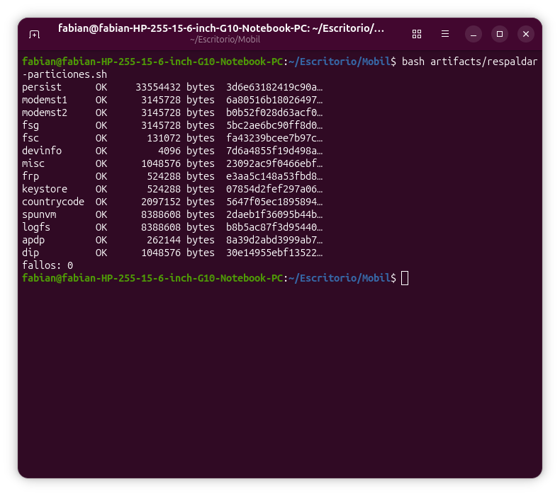

**02 — Tu PID 1 en QEMU (hallazgos #12 y #13)**
`Run /init as init process`, `mi_init: hola, soy el PID 1`, `/proc/uptime`, `/proc/version` y `mi_init: apagando`; código de salida 0.
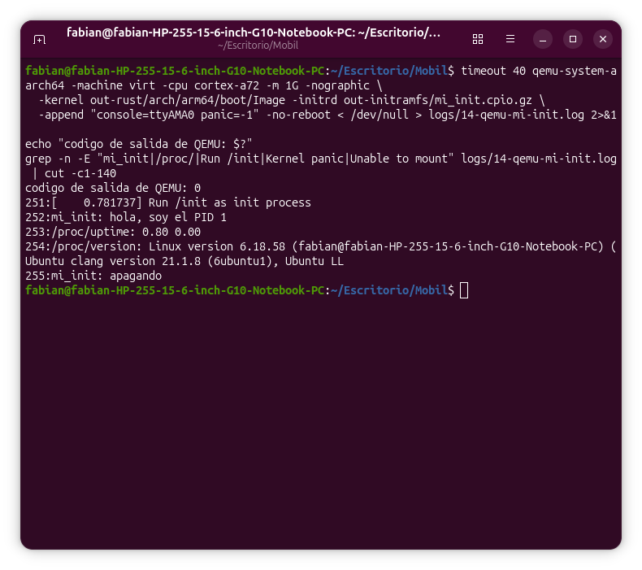

**03 — Tu PID 1 con un hijo (hallazgo #14)**
`hijo: soy el PID 53 y mi padre es el PID 1`, `el hijo 53 termino con codigo 7`.
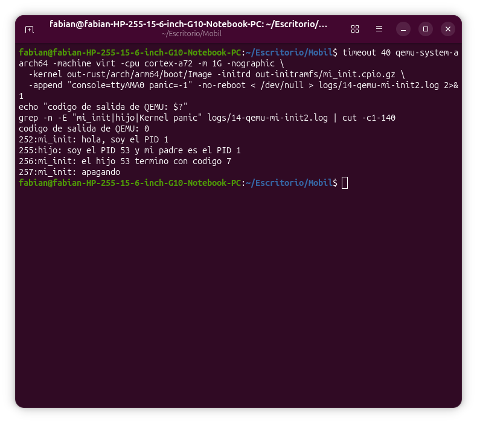

**04 — Descarga y verificación de Alpine (hallazgo #15)**
`alpine-minirootfs-3.24.3-aarch64.tar.gz: OK`.
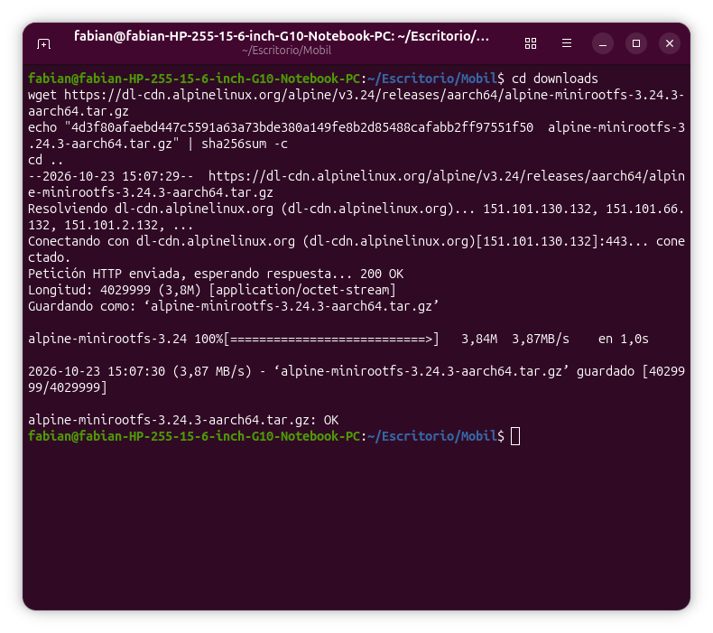

**05 y 06 — Alpine arrancado en QEMU con tu inittab (hallazgo #17)**
Tabla de procesos (`kthreadd` como PID 2, `{arranque}` y `sleep` como únicos de usuario) y los latidos de `mi-servicio` con tres PID distintos.
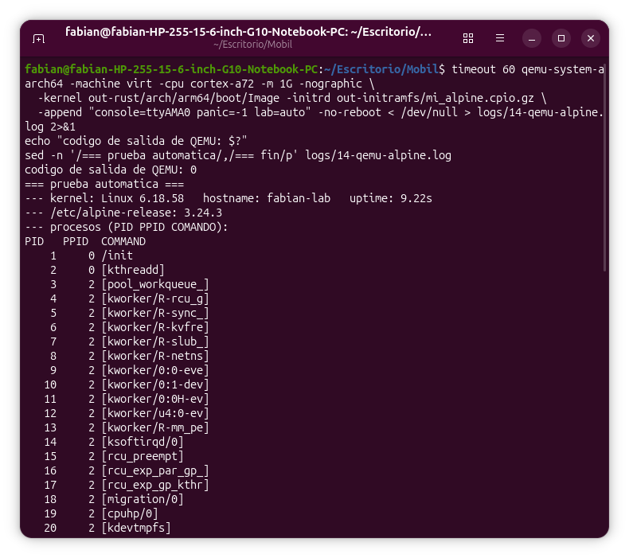
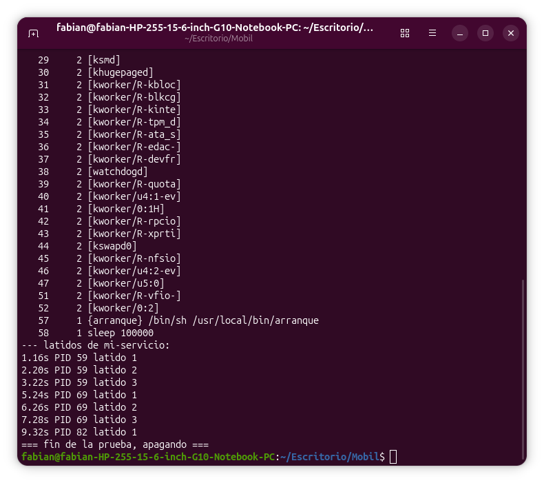

**07 y 08 — Red y paquetes en QEMU (hallazgo #19)**
DHCP, DNS, `apk update` (28 570 paquetes) y `apk add openrc` (5 paquetes, 12,8 MiB; `/sbin/openrc` aparece).
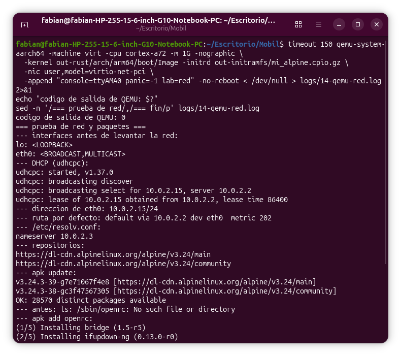
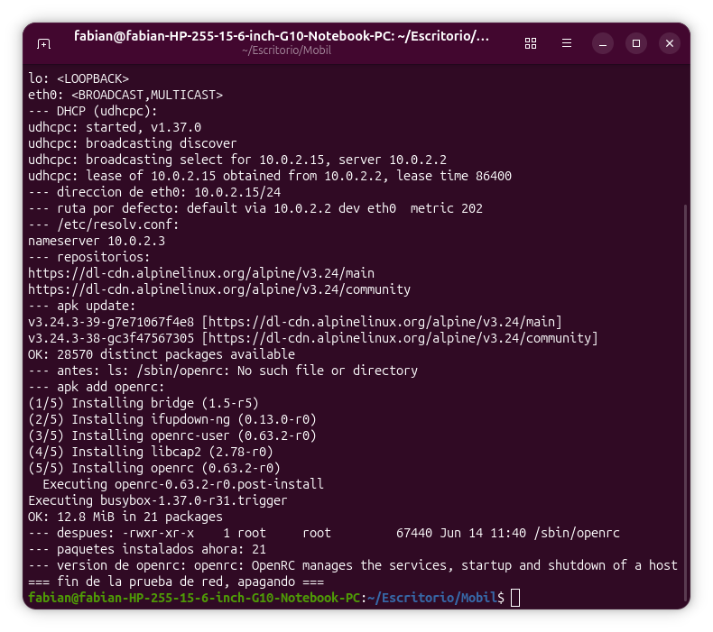

**09 y 10 — Tu servicio en OpenRC (hallazgo #21)**
Arranque con dependencia resuelta, árbol de procesos con el supervisor `supervise-daemon`, el hijo matado y relanzado con otro PID, y la parada.
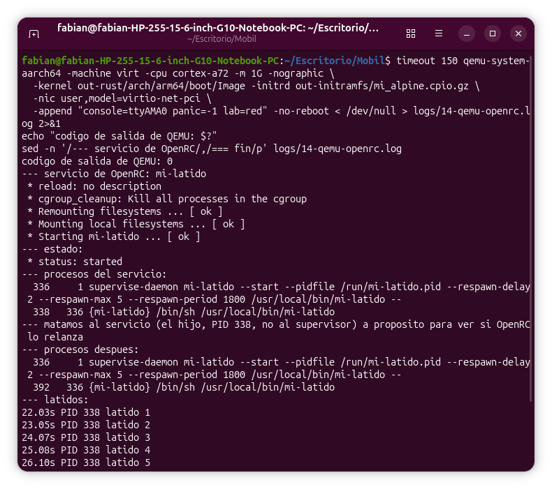
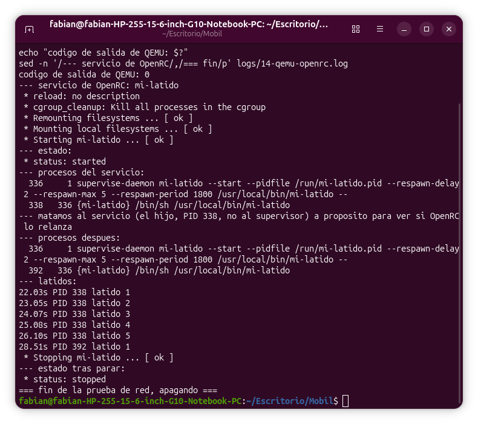

**11 — Namespaces, fuera y dentro (hallazgos #23 y #24)**
Los cinco inodos de los *namespaces* iniciales frente a los cinco nuevos; PID 1, hostname, red y procesos visibles dentro.
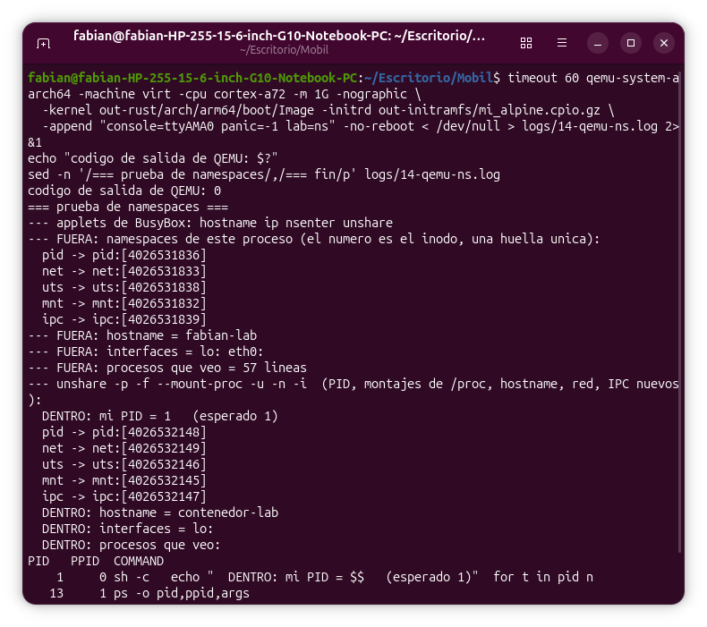

**12 — Un cgroup de memoria mata a un proceso (hallazgos #25 a #27)**
`hog` invoca al OOM-killer dentro del grupo `/lab` con `CONSTRAINT_MEMCG`; la ruta de fallo de página en la pila; el límite de 20 MiB.
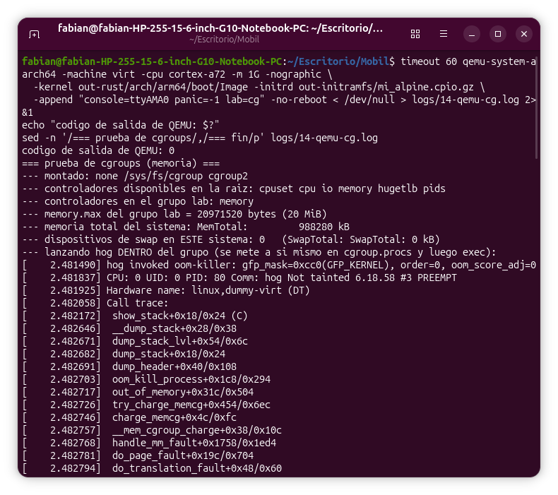

**13 y 14 — Primera prueba del kernel principal en el teléfono (hallazgo #41)**
`fastboot` acepta la imagen versión 2 (`OKAY`/`OKAY`) y el teléfono se queda con el logo de Xiaomi y el candado abierto: sigue en `fastboot`.
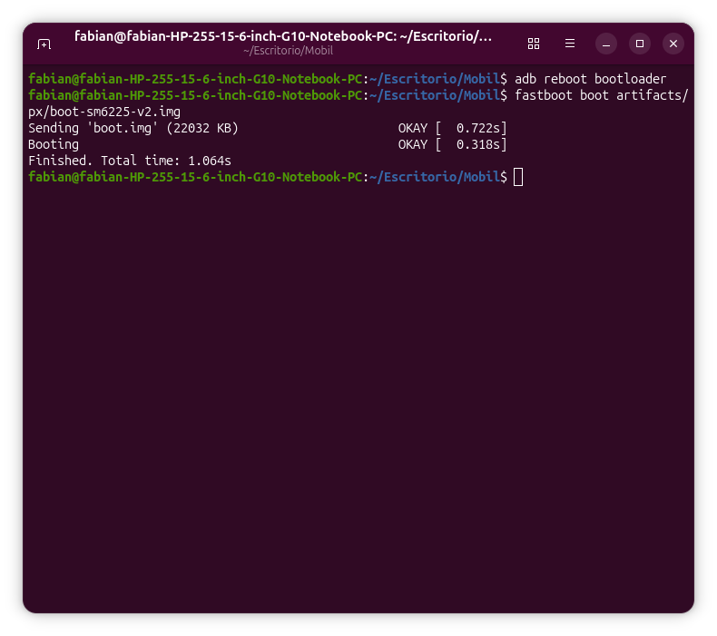
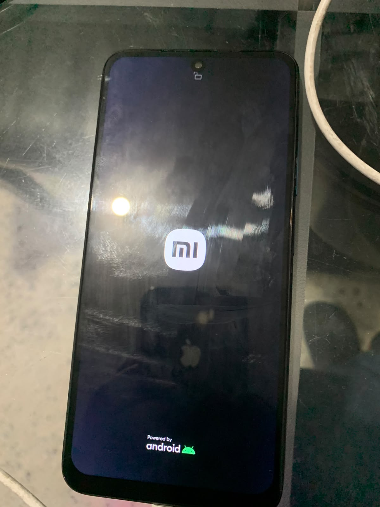

Registros: `logs/14-hash-particiones.txt` (SHA-256 de las 14 copias; las copias en sí no se publican) y `artifacts/respaldar-particiones.sh`. La página de la wiki del dispositivo (`wiki.nura.eco/wiki/Xiaomi_Redmi_Note_11_(xiaomi-spes)`) se consultó en el navegador del usuario porque la herramienta automática estaba bloqueada.

## Pendientes

- [x] Compatibilidad: estado del puerto, variante propia, mapa de particiones y veredicto.
- [x] Respaldo de las particiones propias del teléfono, verificado por hash.
- [x] Etapa 1, paso 1 (QEMU): *initramfs* mínimo con **PID 1 propio** (`mi_init`), arranque y apagado limpios.
- [x] Etapa 1, pasos 2 y 3: PID 1 con `fork`/`exec`/`wait`, y un Alpine real con tu `inittab` y un servicio propio supervisado.
- [x] Etapa 1, paso 4: red en QEMU (DHCP, DNS) y `apk add openrc` dentro del sistema.
- [x] Etapa 1, paso 5: tu servicio como servicio de OpenRC, con dependencia, supervisión y relanzamiento comprobados.
- [x] Etapa 1, pasos 6 y 7: *namespaces* (`unshare`: PID, red, nombre, montajes, IPC) y *cgroups* (límite de memoria con OOM de grupo).
- [ ] Etapa 1, pendiente (opcional): empaquetar un programa propio como paquete de Alpine (`apk`) o Debian (`.deb`); usuarios y permisos; los controladores `cpu` y `pids` de los *cgroups*; Wayland/Phosh.
- [ ] Averiguar **cómo entregar el DTB del kernel principal** con `boot.img` v3 (¿se puede con `fastboot boot`, o exige flashear `vendor_boot`?) y qué contiene la ranura `a`.
- [x] Compilar `v7.2.1-sm6225` con `sm6225_defconfig` y nuestro Clang (hecho; falló una vez por un archivo ausente en la rama y se arregló desactivando la opción huérfana).
- [x] Probar el kernel principal con `fastboot boot` en versión 2 con DTB: aceptado pero **no arranca** (hallazgo #41).
- [x] Prueba de control: el *bootloader* **acepta la versión 2** y aplica la capa de la placa (hallazgos #43 a #47).
- [x] Preparar el salto con `kexec` (4.19 con `KEXEC`, `kexec` ARM64, kernel principal con `pstore`, DTB de laboratorio): todo compilado y verificado, **sin ejecutar nada en el teléfono todavía** (hallazgos #49 a #52).
- [x] Hacer el salto con `kexec` (3 intentos): el `BUG` del 4.19 se resolvió apagando los núcleos a mano; el kernel principal **probablemente** se ejecutó, pero **no se pudo observar** (hallazgos #53 a #59).
- [x] Canal de observación por USB (gadget ACM+NCM): preparado y probado en QEMU, sin resultado en el teléfono (hallazgos #60 a #62).
- [x] Anular la capa `dtbo`: resuelto con un overlay vacío por etiqueta (hallazgos #64 a #69).
- [x] Ver la pantalla del kernel principal (hallazgos #71 a #73).
- [x] Red USB (hallazgo #74) y disco ext4 persistente como raíz (hallazgos #75 a #80).
- [x] Ampliar el ext4, `apk`, SSH (hallazgos #82 a #85).
- [x] Autoarranque de red y SSH tras un reinicio (hallazgo #87).
- [x] Primer servicio real: nginx con página de estado (hallazgos #89 a #91).
- [x] Autoarranque de NTP, sshd y nginx verificado en un reinicio (hallazgo #92).
- [ ] Táctil sin resolver: el chip está vivo (ID `0x5452`, firmware válido) pero no genera interrupciones al tocar (hallazgos #103 a #106).
- [x] Phosh arrancado en el panel real con render por software (hallazgos #95 a #98).
- [ ] Siguiente: manejarlo por VNC (Remmina a `172.16.42.1:5900`), automatizar la sesión en el arranque, y comparar con Nura; cerrar el Módulo 14 y actualizar `docs/README.md`.
- [ ] Medir el comportamiento térmico del kernel principal antes de dejarlo trabajando.
- [ ] Etapa 3 alternativa, sin escribir nada: `fastboot boot` con el kernel 4.19 propio y un `initramfs` de Alpine con los nodos de `/dev` hechos a mano (solo prueba de que el espacio de usuario corre; sin pantalla).
- [ ] **Etapa 4, solo con confirmación explícita del usuario:** `fastboot flash`. Antes verificar a qué partición va el *rootfs*, si Android sigue arrancando, y hacer una copia fuera de la laptop de `backup/particiones/`.
- [ ] Verificar la firma PGP del kernel 6.18.58 (pendiente del módulo 11).
